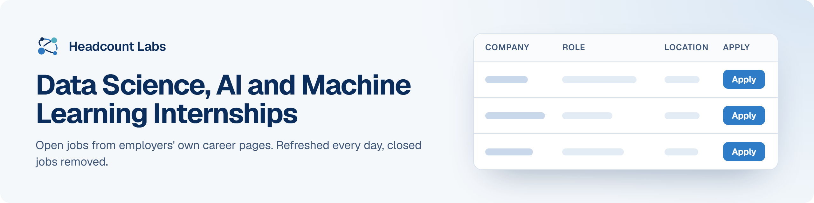

# Data Science, AI and Machine Learning Internships

Open internships in data science, analytics, AI and machine learning at US employers.

**313 open jobs** · 313 new since the last update · 0 removed because they closed or left the employer's board · updated November 3, 2026 at 4:32 AM EST

This list is built and refreshed every day by [Headcount Labs](https://headcountlabs.com/?utm_source=github&utm_medium=job-list&utm_campaign=data-science-ai-internships), which reads jobs straight from employers' own career pages and job boards. Every job here was still listed on its source board when we last read that board, within the past 3 days, and was posted in the past 30 days. Copies of the same job are merged into one row, and jobs that close are removed at the next update.

Want this data in your own app or agent? Use the [Headcount Labs jobs API](https://headcountlabs.com/docs/?utm_source=github&utm_medium=job-list&utm_campaign=data-science-ai-internships) (free tier), the [MCP server](https://headcountlabs.com/mcp/?utm_source=github&utm_medium=job-list&utm_campaign=data-science-ai-internships) for Claude, ChatGPT and other AI assistants, or the [public dataset subsets](https://huggingface.co/HeadcountLabs) on Hugging Face (the full dataset is coming soon).

**Full dataset.** A bigger, one-off snapshot dated 2026-10-19 (all matching jobs, not only the open jobs below) is on Hugging Face: [Tech and software jobs](https://huggingface.co/datasets/HeadcountLabs/tech-jobs) · [Internships](https://huggingface.co/datasets/HeadcountLabs/internships). It loads with `datasets.load_dataset` and is under the Open Database License (ODbL) 1.0.

**Jump to:** [Posted in the last 7 days (102)](#posted-in-the-last-7-days) · [Posted 8 to 30 days ago (211)](#posted-8-to-30-days-ago)

**Columns.** *Apply* opens the original posting on the employer's site. *Details* opens the job on Headcount Labs, with every posting we found for it. *Remote* shows what the employer states; a dash means the posting doesn't say. *Pay* is the range the employer published.

## Posted in the last 7 days

| Company | Role | Location | Remote | Pay | Posted | Apply | Details |
| --- | --- | --- | --- | --- | --- | :---: | :---: |
| **Zebra Technologies Corporation** | 2027 Summer Internship (US) - Data Scientist | Lincolnshire, IL | Hybrid | $34–$44.50/hr | Nov 2 |  | <a href="https://headcountlabs.com/catalog/jobs/9652a103-24cb-499d-bb02-8c054b254719?utm_source=github&utm_medium=job-list&utm_campaign=data-science-ai-internships">via Headcount Labs</a> |
| **Zebra Technologies Corporation** | 2027 Summer Internship (US) - Software/AI Engineer (Handheld Mobile Computers) | Holtsville, NY | Hybrid | $33–$40.50/hr | Nov 2 |  | <a href="https://headcountlabs.com/catalog/jobs/4d174e65-05ca-4275-98b3-54e276be94e7?utm_source=github&utm_medium=job-list&utm_campaign=data-science-ai-internships">via Headcount Labs</a> |
| **The Alexander Group, Inc** | Associate Commercial Data Science Intern | New York, NY | — | $30/hr | Nov 2 |  | <a href="https://headcountlabs.com/catalog/jobs/00cd6ceb-3467-4399-8940-79941ee52f10?utm_source=github&utm_medium=job-list&utm_campaign=data-science-ai-internships">via Headcount Labs</a> |
| **Spectrum** | 2027 Summer Intern: Data Science | Greenwood Village, CO | — | — | Nov 2 |  | <a href="https://headcountlabs.com/catalog/jobs/39370188-014c-4b29-b8f1-6f7d9e07c391?utm_source=github&utm_medium=job-list&utm_campaign=data-science-ai-internships">via Headcount Labs</a> |
| **Roku** | SW Engineer Intern, AI Engineering | San Jose, CA | — | — | Nov 2 |  | <a href="https://headcountlabs.com/catalog/jobs/cfbe737d-7d9d-4285-bbf4-bd048852331a?utm_source=github&utm_medium=job-list&utm_campaign=data-science-ai-internships">via Headcount Labs</a> |
| **Rockland Trust** | Digital Ops &amp; Analytics Intern | Rockland, MA | On-site | $17/hr | Nov 2 |  | <a href="https://headcountlabs.com/catalog/jobs/0c07a6e1-36d0-437d-80a8-a4cf0b4b8797?utm_source=github&utm_medium=job-list&utm_campaign=data-science-ai-internships">via Headcount Labs</a> |
| **Resideo** | Data Science Intern - Summer 2027 | 

2 locations
Austin, TX Golden Valley, MN
 | Hybrid | — | Nov 2 |  | <a href="https://headcountlabs.com/catalog/jobs/36f4a310-cad8-4904-aef7-1dd6dffa3b6e?utm_source=github&utm_medium=job-list&utm_campaign=data-science-ai-internships">via Headcount Labs</a> |
| **ParetoHealth** | Analytics Summer Intern | Philadelphia, PA | — | — | Nov 2 |  | <a href="https://headcountlabs.com/catalog/jobs/09f60f06-c6f5-4d41-aa80-00ac9c50da3f?utm_source=github&utm_medium=job-list&utm_campaign=data-science-ai-internships">via Headcount Labs</a> |
| **NOV** | Marketing and Data Analyst Intern | Houston, TX | Remote | — | Nov 2 |  | <a href="https://headcountlabs.com/catalog/jobs/09e3bdb7-2000-4ebf-b6c8-e57134e4c387?utm_source=github&utm_medium=job-list&utm_campaign=data-science-ai-internships">via Headcount Labs</a> |
| **Mayo Career Site US** | Intern - Data Science AI-I (PhD level) | Rochester, MN | On-site | $29.88/hr | Nov 2 |  | <a href="https://headcountlabs.com/catalog/jobs/a793e933-2b3f-4f79-9945-093cc5c2867a?utm_source=github&utm_medium=job-list&utm_campaign=data-science-ai-internships">via Headcount Labs</a> |
| **MATTE PROJECTS** | Creative &amp; AI Intern - Winter/Spring 2027 (On-Site) | NEW YORK, NY | On-site | — | Nov 2 |  | <a href="https://headcountlabs.com/catalog/jobs/0aeb7f91-7c26-4425-b7c2-ea5f8f88574a?utm_source=github&utm_medium=job-list&utm_campaign=data-science-ai-internships">via Headcount Labs</a> |
| **KLA Corporation** | Software Engineer (AI/ML) Intern | 

2 locations
Austin, TX Milpitas, CA
 | — | $22.10–$42.50/hr | Nov 2 |  | <a href="https://headcountlabs.com/catalog/jobs/c5e241b3-6c14-4a7d-add6-cdabe92c6ce0?utm_source=github&utm_medium=job-list&utm_campaign=data-science-ai-internships">via Headcount Labs</a> |
| **Focus on the Family** | AI Localization &amp; Translation Systems INTERN | Colorado Springs, CO | On-site | — | Nov 2 |  | <a href="https://headcountlabs.com/catalog/jobs/dd4c2d53-4b76-434d-8f4a-98b7e224d434?utm_source=github&utm_medium=job-list&utm_campaign=data-science-ai-internships">via Headcount Labs</a> |
| **First Citizens Bank** | 2027 Summer Intern - Enterprise Data Analyst, Data Products (Raleigh, NC) | Raleigh, NC | Hybrid | — | Nov 2 |  | <a href="https://headcountlabs.com/catalog/jobs/06db6c9c-6d37-4b08-b103-b790bfc5fafb?utm_source=github&utm_medium=job-list&utm_campaign=data-science-ai-internships">via Headcount Labs</a> |
| **Sephora** | Intern, AI &amp; Distribution Analytics | Salt Lake City, UT | On-site | — | Nov 1 |  | <a href="https://headcountlabs.com/catalog/jobs/f400df8f-9860-4132-9586-765e9adfdc26?utm_source=github&utm_medium=job-list&utm_campaign=data-science-ai-internships">via Headcount Labs</a> |
| **Knorr-Bremse** | Intern, Data Scientist (Summer 2027) | Melbourne, FL | — | — | Nov 1 |  | <a href="https://headcountlabs.com/catalog/jobs/facb823d-b4ba-466d-944e-7b86da2b86db?utm_source=github&utm_medium=job-list&utm_campaign=data-science-ai-internships">via Headcount Labs</a> |
| **Bio Tech Consulting** | Environmental Scientist Intern | Jacksonville, FL | — | — | Oct 31 |  | <a href="https://headcountlabs.com/catalog/jobs/67517387-2daa-476e-97c5-ce45d43418c0?utm_source=github&utm_medium=job-list&utm_campaign=data-science-ai-internships">via Headcount Labs</a> |
| **Waymo** | 2027 Summer Intern, PhD, Research Scientist Intern | Mountain View, CA | — | $85/hr | Oct 30 |  | <a href="https://headcountlabs.com/catalog/jobs/a655ad53-2ce7-4d2e-a50c-8faa9e5c54a8?utm_source=github&utm_medium=job-list&utm_campaign=data-science-ai-internships">via Headcount Labs</a> |
| **Tallgrass** | Intern-Procurement (Supply Chain Automation): Agentic AI Content Design Intern | Houston, TX | Hybrid | $20.90–$35.15/hr | Oct 30 |  | <a href="https://headcountlabs.com/catalog/jobs/2c45d422-9e6d-4420-9ec9-b2702efe333e?utm_source=github&utm_medium=job-list&utm_campaign=data-science-ai-internships">via Headcount Labs</a> |
| **Snowflake** | Product Marketing- Agentic Analytics Intern (Spring 2027) | US-CA-Menlo Park | On-site | $40–$47/hr | Oct 30 |  | <a href="https://headcountlabs.com/catalog/jobs/9c27197f-be53-4b59-900e-e14088b5abc4?utm_source=github&utm_medium=job-list&utm_campaign=data-science-ai-internships">via Headcount Labs</a> |
| **Salesforce, Inc.** | AI Labs Summer Internship, Emerging Talent | 

2 locations
San Francisco, CA Seattle, WA
 | — | $53–$57/hr | Oct 30 |  | <a href="https://headcountlabs.com/catalog/jobs/cc3e7d55-f11f-4472-a024-6fb29107b828?utm_source=github&utm_medium=job-list&utm_campaign=data-science-ai-internships">via Headcount Labs</a> |
| **Our Team** | Financial Analytics &amp; Decision Support Internship | Baton Rouge, LA | On-site | $16/hr | Oct 30 |  | <a href="https://headcountlabs.com/catalog/jobs/a5658c61-d1b5-4cb9-9ed9-121ce91fc18f?utm_source=github&utm_medium=job-list&utm_campaign=data-science-ai-internships">via Headcount Labs</a> |
| **Molina Talent Acquisition** | Healthcare Quality &amp; Analytics Internship (Wisconsin Health Plan) – Summer 2027 (Undergraduate) | United States | On-site | $9.25–$18.05/hr | Oct 30 |  | <a href="https://headcountlabs.com/catalog/jobs/4c483e99-7fcb-48a6-8f5c-1b6c13dbc16d?utm_source=github&utm_medium=job-list&utm_campaign=data-science-ai-internships">via Headcount Labs</a> |
| **Molina Healthcare** | Customer Experience &amp; Analytics Internship (Remote) – Summer 2027 (Undergraduate) | United States | Remote | $18–$20/hr | Oct 30 |  | <a href="https://headcountlabs.com/catalog/jobs/9c27920a-cf6b-47e2-aa4f-f403fbac66bb?utm_source=github&utm_medium=job-list&utm_campaign=data-science-ai-internships">via Headcount Labs</a> |
| **Molina Healthcare** | Data Analytics Internship (Remote) – Summer 2027 (Undergraduate) | United States | Remote | $8.33–$18.05/hr | Oct 30 |  | <a href="https://headcountlabs.com/catalog/jobs/454dd7df-de03-475d-9a88-520ffd8ba7de?utm_source=github&utm_medium=job-list&utm_campaign=data-science-ai-internships">via Headcount Labs</a> |
| **Molina Healthcare** | Reporting &amp; Analytics Internship (Remote) – Summer 2027 (Undergraduate) | United States | Remote | $8.33–$18.05/hr | Oct 30 |  | <a href="https://headcountlabs.com/catalog/jobs/f8def306-583b-432a-a523-a086faf30d5e?utm_source=github&utm_medium=job-list&utm_campaign=data-science-ai-internships">via Headcount Labs</a> |
| **Molina Healthcare** | Healthcare Quality &amp; Analytics Internship (Wisconsin Health Plan) – Summer 2027 (Undergraduate) | Wisconsin | — | $9.25–$18.05/hr | Oct 30 |  | <a href="https://headcountlabs.com/catalog/jobs/064506ad-ff5c-4717-9d52-524fbbba7f73?utm_source=github&utm_medium=job-list&utm_campaign=data-science-ai-internships">via Headcount Labs</a> |
| **Jewelers Mutual** | Behavioral Analytics Intern - Summer of 2027 | Raleigh, NC | Hybrid | — | Oct 30 |  | <a href="https://headcountlabs.com/catalog/jobs/c0820c89-a88c-4a72-8686-53a313e3f9f2?utm_source=github&utm_medium=job-list&utm_campaign=data-science-ai-internships">via Headcount Labs</a> |
| **Gainesville Regional Utilities** | Water / Wastewater Engineering Intern: Data Analytics | Gainesville, FL | — | — | Oct 30 |  | <a href="https://headcountlabs.com/catalog/jobs/fc16ea85-1c14-437b-9c42-5d533b289834?utm_source=github&utm_medium=job-list&utm_campaign=data-science-ai-internships">via Headcount Labs</a> |
| **Fussball Club Cincinnati LLC (“FC Cincinnati”)** | Data Analyst Intern | Cincinnati, OH | — | — | Oct 30 |  | <a href="https://headcountlabs.com/catalog/jobs/a24f4139-eb93-42ff-8911-14fceeaaf88c?utm_source=github&utm_medium=job-list&utm_campaign=data-science-ai-internships">via Headcount Labs</a> |
| **First Citizens Bank** | 2027 Summer Intern - AI Innovation (Raleigh, NC) | Raleigh, NC | Hybrid | — | Oct 30 |  | <a href="https://headcountlabs.com/catalog/jobs/aefbd3fb-8cce-4b5b-a553-2f0dac0bbd29?utm_source=github&utm_medium=job-list&utm_campaign=data-science-ai-internships">via Headcount Labs</a> |
| **Dow Jones** | Summer 2027 Internship Program – Data Analyst Intern | NEW YORK, NY | Hybrid | $28/hr | Oct 30 |  | <a href="https://headcountlabs.com/catalog/jobs/375f493b-65b7-422a-8eac-fe04383a6aba?utm_source=github&utm_medium=job-list&utm_campaign=data-science-ai-internships">via Headcount Labs</a> |
| **Cigna-Evernorth Services Inc.** | The Cigna Group's Technology Development Program - Data &amp; Analytics Engineering Track Summer Internship | 

5 locations
Bloomington, MN Morris Plains, NJ St. Louis, MO Bloomfield, CT Saint Louis, MO
 | Hybrid | $25–$33/hr | Oct 30 |  | <a href="https://headcountlabs.com/catalog/jobs/1422d316-3634-41b9-9e10-230dad049005?utm_source=github&utm_medium=job-list&utm_campaign=data-science-ai-internships">via Headcount Labs</a> |
| **Boeing** | Boeing Summer 2027 Internship Program (Paid) – Data Analytics Intern | 

32 locations
Everett, WA Arlington, VA Atlanta, GA Auburn, WA Bellevue, WA Berkeley, MO Charleston, SC Chicago, IL Colorado Springs, CO Dallas, TX El Segundo, CA Fairfax, VA +20 more
 | — | $44k–$89k/yr | Oct 30 |  | <a href="https://headcountlabs.com/catalog/jobs/0404e0db-5034-49c3-bf2f-7a31b74b1e48?utm_source=github&utm_medium=job-list&utm_campaign=data-science-ai-internships">via Headcount Labs</a> |
| **Amazon.com Services LLC** | Software Development Engineer Intern, Machine Learning/Automated Reasoning- Summer 2027 | 

9 locations
Boston, MA Austin, TX Sunnyvale, CA Seattle, WA Arlington, VA Bellevue, WA New York, NY Irvine, CA San Diego, CA
 | — | — | Oct 30 |  | <a href="https://headcountlabs.com/catalog/jobs/e0aabec4-3252-402b-88cc-8d3c3a039564?utm_source=github&utm_medium=job-list&utm_campaign=data-science-ai-internships">via Headcount Labs</a> |
| **WGBH** | Audio Visual Metadata and Training Data Internship -Spring 2027 | Boston, MA | Hybrid | $17/hr | Oct 29 |  | <a href="https://headcountlabs.com/catalog/jobs/8144a16c-a8b0-471c-af1c-f27c4c404cf4?utm_source=github&utm_medium=job-list&utm_campaign=data-science-ai-internships">via Headcount Labs</a> |
| **USAFacts** | AI &amp; Software Engineering Intern | Bellevue, WA | Hybrid | $38/hr | Oct 29 |  | <a href="https://headcountlabs.com/catalog/jobs/8f4f9105-94a8-484b-947e-5bdc763d5f5d?utm_source=github&utm_medium=job-list&utm_campaign=data-science-ai-internships">via Headcount Labs</a> |
| **The Cigna Group** | Legal Operations Financial, Data &amp; AI Analytics Intern | 

2 locations
St. Louis, MO Saint Louis, MO
 | Hybrid | $24–$25/hr | Oct 29 |  | <a href="https://headcountlabs.com/catalog/jobs/5de1124e-05c9-437a-b2ab-b02d3b08976f?utm_source=github&utm_medium=job-list&utm_campaign=data-science-ai-internships">via Headcount Labs</a> |
| **Syntiant** | Internship - DevOps Machine Learning Infrastructure | Irvine, CA | On-site | — | Oct 29 |  | <a href="https://headcountlabs.com/catalog/jobs/aa1834b4-0833-4637-bb9b-c2e78b3dc416?utm_source=github&utm_medium=job-list&utm_campaign=data-science-ai-internships">via Headcount Labs</a> |
| **Syngenta Group** | Data Scientist Intern | Raleigh, NC | — | $20–$45/hr | Oct 29 |  | <a href="https://headcountlabs.com/catalog/jobs/e9a8cf11-7ea6-420f-93a4-1c54f46697d6?utm_source=github&utm_medium=job-list&utm_campaign=data-science-ai-internships">via Headcount Labs</a> |
| **Seagate Technology** | R&amp;D Data Analytics, AI and Production Systems - Summer 2027 Internship (Masters or PhD) | Bloomington, MN | — | $35–$45/hr | Oct 29 |  | <a href="https://headcountlabs.com/catalog/jobs/70039303-d8c2-4c37-a3ea-efcf66691ab6?utm_source=github&utm_medium=job-list&utm_campaign=data-science-ai-internships">via Headcount Labs</a> |
| **Sanofi** | 2027 Summer Intern US Advanced Analytics Cambridge MA | 

2 locations
Cambridge (U.S.) Morristown, NJ
 | — | $36–$47/hr | Oct 29 |  | <a href="https://headcountlabs.com/catalog/jobs/26e9a3ae-c83a-4f93-a347-bfe45ba61895?utm_source=github&utm_medium=job-list&utm_campaign=data-science-ai-internships">via Headcount Labs</a> |
| **National Laboratory of the Rockies** | Graduate Intern – Agentic AI-Driven Computational Synthesis of PGM-free Fuel Cell Catalysts | Golden, CO | Hybrid | $44k–$71k/yr | Oct 29 |  | <a href="https://headcountlabs.com/catalog/jobs/c30eccb8-aa75-47b2-8b54-7302413dde3c?utm_source=github&utm_medium=job-list&utm_campaign=data-science-ai-internships">via Headcount Labs</a> |
| **National Laboratory of the Rockies** | Graduate Intern – Power Data Analysis for AI Data Centers | 

2 locations
Golden, CO United States
 | — | $44k–$71k/yr | Oct 29 |  | <a href="https://headcountlabs.com/catalog/jobs/7f286666-17b9-4751-8895-1fe4d7d65f14?utm_source=github&utm_medium=job-list&utm_campaign=data-science-ai-internships">via Headcount Labs</a> |
| **National Gypsum Company** | Internship Opportunity - Data Science Intern | Charlotte, NC | Hybrid | $30/hr | Oct 29 |  | <a href="https://headcountlabs.com/catalog/jobs/1dd0a341-f96b-429a-9f02-d0ca15062312?utm_source=github&utm_medium=job-list&utm_campaign=data-science-ai-internships">via Headcount Labs</a> |
| **Martin Sprocket &amp; Gear** | Data Entry Intern 1st shift | Arlington, TX | On-site | — | Oct 29 |  | <a href="https://headcountlabs.com/catalog/jobs/93b4db94-3bc8-4be8-86f9-c3b11bcbbb14?utm_source=github&utm_medium=job-list&utm_campaign=data-science-ai-internships">via Headcount Labs</a> |
| **Hut 8** | Civil &amp; Structural Engineering Intern, Data Center Infrastructure | Miami, FL | On-site | — | Oct 29 |  | <a href="https://headcountlabs.com/catalog/jobs/c07d07cb-4944-446c-bdfb-f274b426f596?utm_source=github&utm_medium=job-list&utm_campaign=data-science-ai-internships">via Headcount Labs</a> |
| **Hut 8** | Mechanical Engineering Intern, Data Center Infrastructure | Miami, FL | On-site | — | Oct 29 |  | <a href="https://headcountlabs.com/catalog/jobs/a83fee2f-abc5-4c50-969d-b7ddeb8017cc?utm_source=github&utm_medium=job-list&utm_campaign=data-science-ai-internships">via Headcount Labs</a> |
| **Hut 8** | Electrical Engineering Intern, Data Center Infrastructure | Miami, FL | On-site | — | Oct 29 |  | <a href="https://headcountlabs.com/catalog/jobs/02c46504-5439-4648-a42e-a769dcbbdab2?utm_source=github&utm_medium=job-list&utm_campaign=data-science-ai-internships">via Headcount Labs</a> |
| **GTI Energy** | Intern - Data Science (Summer 2027) | Des Plaines, IL | On-site | $17–$28/hr | Oct 29 |  | <a href="https://headcountlabs.com/catalog/jobs/ddb5acea-4453-46f3-ab22-bf2c2109ec9a?utm_source=github&utm_medium=job-list&utm_campaign=data-science-ai-internships">via Headcount Labs</a> |
| **First Citizens Bank** | 2027 Summer Intern - AI Adoption (Raleigh, NC) | Raleigh, NC | Hybrid | $18.70–$28.60/hr | Oct 29 |  | <a href="https://headcountlabs.com/catalog/jobs/eb4dfadb-f64d-4e66-974a-6eea976338bd?utm_source=github&utm_medium=job-list&utm_campaign=data-science-ai-internships">via Headcount Labs</a> |
| **Charles River Analytics** | Scientist Intern | Cambridge, MA | — | $20–$30/hr | Oct 29 |  | <a href="https://headcountlabs.com/catalog/jobs/282e1640-e4a8-471c-b955-29b7b03af6f6?utm_source=github&utm_medium=job-list&utm_campaign=data-science-ai-internships">via Headcount Labs</a> |
| **Cargill** | Applications Food Scientist R&amp;D Intern - Meat | Wichita, KS | — | $2/hr | Oct 29 |  | <a href="https://headcountlabs.com/catalog/jobs/35af625a-3da0-4705-98cf-7d68100978e5?utm_source=github&utm_medium=job-list&utm_campaign=data-science-ai-internships">via Headcount Labs</a> |
| **CareSource** | 2027 Summer Internship Program - Full Stack AI Development Intern-1 | United States | Remote | $41k–$66k/yr | Oct 29 |  | <a href="https://headcountlabs.com/catalog/jobs/47f65d4b-344c-4aee-b4d6-159b052ffea1?utm_source=github&utm_medium=job-list&utm_campaign=data-science-ai-internships">via Headcount Labs</a> |
| **CareSource** | 2027 Summer Internship Program - AI Intern | United States | Remote | $41k–$66k/yr | Oct 29 |  | <a href="https://headcountlabs.com/catalog/jobs/8fb541f6-191e-43c0-a0c6-850f67b59961?utm_source=github&utm_medium=job-list&utm_campaign=data-science-ai-internships">via Headcount Labs</a> |
| **CareSource** | 2027 Summer Internship Program - AI Healthcare Operations | United States | Remote | $41k–$66k/yr | Oct 29 |  | <a href="https://headcountlabs.com/catalog/jobs/e6134f2e-69da-4b5d-8c01-f293b52a399e?utm_source=github&utm_medium=job-list&utm_campaign=data-science-ai-internships">via Headcount Labs</a> |
| **AXA** | Summer 2027 - Underwriting Data &amp; Analytics Intern | United States | — | $25/hr | Oct 29 |  | <a href="https://headcountlabs.com/catalog/jobs/6b7615ff-f978-4fbe-b1bb-fbb71e891d8f?utm_source=github&utm_medium=job-list&utm_campaign=data-science-ai-internships">via Headcount Labs</a> |
| **Amazon Data Services, Inc.** | Data Center Infrastructure Engineer Intern, Summer 2027 - Midwest / Southeast | 

8 locations
Dublin, OH Austin, TX Atlanta, GA Hilliard, OH Lithia Springs, GA Columbus, OH Plain City, OH Dallas, TX
 | — | — | Oct 29 |  | <a href="https://headcountlabs.com/catalog/jobs/87e114e2-92cd-4634-bf1f-8d0abc58f9d5?utm_source=github&utm_medium=job-list&utm_campaign=data-science-ai-internships">via Headcount Labs</a> |
| **Valmont Industries, Inc.** | AI &amp; Data Engineering Intern | Omaha, NE | On-site | — | Oct 28 |  | <a href="https://headcountlabs.com/catalog/jobs/3ba14820-6ad0-4f41-a550-5810839d2c97?utm_source=github&utm_medium=job-list&utm_campaign=data-science-ai-internships">via Headcount Labs</a> |
| **Systems Planning and Analysis** | Data Engineering Intern - Summer 2027 | Alexandria, VA | — | $23/hr | Oct 28 |  | <a href="https://headcountlabs.com/catalog/jobs/c7f855b5-2a64-4079-a717-44fe9c4d5c45?utm_source=github&utm_medium=job-list&utm_campaign=data-science-ai-internships">via Headcount Labs</a> |
| **Schonfeld** | 2027 Enterprise AI Intern | New York, NY | — | $100k–$110k/yr | Oct 28 |  | <a href="https://headcountlabs.com/catalog/jobs/77504613-10f3-4ec1-9785-dc1f03901819?utm_source=github&utm_medium=job-list&utm_campaign=data-science-ai-internships">via Headcount Labs</a> |
| **Regeneron Pharmaceuticals** | 2027 Summer Intern Data Science &amp; Digital Innovation (IOPS) | 

2 locations
Rensselaer, NY Troy, NY
 | On-site | $17.90–$25.50/hr | Oct 28 |  | <a href="https://headcountlabs.com/catalog/jobs/d2090454-e99b-4a45-861a-7d8331bf88af?utm_source=github&utm_medium=job-list&utm_campaign=data-science-ai-internships">via Headcount Labs</a> |
| **Regeneron Pharmaceuticals** | 2027 Summer Intern Market Access, Pricing &amp; Commercial Analytics | Sleepy Hollow, NY | On-site | $17.90–$50.90/hr | Oct 28 |  | <a href="https://headcountlabs.com/catalog/jobs/769004cb-a4fa-49ef-9253-23e2ff44f8e8?utm_source=github&utm_medium=job-list&utm_campaign=data-science-ai-internships">via Headcount Labs</a> |
| **Regeneron Pharmaceuticals** | 2027 Summer Intern AI/ML &amp; Data Engineering | 

6 locations
Tarrytown, NY Warren, NJ Armonk, NY Cambridge, MA Sleepy Hollow, NY United States
 | On-site | $17.90–$50.90/hr | Oct 28 |  | <a href="https://headcountlabs.com/catalog/jobs/3179a3ea-4869-4e00-892b-7aea3bc1173a?utm_source=github&utm_medium=job-list&utm_campaign=data-science-ai-internships">via Headcount Labs</a> |
| **Regeneron Pharmaceuticals** | 2027 Summer Intern Genomics, Computational Biology &amp; Translational Data Science | 

3 locations
Tarrytown, NY Sleepy Hollow, NY United States
 | On-site | $17.90–$50.90/hr | Oct 28 |  | <a href="https://headcountlabs.com/catalog/jobs/cce405d8-55f9-442c-888b-ed983d2b71e1?utm_source=github&utm_medium=job-list&utm_campaign=data-science-ai-internships">via Headcount Labs</a> |
| **Regeneron Pharmaceuticals** | 2027 Summer Intern Data Analytics, Dashboards &amp; Business Process Automation | 

3 locations
Tarrytown, NY Warren, NJ Armonk, NY
 | On-site | $17.90–$50.90/hr | Oct 28 |  | <a href="https://headcountlabs.com/catalog/jobs/1a808b06-3ec8-441c-b9e4-a2295b5f138c?utm_source=github&utm_medium=job-list&utm_campaign=data-science-ai-internships">via Headcount Labs</a> |
| **Prologis Management LLC** | AI Product Management Intern | Denver, CO | — | $25–$30/hr | Oct 28 |  | <a href="https://headcountlabs.com/catalog/jobs/baec5c51-6ee4-4894-9c89-02c1041280a8?utm_source=github&utm_medium=job-list&utm_campaign=data-science-ai-internships">via Headcount Labs</a> |
| **Prologis Management LLC** | Customer Experience Data Intern | Atlanta, GA | — | $25–$30/hr | Oct 28 |  | <a href="https://headcountlabs.com/catalog/jobs/93d1e0b9-113d-49c2-90bd-2de72a104026?utm_source=github&utm_medium=job-list&utm_campaign=data-science-ai-internships">via Headcount Labs</a> |
| **PRICEWATERHOUSECOOPERS LLP** | Digital Assurance &amp; Transparency (DAT) - Data - Intern - Summer 2027 | 

4 locations
Rosemont, IL Florham Park, NJ Illinois Dallas, TX
 | — | $29.25–$48/hr | Oct 28 |  | <a href="https://headcountlabs.com/catalog/jobs/8ea6376f-6e09-442f-aeac-5fbca87367c9?utm_source=github&utm_medium=job-list&utm_campaign=data-science-ai-internships">via Headcount Labs</a> |
| **Micron Technology, Inc.** | Intern - Data Science | 

2 locations
Folsom, CA San Jose, CA
 | — | $36.55–$55.82/hr | Oct 28 |  | <a href="https://headcountlabs.com/catalog/jobs/1b541052-ee1f-410f-92ed-ce8cbf265f8e?utm_source=github&utm_medium=job-list&utm_campaign=data-science-ai-internships">via Headcount Labs</a> |
| **Lockheed Martin** | AI/ Supply Chain Intelligence Intern | Virtual Four, MI | Remote | — | Oct 28 |  | <a href="https://headcountlabs.com/catalog/jobs/30292ad2-697b-4ded-84f9-e320cef7d653?utm_source=github&utm_medium=job-list&utm_campaign=data-science-ai-internships">via Headcount Labs</a> |
| **Itron, Inc.** | Intern - Data Engineering | Liberty Lake, WA | Hybrid | $15.87–$44.23/hr | Oct 28 |  | <a href="https://headcountlabs.com/catalog/jobs/f1167e35-f227-49dd-81bd-eab4d6167fae?utm_source=github&utm_medium=job-list&utm_campaign=data-science-ai-internships">via Headcount Labs</a> |
| **Intuitive** | AI Research Intern | Sunnyvale, CA | — | — | Oct 28 |  | <a href="https://headcountlabs.com/catalog/jobs/172f9f60-ccf8-4775-ae7d-183873875318?utm_source=github&utm_medium=job-list&utm_campaign=data-science-ai-internships">via Headcount Labs</a> |
| **Gallagher** | U.S. Internship - Data Analytics - ALL LOCATIONS | Rolling Meadows, IL | — | — | Oct 28 |  | <a href="https://headcountlabs.com/catalog/jobs/c1383138-61fe-43c6-8743-b7bbf8ac4ff0?utm_source=github&utm_medium=job-list&utm_campaign=data-science-ai-internships">via Headcount Labs</a> |
| **FormFactor, Inc.** | Electrical Design Automation Intern – AI &amp; EDA Automation | Livermore, CA | — | $30.95–$40.64/hr | Oct 28 |  | <a href="https://headcountlabs.com/catalog/jobs/3cc4f260-c951-4f74-a8ed-3faf973036d9?utm_source=github&utm_medium=job-list&utm_campaign=data-science-ai-internships">via Headcount Labs</a> |
| **Federal Home Loan Bank of Indianapolis** | MPP Data Analytics Intern | Indianapolis | Hybrid | — | Oct 28 |  | <a href="https://headcountlabs.com/catalog/jobs/ab00aa56-dda4-4ced-b373-dd1e5d219d77?utm_source=github&utm_medium=job-list&utm_campaign=data-science-ai-internships">via Headcount Labs</a> |
| **AmerisourceBergen Services Corporation** | Data Analytics Intern | Corona, CA | Remote | $38k–$57k/yr | Oct 28 |  | <a href="https://headcountlabs.com/catalog/jobs/58d71f4c-c2c3-4153-af4e-e85138c638b0?utm_source=github&utm_medium=job-list&utm_campaign=data-science-ai-internships">via Headcount Labs</a> |
| **Acuity Inc.** | Finance AI Product Management Intern - Onsite | Atlanta, GA | On-site | — | Oct 28 |  | <a href="https://headcountlabs.com/catalog/jobs/f4ee5e86-7cd4-4124-b1f6-daf9f038719d?utm_source=github&utm_medium=job-list&utm_campaign=data-science-ai-internships">via Headcount Labs</a> |
| **Acuity Inc.** | Finance AI Engineering Intern - Onsite | Atlanta, GA | On-site | — | Oct 28 |  | <a href="https://headcountlabs.com/catalog/jobs/fba36d0f-5ce5-4f40-992c-a824d257bf84?utm_source=github&utm_medium=job-list&utm_campaign=data-science-ai-internships">via Headcount Labs</a> |
| **31 MSI - (Marvell Semiconductor Inc.) US** | Data Science Intern, BS - Summer 2027 | Boise, ID | — | — | Oct 28 |  | <a href="https://headcountlabs.com/catalog/jobs/1a07be15-42ad-4c6b-8d48-5e6b37aba5ad?utm_source=github&utm_medium=job-list&utm_campaign=data-science-ai-internships">via Headcount Labs</a> |
| **Visa U.S.A. Inc.** | Consulting &amp; Analytics Intern - Summer 2027 | Atlanta, GA | Hybrid | $29–$33/hr | Oct 27 |  | <a href="https://headcountlabs.com/catalog/jobs/3173c8f4-d009-41b8-8af1-de4f5be2392c?utm_source=github&utm_medium=job-list&utm_campaign=data-science-ai-internships">via Headcount Labs</a> |
| **Visa** | Business Strategy Intern, Data and AI Team - Summer 2027 | Foster City, CA | Hybrid | $35–$39/hr | Oct 27 |  | <a href="https://headcountlabs.com/catalog/jobs/f5598095-7269-4c57-aafa-28f44fe1c0f7?utm_source=github&utm_medium=job-list&utm_campaign=data-science-ai-internships">via Headcount Labs</a> |
| **Visa** | Product Management Intern, Data and AI Team - Summer 2027 | Foster City, CA | Hybrid | $46–$55/hr | Oct 27 |  | <a href="https://headcountlabs.com/catalog/jobs/a7303192-f6f9-48cd-8d6b-361bf2ed3059?utm_source=github&utm_medium=job-list&utm_campaign=data-science-ai-internships">via Headcount Labs</a> |
| **Visa** | Data Science Intern, Data and AI Team – Summer 2027 | Foster City, CA | Hybrid | $46–$55/hr | Oct 27 |  | <a href="https://headcountlabs.com/catalog/jobs/55d2b27c-6304-4480-b898-32cd8ba3ea9a?utm_source=github&utm_medium=job-list&utm_campaign=data-science-ai-internships">via Headcount Labs</a> |
| **US01 Elanco US Inc.** | US Pet Health - Sales Training and AI Enablement Intern | Indianapolis, IN | — | $20–$40/hr | Oct 27 |  | <a href="https://headcountlabs.com/catalog/jobs/c2444c14-5119-41d0-b724-6e9b87421b03?utm_source=github&utm_medium=job-list&utm_campaign=data-science-ai-internships">via Headcount Labs</a> |
| **Trinity Partners, LLC** | Data Science Intern | 

2 locations
Waltham, MA New York, NY
 | — | — | Oct 27 |  | <a href="https://headcountlabs.com/catalog/jobs/7a4be7a2-03fd-4914-b663-e387a16a7103?utm_source=github&utm_medium=job-list&utm_campaign=data-science-ai-internships">via Headcount Labs</a> |
| **Trinity Partners, LLC** | Analytics Strategy Intern | 

2 locations
Waltham, MA New York, NY
 | — | — | Oct 27 |  | <a href="https://headcountlabs.com/catalog/jobs/63786a69-5fe1-471e-8c37-90a1710bfe2b?utm_source=github&utm_medium=job-list&utm_campaign=data-science-ai-internships">via Headcount Labs</a> |
| **Select Sires, Inc.** | 2027 Select Sires, Inc. Internship - Data Analytics | Plain City, OH | — | — | Oct 27 |  | <a href="https://headcountlabs.com/catalog/jobs/5d4f8ac4-fb1a-492d-8a2c-3f998939f166?utm_source=github&utm_medium=job-list&utm_campaign=data-science-ai-internships">via Headcount Labs</a> |
| **SageSure** | Data Science Product Analyst Intern | Fairfield, CA | — | — | Oct 27 |  | <a href="https://headcountlabs.com/catalog/jobs/230b4e6f-2261-454d-af89-5ac4cb967ffa?utm_source=github&utm_medium=job-list&utm_campaign=data-science-ai-internships">via Headcount Labs</a> |
| **PCC Talent Acquisition Portal** | AI Developer Co-op/Internship (January 2027) | Portland | — | — | Oct 27 |  | <a href="https://headcountlabs.com/catalog/jobs/11e83b95-6b1b-43b4-91af-e3e3cd4b4311?utm_source=github&utm_medium=job-list&utm_campaign=data-science-ai-internships">via Headcount Labs</a> |
| **Olsson** | Mechanical Engineering Internship - Data Center Facilities | 

3 locations
Omaha, NE Tulsa, OK North Kansas City, MO
 | — | — | Oct 27 |  | <a href="https://headcountlabs.com/catalog/jobs/f975d908-cbe9-436f-a8a5-080b092edd85?utm_source=github&utm_medium=job-list&utm_campaign=data-science-ai-internships">via Headcount Labs</a> |
| **Micron Technology, Inc.** | Intern - HBM Data Scientist | Richardson, TX | — | — | Oct 27 |  | <a href="https://headcountlabs.com/catalog/jobs/93e97465-c078-4e17-8fbb-d9161b121e42?utm_source=github&utm_medium=job-list&utm_campaign=data-science-ai-internships">via Headcount Labs</a> |
| **Micron Semiconductor Prds** | Intern – AI &amp; Product Management, Mobile Memory (LPDRAM) | San Jose, CA | — | $40.62/hr | Oct 27 |  | <a href="https://headcountlabs.com/catalog/jobs/1fd41b4d-28f9-4618-9ec0-6d493d30ef4c?utm_source=github&utm_medium=job-list&utm_campaign=data-science-ai-internships">via Headcount Labs</a> |
| **Mercor** | Research Engineer Intern - Environments, Data and Post-Training | San Francisco, CA | On-site | $70/hr | Oct 27 |  | <a href="https://headcountlabs.com/catalog/jobs/30823875-6a7c-42a8-8d2a-d0e972ce95c7?utm_source=github&utm_medium=job-list&utm_campaign=data-science-ai-internships">via Headcount Labs</a> |
| **ICON Venue Group - USA** | CAA ICON Data Analytics Intern – Summer 2027 (Denver, CO) | Denver, CO | — | $19.84–$26/hr | Oct 27 |  | <a href="https://headcountlabs.com/catalog/jobs/375117cb-a71b-40f6-b706-7a52dd67f536?utm_source=github&utm_medium=job-list&utm_campaign=data-science-ai-internships">via Headcount Labs</a> |
| **Hive Financial Systems** | Analytics Internship 2027 | Atlanta, GA | — | — | Oct 27 |  | <a href="https://headcountlabs.com/catalog/jobs/d9079ecf-0432-4c73-97b1-3b0ea9a4d781?utm_source=github&utm_medium=job-list&utm_campaign=data-science-ai-internships">via Headcount Labs</a> |
| **Dominion Energy** | Intern - Power Systems Time-Series Analytics | GLEN ALLEN, VA | Hybrid | $34–$42/hr | Oct 27 |  | <a href="https://headcountlabs.com/catalog/jobs/47a30619-e002-4331-9e23-e027f59ce8bd?utm_source=github&utm_medium=job-list&utm_campaign=data-science-ai-internships">via Headcount Labs</a> |
| **ATOMS Careers page** | AI Research Intern (BS/MS) | Mountain View, CA | On-site | $70/hr | Oct 27 |  | <a href="https://headcountlabs.com/catalog/jobs/54c48492-1991-4e5f-a5ff-4e0ff2ebba2a?utm_source=github&utm_medium=job-list&utm_campaign=data-science-ai-internships">via Headcount Labs</a> |
| **Atoms** | AI Research Intern (BS/MS) | Mountain View, CA | On-site | $70/hr | Oct 27 |  | <a href="https://headcountlabs.com/catalog/jobs/be7c0c8d-4db7-46dc-9563-dd1c6b4342e5?utm_source=github&utm_medium=job-list&utm_campaign=data-science-ai-internships">via Headcount Labs</a> |
| **Acuity Inc.** | Data and AI Intern - Flexible | Atlanta, GA | — | — | Oct 27 |  | <a href="https://headcountlabs.com/catalog/jobs/ef010d8f-c03d-484e-8012-c37547dc7c5b?utm_source=github&utm_medium=job-list&utm_campaign=data-science-ai-internships">via Headcount Labs</a> |
| **ACLU - Internships** | Spring 2027 Graduate Intern, Product Design- Technology and Analytics Department | New York City | Remote | $24/hr | Oct 27 |  | <a href="https://headcountlabs.com/catalog/jobs/4a3a7fca-ffe6-4d21-a1fc-7c923cfc5dd9?utm_source=github&utm_medium=job-list&utm_campaign=data-science-ai-internships">via Headcount Labs</a> |
| **ACLU - Internships** | Spring 2027 Undergraduate Intern, Technology and Analytics Department- Educate Pod | New York City | Remote | — | Oct 27 |  | <a href="https://headcountlabs.com/catalog/jobs/2e8b3946-2082-45cc-ab20-911917a06b92?utm_source=github&utm_medium=job-list&utm_campaign=data-science-ai-internships">via Headcount Labs</a> |

## Posted 8 to 30 days ago

| Company | Role | Location | Remote | Pay | Posted | Apply | Details |
| --- | --- | --- | --- | --- | --- | :---: | :---: |
| **ZINC Zillow, Inc.** | Data Science Intern | United States | On-site | $104k–$166k/yr | Oct 26 |  | <a href="https://headcountlabs.com/catalog/jobs/04d331b1-fad1-4707-928d-f0d4c5419e3a?utm_source=github&utm_medium=job-list&utm_campaign=data-science-ai-internships">via Headcount Labs</a> |
| **Valmont Industries, Inc.** | Operations Data Analyst Intern | Valley, NE | On-site | — | Oct 26 |  | <a href="https://headcountlabs.com/catalog/jobs/b79e7ae3-1a01-43fa-a226-849f704ba76b?utm_source=github&utm_medium=job-list&utm_campaign=data-science-ai-internships">via Headcount Labs</a> |
| **USF University of South Florida** | IAE Financial Data Analyst Internship - Spring 2027 | Tampa, FL | On-site | $17.50/hr | Oct 26 |  | <a href="https://headcountlabs.com/catalog/jobs/38bd7133-101e-4b23-95d3-e4a55a326a67?utm_source=github&utm_medium=job-list&utm_campaign=data-science-ai-internships">via Headcount Labs</a> |
| **Tradeweb Markets LLC** | Summer 2027 Human Resources Data &amp; Analytics Internship | New York, NY | On-site | $22–$25/hr | Oct 26 |  | <a href="https://headcountlabs.com/catalog/jobs/b853704b-d964-4d22-a11e-108c6b8acab8?utm_source=github&utm_medium=job-list&utm_campaign=data-science-ai-internships">via Headcount Labs</a> |
| **StandardAero** | HR AI &amp; Process Innovation Intern | Scottsdale, AZ | On-site | — | Oct 26 |  | <a href="https://headcountlabs.com/catalog/jobs/80cd5077-fc84-44aa-b24a-3145ddcc641f?utm_source=github&utm_medium=job-list&utm_campaign=data-science-ai-internships">via Headcount Labs</a> |
| **Search Jobs - INL Interns** | AI-Enhanced Automation Intern - Summer 2027 | Idaho Falls, ID | On-site | $36.83–$41.29/hr | Oct 26 |  | <a href="https://headcountlabs.com/catalog/jobs/9ac11198-40f5-481e-b630-09f1e7a27017?utm_source=github&utm_medium=job-list&utm_campaign=data-science-ai-internships">via Headcount Labs</a> |
| **Generac Power Systems** | Intern AI Engineering | Waukesha, WI | On-site | — | Oct 26 |  | <a href="https://headcountlabs.com/catalog/jobs/097ac585-7bdf-4d87-a8af-0d333d1b9d2a?utm_source=github&utm_medium=job-list&utm_campaign=data-science-ai-internships">via Headcount Labs</a> |
| **Hubbell Incorporated** | 2027 Summer Intern: Marketing - Digital Analytics | Greenville, SC | — | $22.50–$29/hr | Oct 25 |  | <a href="https://headcountlabs.com/catalog/jobs/697412e8-1082-4df8-b00f-f5791f0505cd?utm_source=github&utm_medium=job-list&utm_campaign=data-science-ai-internships">via Headcount Labs</a> |
| **Hewlett Packard Enterprise** | AI/ML Developer Intern | San Jose, CA | Hybrid | $35–$41/hr | Oct 25 |  | <a href="https://headcountlabs.com/catalog/jobs/918a2194-1fb8-4395-9a3b-7dfd7a95d4db?utm_source=github&utm_medium=job-list&utm_campaign=data-science-ai-internships">via Headcount Labs</a> |
| **Dell Inc.** | Services Analytics Graduate Intern | United States | On-site | $52.28/hr | Oct 25 |  | <a href="https://headcountlabs.com/catalog/jobs/7b074fb1-f261-43d8-a377-3b627a72f920?utm_source=github&utm_medium=job-list&utm_campaign=data-science-ai-internships">via Headcount Labs</a> |
| **Dell Inc.** | Services Data Science Graduate Intern | United States | On-site | $52.28/hr | Oct 25 |  | <a href="https://headcountlabs.com/catalog/jobs/265edf2b-0e8a-4812-a5fa-ce8672ff3413?utm_source=github&utm_medium=job-list&utm_campaign=data-science-ai-internships">via Headcount Labs</a> |
| **ZINC Zillow, Inc.** | Applied Scientist (Economics) Intern | United States | On-site | $104k–$166k/yr | Oct 23 |  | <a href="https://headcountlabs.com/catalog/jobs/a6df0eb2-851d-4b1e-91bf-a78f526c24a6?utm_source=github&utm_medium=job-list&utm_campaign=data-science-ai-internships">via Headcount Labs</a> |
| **TE Connectivity** | DATA ANALYST INTERN | 

2 locations
MIDDLETOWN, PA United States
 | Remote | $20.91–$45.04/hr | Oct 23 |  | <a href="https://headcountlabs.com/catalog/jobs/58c41084-6920-475c-93e8-5af8c1d4cdc9?utm_source=github&utm_medium=job-list&utm_campaign=data-science-ai-internships">via Headcount Labs</a> |
| **Sun Life Financial (U.S.) Services Company, Inc.** | Data Science Intern - Summer 2027 Intern | Wellesley Hills, MA | — | — | Oct 23 |  | <a href="https://headcountlabs.com/catalog/jobs/6e6eb77c-0aec-49de-b61c-3cf6edc809c7?utm_source=github&utm_medium=job-list&utm_campaign=data-science-ai-internships">via Headcount Labs</a> |
| **our team** | Procurement Analytics Intern | Elk Grove Village | — | $20–$25/hr | Oct 23 |  | <a href="https://headcountlabs.com/catalog/jobs/af2423c5-fe72-4c70-ab1d-ed81f8f35303?utm_source=github&utm_medium=job-list&utm_campaign=data-science-ai-internships">via Headcount Labs</a> |
| **onsemi** | Spring 2027 - Semiconductor AI Specialist Intern | Gresham, OR | On-site | — | Oct 23 |  | <a href="https://headcountlabs.com/catalog/jobs/2be2f69b-e70f-4c65-8a2d-b28e554c187b?utm_source=github&utm_medium=job-list&utm_campaign=data-science-ai-internships">via Headcount Labs</a> |
| **Navy Federal Credit Union** | Intern - Year Round (Data Analytics) | 

2 locations
Vienna, VA Pensacola, FL
 | Hybrid | $17.21–$29.76/hr | Oct 23 |  | <a href="https://headcountlabs.com/catalog/jobs/49426bf0-6b24-4424-9b49-a2f86814b133?utm_source=github&utm_medium=job-list&utm_campaign=data-science-ai-internships">via Headcount Labs</a> |
| **Merck** | 2027 Future Talent Program - Data, AI, and Genome Sciences - Intern | Cambridge, MA | — | $40k–$111k/yr | Oct 23 |  | <a href="https://headcountlabs.com/catalog/jobs/c6c3b275-f352-452f-a307-f2cdc24cde18?utm_source=github&utm_medium=job-list&utm_campaign=data-science-ai-internships">via Headcount Labs</a> |
| **Merck** | 2027 Future Talent Program - Data, AI, and Genome Sciences, Foundation Models - Intern | Cambridge, MA | — | $40k–$111k/yr | Oct 23 |  | <a href="https://headcountlabs.com/catalog/jobs/64a2aeab-bdc2-40a5-874f-218d0dfe92bb?utm_source=github&utm_medium=job-list&utm_campaign=data-science-ai-internships">via Headcount Labs</a> |
| **Merck** | 2027 Future Talent Program - AI/ML Biomedical Imaging and Computational Pathology - Intern | Cambridge, MA | — | $40k–$111k/yr | Oct 23 |  | <a href="https://headcountlabs.com/catalog/jobs/0bb1d102-1a52-4b27-b3c8-e6ef008a5fe9?utm_source=github&utm_medium=job-list&utm_campaign=data-science-ai-internships">via Headcount Labs</a> |
| **Koppers Performance Chemicals, Inc** | Financial Data Analyst Intern | Peachtree City, GA | Hybrid | — | Oct 23 |  | <a href="https://headcountlabs.com/catalog/jobs/3638026e-1642-4ee0-be7e-695727a82828?utm_source=github&utm_medium=job-list&utm_campaign=data-science-ai-internships">via Headcount Labs</a> |
| **KLA Corporation** | Software Engineering Intern – AI/ML for Diagnostics &amp; Calibration | Milpitas, CA | — | $37–$58/hr | Oct 23 |  | <a href="https://headcountlabs.com/catalog/jobs/ca123963-8c9a-4aa7-95a3-bd1da932bbea?utm_source=github&utm_medium=job-list&utm_campaign=data-science-ai-internships">via Headcount Labs</a> |
| **Intel Corporation** | AI Hardware Engineering Intern | 

2 locations
Folsom, CA Santa Clara, CA
 | Hybrid | $101k–$101k/yr | Oct 23 |  | <a href="https://headcountlabs.com/catalog/jobs/9af6092b-64c7-405d-881c-c0093ccfbbaf?utm_source=github&utm_medium=job-list&utm_campaign=data-science-ai-internships">via Headcount Labs</a> |
| **ID.me University Recruiting** | Summer Intern 2027 - Analytics Engineer Intern | Mountain View, CA | On-site | — | Oct 23 |  | <a href="https://headcountlabs.com/catalog/jobs/f72a5318-af91-4cbd-8ad7-18ecf41aade7?utm_source=github&utm_medium=job-list&utm_campaign=data-science-ai-internships">via Headcount Labs</a> |
| **Ericsson** | AI and Automation Engineer Intern | Texas | — | — | Oct 23 |  | <a href="https://headcountlabs.com/catalog/jobs/2acf6e4c-18ad-4b7b-ac0f-7949a50cc961?utm_source=github&utm_medium=job-list&utm_campaign=data-science-ai-internships">via Headcount Labs</a> |
| **Bertelsmann-Jobs** | Data Science Intern | New York | — | $19/hr | Oct 23 |  | <a href="https://headcountlabs.com/catalog/jobs/dddc0798-0a3c-45c3-a6c9-595ce5d1841a?utm_source=github&utm_medium=job-list&utm_campaign=data-science-ai-internships">via Headcount Labs</a> |
| **Apply now!** | Data Science Intern | New York | — | $19/hr | Oct 23 |  | <a href="https://headcountlabs.com/catalog/jobs/6d263249-5b99-41a4-a936-8ef5610323a7?utm_source=github&utm_medium=job-list&utm_campaign=data-science-ai-internships">via Headcount Labs</a> |
| **Aflac, Incorporated** | 2027 Global Investments (NY) Business &amp; Analytics Intern | New York City, NY | Hybrid | $20–$30/hr | Oct 23 |  | <a href="https://headcountlabs.com/catalog/jobs/bd5937dd-d1da-49f0-9914-1416feb712d2?utm_source=github&utm_medium=job-list&utm_campaign=data-science-ai-internships">via Headcount Labs</a> |
| **WMATA** | Metro College Intern (SDA) Safety Data Analytics | 

2 locations
United States Hyattsville, MD
 | Hybrid | — | Oct 22 |  | <a href="https://headcountlabs.com/catalog/jobs/1dab0a3a-e54a-4945-8944-2d1555bceef4?utm_source=github&utm_medium=job-list&utm_campaign=data-science-ai-internships">via Headcount Labs</a> |
| **WMATA** | Metro College Intern - (TTDV) Technical Training and Development - Analytics Dashboard Intern | 

2 locations
United States Hyattsville, MD
 | Hybrid | — | Oct 22 |  | <a href="https://headcountlabs.com/catalog/jobs/977b0907-d4f6-4c13-b611-5dbf582468dd?utm_source=github&utm_medium=job-list&utm_campaign=data-science-ai-internships">via Headcount Labs</a> |
| **Trimble Inc.** | People Development AI &amp; Digital Learning Intern | Westminster, CO | On-site | $19.62–$29.47/hr | Oct 22 |  | <a href="https://headcountlabs.com/catalog/jobs/5f1b9f20-8ec8-4e76-91d6-78a0d7514f97?utm_source=github&utm_medium=job-list&utm_campaign=data-science-ai-internships">via Headcount Labs</a> |
| **Stand Together** | KIP Spring 2027 - Data Analysis Intern - Open The Books | United States | Remote | $8k/yr | Oct 22 |  | <a href="https://headcountlabs.com/catalog/jobs/c04eea1f-04d4-4471-9c6c-a283ff49cbc2?utm_source=github&utm_medium=job-list&utm_campaign=data-science-ai-internships">via Headcount Labs</a> |
| **OpenArt AI** | Early Adopter &amp; Product Builder Intern, Creative AI | San Carlos, CA | Hybrid | $40–$50/hr | Oct 22 |  | <a href="https://headcountlabs.com/catalog/jobs/f2ac51cb-7b15-441b-bbc4-c75c2888c11a?utm_source=github&utm_medium=job-list&utm_campaign=data-science-ai-internships">via Headcount Labs</a> |
| **HDR** | Data Scientist Intern (Summer 2027) | 

4 locations
Omaha, NE Anchorage, AK Salt Lake City, UT Boise, ID
 | — | — | Oct 22 |  | <a href="https://headcountlabs.com/catalog/jobs/efc6b96a-6b35-42cc-b90e-b733f7b8e219?utm_source=github&utm_medium=job-list&utm_campaign=data-science-ai-internships">via Headcount Labs</a> |
| **Grassroots Analytics** | Campaigns Data Services Intern &#124; Spring 2027 | Washington, DC | On-site | $20/hr | Oct 22 |  | <a href="https://headcountlabs.com/catalog/jobs/791f3215-eb18-4aba-9873-c7b7d9b98ec6?utm_source=github&utm_medium=job-list&utm_campaign=data-science-ai-internships">via Headcount Labs</a> |
| **Citizens Energy Group** | Meter Services Data Analytics Intern | Indianapolis, IN | — | — | Oct 22 |  | <a href="https://headcountlabs.com/catalog/jobs/8d91b656-b83c-44ac-96d8-da67f225205b?utm_source=github&utm_medium=job-list&utm_campaign=data-science-ai-internships">via Headcount Labs</a> |
| **ATOMS Careers page** | AI Research Intern (PhD) | San Francisco, CA | On-site | $70/hr | Oct 22 |  | <a href="https://headcountlabs.com/catalog/jobs/c0d5b117-c0ef-4061-9c12-b0b825cc09f4?utm_source=github&utm_medium=job-list&utm_campaign=data-science-ai-internships">via Headcount Labs</a> |
| **Atoms** | AI Research Intern (PhD) | San Francisco, CA | On-site | $70/hr | Oct 22 |  | <a href="https://headcountlabs.com/catalog/jobs/ce4f866d-195a-4865-84d1-356fc7e02136?utm_source=github&utm_medium=job-list&utm_campaign=data-science-ai-internships">via Headcount Labs</a> |
| **American Electric Power** | Data Scientist Intern | Columbus, OH | — | — | Oct 22 |  | <a href="https://headcountlabs.com/catalog/jobs/8aa70e16-235b-41d1-b395-09b65fe64519?utm_source=github&utm_medium=job-list&utm_campaign=data-science-ai-internships">via Headcount Labs</a> |
| **Allstate Insurance Co.** | Arity - Data Science Intern (Core Telematics) | USA -, IL | Remote | $22–$33/hr | Oct 22 |  | <a href="https://headcountlabs.com/catalog/jobs/9ff392ce-d904-4e69-909a-1b17eab1eeb3?utm_source=github&utm_medium=job-list&utm_campaign=data-science-ai-internships">via Headcount Labs</a> |
| **Allstate Insurance Co.** | Arity - Data Analytics Engineer Intern | USA -, IL | Remote | $22–$33/hr | Oct 22 |  | <a href="https://headcountlabs.com/catalog/jobs/47cd4b09-830a-4cd4-896e-25d0c3a6ad0a?utm_source=github&utm_medium=job-list&utm_campaign=data-science-ai-internships">via Headcount Labs</a> |
| **Trace3** | Data &amp; Analytics Intern | Irvine, CA | — | $18–$27/hr | Oct 21 |  | <a href="https://headcountlabs.com/catalog/jobs/03c44868-48e5-407a-a6a8-41173dd7c328?utm_source=github&utm_medium=job-list&utm_campaign=data-science-ai-internships">via Headcount Labs</a> |
| **The Elevance Health Companies, Inc.** | Marketing Workflow &amp; AI Enablement Intern - Summer 2027 | Indianapolis, IN | Hybrid | — | Oct 21 |  | <a href="https://headcountlabs.com/catalog/jobs/87c0b659-2d3d-4406-8c9b-fa02f9b57ac2?utm_source=github&utm_medium=job-list&utm_campaign=data-science-ai-internships">via Headcount Labs</a> |
| **Promega** | Research Scientist Intern | Madison, WI | — | — | Oct 21 |  | <a href="https://headcountlabs.com/catalog/jobs/8fae8ed8-8de3-497e-91cc-4d9b8460b5f1?utm_source=github&utm_medium=job-list&utm_campaign=data-science-ai-internships">via Headcount Labs</a> |
| **NFP Corp** | 2027 IT / AI Engineer Intern - Chicago, IL | Chicago, IL | — | $20–$22/hr | Oct 21 |  | <a href="https://headcountlabs.com/catalog/jobs/bfdac014-3812-4fcb-81e3-3eeb57f740c3?utm_source=github&utm_medium=job-list&utm_campaign=data-science-ai-internships">via Headcount Labs</a> |
| **NFP Corp** | 2027 Performance Analytics Intern - Chicago, IL | Chicago, IL | — | $20–$22/hr | Oct 21 |  | <a href="https://headcountlabs.com/catalog/jobs/6fb6a7df-dde6-463d-8fa3-23422109b41e?utm_source=github&utm_medium=job-list&utm_campaign=data-science-ai-internships">via Headcount Labs</a> |
| **National Laboratory of the Rockies** | (Year-Round) Graduate Intern - Marine Hydrokinetic Data Curation | 

2 locations
United States Golden, CO
 | — | $44k–$71k/yr | Oct 21 |  | <a href="https://headcountlabs.com/catalog/jobs/0c123cf3-a932-4756-9829-55a7e15ee9d6?utm_source=github&utm_medium=job-list&utm_campaign=data-science-ai-internships">via Headcount Labs</a> |
| **KnowBe4** | AI Customer Success Intern | Clearwater, FL | Hybrid | — | Oct 21 |  | <a href="https://headcountlabs.com/catalog/jobs/931b4f37-7686-41b3-a248-b7982feed9ee?utm_source=github&utm_medium=job-list&utm_campaign=data-science-ai-internships">via Headcount Labs</a> |
| **Intuitive** | Clinical Scientist Intern | Sunnyvale, CA | — | — | Oct 21 |  | <a href="https://headcountlabs.com/catalog/jobs/1c5f6463-5c47-487e-98bc-78ee5199fdc7?utm_source=github&utm_medium=job-list&utm_campaign=data-science-ai-internships">via Headcount Labs</a> |
| **Carnegie Mellon University** | AI Security Research Intern – Summer 2027 | Pittsburgh, PA | — | — | Oct 21 |  | <a href="https://headcountlabs.com/catalog/jobs/db5881fb-3fc0-4567-b3b8-162815a10812?utm_source=github&utm_medium=job-list&utm_campaign=data-science-ai-internships">via Headcount Labs</a> |
| **Ardian** | Data Scientist Intern - February 2027 &#124; NYC | New York | — | — | Oct 21 |  | <a href="https://headcountlabs.com/catalog/jobs/6d6952d2-3685-4794-92f5-23ff6611ab19?utm_source=github&utm_medium=job-list&utm_campaign=data-science-ai-internships">via Headcount Labs</a> |
| **Xcel Energy Services Inc** | GIS, Grid Data Intern - MN | Minneapolis, MN | Hybrid | $22.10–$27.90/hr | Oct 20 |  | <a href="https://headcountlabs.com/catalog/jobs/4dd9e678-4257-461f-8ded-555028469ac9?utm_source=github&utm_medium=job-list&utm_campaign=data-science-ai-internships">via Headcount Labs</a> |
| **WSP USA** | Data Center Electrical Engineering Intern - Fall 2026 - Spring 2027 | New York, NY | — | $24.76–$32.22/hr | Oct 20 |  | <a href="https://headcountlabs.com/catalog/jobs/e36ab0b1-47de-40d6-ab3d-20803816cc5f?utm_source=github&utm_medium=job-list&utm_campaign=data-science-ai-internships">via Headcount Labs</a> |
| **TMN Toyota Motor North America Company** | 2027 TFS Data Science Internship | Plano, TX | — | — | Oct 20 |  | <a href="https://headcountlabs.com/catalog/jobs/fc15ac41-0a81-4049-a2f5-a36f256dcef6?utm_source=github&utm_medium=job-list&utm_campaign=data-science-ai-internships">via Headcount Labs</a> |
| **The Cigna Group** | Business Analytics Intern | Bloomfield, CT | Hybrid | — | Oct 20 |  | <a href="https://headcountlabs.com/catalog/jobs/54a791eb-6f9d-411d-ba48-9eeba01f552d?utm_source=github&utm_medium=job-list&utm_campaign=data-science-ai-internships">via Headcount Labs</a> |
| **Stand Together** | KIP Spring 2027 - Policy Data Analyst Intern - Empire Center for Public Policy | United States | Remote | $6k–$8k/yr | Oct 20 |  | <a href="https://headcountlabs.com/catalog/jobs/d9bdd3f5-77a5-43f3-a3b9-95eb5ea67385?utm_source=github&utm_medium=job-list&utm_campaign=data-science-ai-internships">via Headcount Labs</a> |
| **Salesforce, Inc.** | Summer 2027 Intern - AI Research | Palo Alto, CA | — | $49–$68/hr | Oct 20 |  | <a href="https://headcountlabs.com/catalog/jobs/973fabed-cc88-4fa9-ab13-481fe0e46ab4?utm_source=github&utm_medium=job-list&utm_campaign=data-science-ai-internships">via Headcount Labs</a> |
| **New Mexico Gas Co - Peoples Gas - Tampa Electric** | Spring 2027 Student Internship - Drone &amp; Diagnostics Center, Data Science | LUTZ, FL | — | — | Oct 20 |  | <a href="https://headcountlabs.com/catalog/jobs/ebadf775-414d-43ad-bfbc-4d1979764c19?utm_source=github&utm_medium=job-list&utm_campaign=data-science-ai-internships">via Headcount Labs</a> |
| **Micron Technology, Inc.** | Intern - Machine Learning Engineering | Richardson, TX | — | — | Oct 20 |  | <a href="https://headcountlabs.com/catalog/jobs/69c149c8-00ba-4261-8182-f493245713bd?utm_source=github&utm_medium=job-list&utm_campaign=data-science-ai-internships">via Headcount Labs</a> |
| **Micron Technology, Inc.** | Intern - SMAI Probe AI Engineer | Boise, ID | — | — | Oct 20 |  | <a href="https://headcountlabs.com/catalog/jobs/50a2c9c7-8f47-4a8c-82c2-c6fba64d14ea?utm_source=github&utm_medium=job-list&utm_campaign=data-science-ai-internships">via Headcount Labs</a> |
| **KLA Corporation** | Computer Vision/Machine Learning Intern | Milpitas, CA | — | — | Oct 20 |  | <a href="https://headcountlabs.com/catalog/jobs/75effb66-ab01-4492-a7c1-c0b968c0ba3d?utm_source=github&utm_medium=job-list&utm_campaign=data-science-ai-internships">via Headcount Labs</a> |
| **K1** | AI Intern | Manhattan Beach, CA | On-site | $40/hr | Oct 20 |  | <a href="https://headcountlabs.com/catalog/jobs/cc078743-84ff-49b1-b30e-0f05caeb3a92?utm_source=github&utm_medium=job-list&utm_campaign=data-science-ai-internships">via Headcount Labs</a> |
| **Intel Corporation** | AI Data Science / Software Engineering PhD Intern New 2027 | 

2 locations
Santa Clara, CA Hillsboro, OR
 | On-site | $171k–$171k/yr | Oct 20 |  | <a href="https://headcountlabs.com/catalog/jobs/dd6c632e-7481-47d9-bafb-83bbee486010?utm_source=github&utm_medium=job-list&utm_campaign=data-science-ai-internships">via Headcount Labs</a> |
| **Erie Insurance** | Intern II (Data) | Erie, PA | — | — | Oct 20 |  | <a href="https://headcountlabs.com/catalog/jobs/efd9aa55-5205-4fc0-9f60-ecb5003389ce?utm_source=github&utm_medium=job-list&utm_campaign=data-science-ai-internships">via Headcount Labs</a> |
| **Constellation Brands** | Intern, AI Enablement | Rochester, NY | — | $19–$32/hr | Oct 20 |  | <a href="https://headcountlabs.com/catalog/jobs/b294f839-e9d5-4b6f-b128-2a8e66ca7e67?utm_source=github&utm_medium=job-list&utm_campaign=data-science-ai-internships">via Headcount Labs</a> |
| **Berkshire Hathaway** | Intern, AI &amp; Emerging Technology | Boston, MA | — | $25–$28/hr | Oct 20 |  | <a href="https://headcountlabs.com/catalog/jobs/a7296688-6f7b-4731-9894-81291e0b8a45?utm_source=github&utm_medium=job-list&utm_campaign=data-science-ai-internships">via Headcount Labs</a> |
| **Anduril Industries** | 2027 Finance Data Analyst Intern | Costa Mesa, CA | — | — | Oct 20 |  | <a href="https://headcountlabs.com/catalog/jobs/f1465e22-757a-42fc-b98d-3e4fcb6c81a8?utm_source=github&utm_medium=job-list&utm_campaign=data-science-ai-internships">via Headcount Labs</a> |
| **AeroVironment, Inc.** | Machine Learning Engineering Intern | Centreville, VA | — | — | Oct 20 |  | <a href="https://headcountlabs.com/catalog/jobs/8dc8d607-f1a2-48c0-b7bf-de9330b45a01?utm_source=github&utm_medium=job-list&utm_campaign=data-science-ai-internships">via Headcount Labs</a> |
| **US Internships Public Careers Site** | Developer Experience (DevEx) AI Engineering Intern - Master's | United States, San Mateo, CA | — | $55.25/hr | Oct 19 |  | <a href="https://headcountlabs.com/catalog/jobs/682ab015-e23d-4406-a4ca-21489e17bac5?utm_source=github&utm_medium=job-list&utm_campaign=data-science-ai-internships">via Headcount Labs</a> |
| **US Internships Public Careers Site** | Machine Learning Intern - PhD | United States, San Mateo, CA | — | $63.50/hr | Oct 19 |  | <a href="https://headcountlabs.com/catalog/jobs/52729920-9fdb-485b-b422-b955374e7ebd?utm_source=github&utm_medium=job-list&utm_campaign=data-science-ai-internships">via Headcount Labs</a> |
| **US Internships Public Careers Site** | Machine Learning Intern - Master's | United States, San Mateo, CA | — | $55.25/hr | Oct 19 |  | <a href="https://headcountlabs.com/catalog/jobs/b400f1f8-a723-4071-8657-b3bebc632226?utm_source=github&utm_medium=job-list&utm_campaign=data-science-ai-internships">via Headcount Labs</a> |
| **US Internships Public Careers Site** | Software Development Engineer in Test Intern (AI/ML) - Undergraduate | United States, San Mateo, CA | — | $50/hr | Oct 19 |  | <a href="https://headcountlabs.com/catalog/jobs/140c0149-bead-4f37-864e-287ab175459c?utm_source=github&utm_medium=job-list&utm_campaign=data-science-ai-internships">via Headcount Labs</a> |
| **The Allen Institute for Artificial Intelligence** | Research Internship, AI for Science | Seattle, WA | — | — | Oct 19 |  | <a href="https://headcountlabs.com/catalog/jobs/18a74db5-a835-4bf1-951d-d0d3fc96fb63?utm_source=github&utm_medium=job-list&utm_campaign=data-science-ai-internships">via Headcount Labs</a> |
| **Seagate Technology** | Recording Media R&amp;D Intern, AI &amp; Data Science | Fremont, CA | — | $26–$41/hr | Oct 19 |  | <a href="https://headcountlabs.com/catalog/jobs/679d5011-d18a-4aab-b15d-bc81214392b1?utm_source=github&utm_medium=job-list&utm_campaign=data-science-ai-internships">via Headcount Labs</a> |
| **Scale AI** | Machine Learning Research Intern (Summer 2027) | 

2 locations
New York, NY San Francisco, CA
 | — | $120k–$150k/yr | Oct 19 |  | <a href="https://headcountlabs.com/catalog/jobs/e9b7d83e-a099-443f-9ce3-74c254dd47a9?utm_source=github&utm_medium=job-list&utm_campaign=data-science-ai-internships">via Headcount Labs</a> |
| **Ricoh** | Applied Machine Learning and AI Engineering Intern | Boulder, CO | Hybrid | $26–$35/hr | Oct 19 |  | <a href="https://headcountlabs.com/catalog/jobs/9a7cebb3-4a8a-4896-aa45-428ec29f7a80?utm_source=github&utm_medium=job-list&utm_campaign=data-science-ai-internships">via Headcount Labs</a> |
| **Navy Federal Credit Union** | Intern - Year Round (AI Engineering) | Vienna, VA | On-site | $21.09–$36.48/hr | Oct 19 |  | <a href="https://headcountlabs.com/catalog/jobs/a04a1ea5-d9dc-4dd0-9830-ea259fdc287e?utm_source=github&utm_medium=job-list&utm_campaign=data-science-ai-internships">via Headcount Labs</a> |
| **mass** | Data Information and Project Support Intern | Marlborough, MA | — | — | Oct 19 |  | <a href="https://headcountlabs.com/catalog/jobs/0da3601f-7176-4297-9efa-d7923c5ee348?utm_source=github&utm_medium=job-list&utm_campaign=data-science-ai-internships">via Headcount Labs</a> |
| **Manitowoc** | Summer 2027 Intern - Data Analyst - Aftermarket | Shady Grove, PA | On-site | — | Oct 19 |  | <a href="https://headcountlabs.com/catalog/jobs/63be6742-25fc-4b5d-bf43-6bfdbf660ec8?utm_source=github&utm_medium=job-list&utm_campaign=data-science-ai-internships">via Headcount Labs</a> |
| **Legend Biotech US** | Data Intern | Bridgewater, NJ | Hybrid | — | Oct 19 |  | <a href="https://headcountlabs.com/catalog/jobs/fa5678af-d0b1-4488-8a36-a4bedfdc0abb?utm_source=github&utm_medium=job-list&utm_campaign=data-science-ai-internships">via Headcount Labs</a> |
| **KLA Corporation** | Tax &amp; Data Analytics Intern | Ann Arbor, MI | — | — | Oct 19 |  | <a href="https://headcountlabs.com/catalog/jobs/4f3448de-a133-491b-a90f-1f8142c5c2a6?utm_source=github&utm_medium=job-list&utm_campaign=data-science-ai-internships">via Headcount Labs</a> |
| **FlightSafety International** | Business Intelligence &amp; Analytics Internship- Summer 2027 | Columbus, OH | On-site | — | Oct 19 |  | <a href="https://headcountlabs.com/catalog/jobs/c920ac8d-ecb5-4cd9-8dda-9bc78647563e?utm_source=github&utm_medium=job-list&utm_campaign=data-science-ai-internships">via Headcount Labs</a> |
| **EPC Eneric Petroleum Corp.** | Data Engineering Intern | 

2 locations
Phoenix, AZ Fairfield, IA
 | On-site | $17–$26/hr | Oct 19 |  | <a href="https://headcountlabs.com/catalog/jobs/5c7285a6-56f3-4c15-b755-4d6f4909d832?utm_source=github&utm_medium=job-list&utm_campaign=data-science-ai-internships">via Headcount Labs</a> |
| **EPC Eneric Petroleum Corp.** | Consulting Services AI &amp; Automation Intern | Fairfield, IA | On-site | $17–$26/hr | Oct 19 |  | <a href="https://headcountlabs.com/catalog/jobs/5a6dc3bf-0a74-4fb4-b390-1f7856b373da?utm_source=github&utm_medium=job-list&utm_campaign=data-science-ai-internships">via Headcount Labs</a> |
| **Carrier** | Data Analytics Intern - Summer | Indiana | On-site | — | Oct 19 |  | <a href="https://headcountlabs.com/catalog/jobs/775b5ca5-0fb7-4c8e-b27a-32ef9625193f?utm_source=github&utm_medium=job-list&utm_campaign=data-science-ai-internships">via Headcount Labs</a> |
| **C01 Carrier Corporation** | Data Analytics Intern - Summer | Indianapolis, IN | On-site | $44k–$88k/yr | Oct 19 |  | <a href="https://headcountlabs.com/catalog/jobs/5e59c495-3d09-41ba-bfb6-77349a1c3ef8?utm_source=github&utm_medium=job-list&utm_campaign=data-science-ai-internships">via Headcount Labs</a> |
| **Qorvo** | Sales Data Analyst Intern | Hillsboro, OR | — | $31–$42/hr | Oct 18 |  | <a href="https://headcountlabs.com/catalog/jobs/45ff50f8-a8a0-4fee-9327-99b63bf99831?utm_source=github&utm_medium=job-list&utm_campaign=data-science-ai-internships">via Headcount Labs</a> |
| **AWG** | Business Analytics Intern | Kansas City, KS | On-site | $21/hr | Oct 18 |  | <a href="https://headcountlabs.com/catalog/jobs/a8096588-ba59-4810-ba71-b7f47a0f67f7?utm_source=github&utm_medium=job-list&utm_campaign=data-science-ai-internships">via Headcount Labs</a> |
| **WSP USA** | Data Center Mechanical Engineering Intern - Summer 2027 | Herndon, VA | — | $24.76–$28.84/hr | Oct 17 |  | <a href="https://headcountlabs.com/catalog/jobs/1e5ca155-22bd-43dd-8a8e-8cfa05d84dc1?utm_source=github&utm_medium=job-list&utm_campaign=data-science-ai-internships">via Headcount Labs</a> |
| **Hubbell Incorporated** | 2027 Summer Intern: Operations - Business Intelligence &amp; Analytics | St. Louis, MO | — | $22.50–$29/hr | Oct 17 |  | <a href="https://headcountlabs.com/catalog/jobs/bee3adc8-dcab-47c8-8600-baa43a26b7a2?utm_source=github&utm_medium=job-list&utm_campaign=data-science-ai-internships">via Headcount Labs</a> |
| **Hubbell Incorporated** | 2027 Summer Intern: Operations - SAP Data Analytics | St. Louis, MO | — | $22.50–$29/hr | Oct 17 |  | <a href="https://headcountlabs.com/catalog/jobs/a0721401-1454-4bcf-8ce0-c86a76b81db1?utm_source=github&utm_medium=job-list&utm_campaign=data-science-ai-internships">via Headcount Labs</a> |
| **Hubbell Incorporated** | 2027 Summer Intern: Operations - Supply Chain &amp; Manufacturing Analytics | 

2 locations
Portsmouth, NH Manchester, NH
 | — | — | Oct 17 |  | <a href="https://headcountlabs.com/catalog/jobs/85a05662-f7a5-4de4-9ef8-12edfb645ed1?utm_source=github&utm_medium=job-list&utm_campaign=data-science-ai-internships">via Headcount Labs</a> |
| **Eulerity** | AI Intern - Office of CEO &amp; Head of Product | New York, NY | On-site | $18–$20/hr | Oct 17 |  | <a href="https://headcountlabs.com/catalog/jobs/45253f01-e885-4692-8f28-2dbc7ab1de8d?utm_source=github&utm_medium=job-list&utm_campaign=data-science-ai-internships">via Headcount Labs</a> |
| **Erie Insurance** | Actuarial Intern (Data Science) | Erie, PA | — | $26–$27.50/hr | Oct 17 |  | <a href="https://headcountlabs.com/catalog/jobs/2150853f-2aff-48b9-aed7-a374f86376f0?utm_source=github&utm_medium=job-list&utm_campaign=data-science-ai-internships">via Headcount Labs</a> |
| **Zendar** | Product / Data Science Intern | Berkeley, CA | On-site | $38–$40/hr | Oct 16 |  | <a href="https://headcountlabs.com/catalog/jobs/4ba453e1-9a9e-42fe-845d-cb8713db600a?utm_source=github&utm_medium=job-list&utm_campaign=data-science-ai-internships">via Headcount Labs</a> |
| **Vontier** | Engineering Intern - Design Process and AI (Summer 2027) | Greensboro, NC | Hybrid | $23/hr | Oct 16 |  | <a href="https://headcountlabs.com/catalog/jobs/f99c683b-84bd-4f57-9a51-0605f4815dd3?utm_source=github&utm_medium=job-list&utm_campaign=data-science-ai-internships">via Headcount Labs</a> |
| **Veeam Software** | Data &amp; Analytics Engineering Intern - Summer 2027 | Alpharetta, GA | Hybrid | $20–$25/hr | Oct 16 |  | <a href="https://headcountlabs.com/catalog/jobs/5bede982-c473-4ad2-9f8f-018862c7119b?utm_source=github&utm_medium=job-list&utm_campaign=data-science-ai-internships">via Headcount Labs</a> |
| **Schneider Electric** | Spring Semester AI Quality &amp; Continuous Improvement Intern | Foxboro, MA | — | — | Oct 16 |  | <a href="https://headcountlabs.com/catalog/jobs/e0c13c75-7d8b-47de-8f5f-f4f59a111097?utm_source=github&utm_medium=job-list&utm_campaign=data-science-ai-internships">via Headcount Labs</a> |
| **National Laboratory of the Rockies** | Graduate (10-12 weeks) Intern - AI/ML for Cybersecurity | 

2 locations
United States Golden, CO
 | — | $51k–$82k/yr | Oct 16 |  | <a href="https://headcountlabs.com/catalog/jobs/5489b225-3d06-4ec8-b2f9-d064db3e0d55?utm_source=github&utm_medium=job-list&utm_campaign=data-science-ai-internships">via Headcount Labs</a> |
| **Media Source** | PR Measurement &amp; Analytics Intern (Spring 2027) | Columbus, OH | Hybrid | — | Oct 16 |  | <a href="https://headcountlabs.com/catalog/jobs/f610959e-5e58-42f3-9d0e-149af78c0e1f?utm_source=github&utm_medium=job-list&utm_campaign=data-science-ai-internships">via Headcount Labs</a> |
| **Knorr-Bremse** | Intern, Commercial Intelligence (Data Enablement) | Melbourne, FL | — | — | Oct 16 |  | <a href="https://headcountlabs.com/catalog/jobs/3edba090-65ae-4fb6-8b0b-01508783688f?utm_source=github&utm_medium=job-list&utm_campaign=data-science-ai-internships">via Headcount Labs</a> |
| **Invesco Advisors Inc.** | Quantitative Intern - Portfolio Engineering and Analytics | Boston, MA | — | — | Oct 16 |  | <a href="https://headcountlabs.com/catalog/jobs/c3b2fd73-6ff1-4ed5-bbb0-57e8040d2eae?utm_source=github&utm_medium=job-list&utm_campaign=data-science-ai-internships">via Headcount Labs</a> |
| **Hubbell Incorporated** | 2027 Summer Intern: Data &amp; Systems Management | Portsmouth, NH | — | $22.50–$29/hr | Oct 16 |  | <a href="https://headcountlabs.com/catalog/jobs/d63f812d-4912-449c-b461-a5621eb4384b?utm_source=github&utm_medium=job-list&utm_campaign=data-science-ai-internships">via Headcount Labs</a> |
| **FreshCut Paper** | Business Insights &amp; Analytics Co-op / Intern (Jan 2027) | Concord, MA | On-site | — | Oct 16 |  | <a href="https://headcountlabs.com/catalog/jobs/043abd5f-5153-48ac-8ffd-904ff5cf2d97?utm_source=github&utm_medium=job-list&utm_campaign=data-science-ai-internships">via Headcount Labs</a> |
| **Eulerity** | Product Marketing Intern - AI &amp; Automation | New York, NY | — | $18–$20/hr | Oct 16 |  | <a href="https://headcountlabs.com/catalog/jobs/b120dac2-8abc-4575-9133-7afe62274cc6?utm_source=github&utm_medium=job-list&utm_campaign=data-science-ai-internships">via Headcount Labs</a> |
| **Baylor University** | Student Worker - Holiday, Audience Research and Data Analysis Internship - BC | Waco, TX | On-site | $10/hr | Oct 16 |  | <a href="https://headcountlabs.com/catalog/jobs/c715aa8a-4778-4371-866d-9470ab71488f?utm_source=github&utm_medium=job-list&utm_campaign=data-science-ai-internships">via Headcount Labs</a> |
| **ABA - American Bankers Association** | Intern, Digital Marketing &amp; Data Analytics | District of Columbia | Hybrid | $30/hr | Oct 16 |  | <a href="https://headcountlabs.com/catalog/jobs/6abcd181-45c2-454c-a882-6c8a82518006?utm_source=github&utm_medium=job-list&utm_campaign=data-science-ai-internships">via Headcount Labs</a> |
| **6J6 - Zoetis LLC** | Chemistry Data Science Intern - Digital CMC Workflows | Columbia, IL | — | — | Oct 16 |  | <a href="https://headcountlabs.com/catalog/jobs/33ee24e8-a766-44b4-b06e-9c794f2b4d1d?utm_source=github&utm_medium=job-list&utm_campaign=data-science-ai-internships">via Headcount Labs</a> |
| **The Cigna Group** | Healthcare Analytics Summer Intern - Morris Plains, NJ - Start Date: May 24, 2027 | Morris Plains, NJ | On-site | $26–$28/hr | Oct 15 |  | <a href="https://headcountlabs.com/catalog/jobs/fd04e1eb-808b-4206-a3a5-9919b65f4f20?utm_source=github&utm_medium=job-list&utm_campaign=data-science-ai-internships">via Headcount Labs</a> |
| **Pasa Sustainable Agriculture** | Farm Data Intern | Harrisburg, PA | Remote | $25/hr | Oct 15 |  | <a href="https://headcountlabs.com/catalog/jobs/d510ae6d-c645-4080-9d08-fcccbbeb1a1e?utm_source=github&utm_medium=job-list&utm_campaign=data-science-ai-internships">via Headcount Labs</a> |
| **KLA Corporation** | Research Scientist Intern - Plasma Light Source Characterization | Ann Arbor, MI | — | $27–$48/hr | Oct 15 |  | <a href="https://headcountlabs.com/catalog/jobs/b90c0436-b20c-4682-8c07-61d7abfa041b?utm_source=github&utm_medium=job-list&utm_campaign=data-science-ai-internships">via Headcount Labs</a> |
| **Hewlett Packard Enterprise** | AI &amp; HPC Performance Engineering Intern | Spring, TX | On-site | $35–$41/hr | Oct 15 |  | <a href="https://headcountlabs.com/catalog/jobs/4b3970a6-a112-4b65-84b2-c7f7e9707245?utm_source=github&utm_medium=job-list&utm_campaign=data-science-ai-internships">via Headcount Labs</a> |
| **Duolingo University Recruitment** | Data Scientist, Intern | 

2 locations
Pittsburgh, PA New York, NY
 | — | $54–$56/hr | Oct 15 |  | <a href="https://headcountlabs.com/catalog/jobs/e3ee5e68-21e9-4e71-abaa-5096a96de4d7?utm_source=github&utm_medium=job-list&utm_campaign=data-science-ai-internships">via Headcount Labs</a> |
| **Duolingo University Recruitment** | Data Scientist, Intern (PhD) | 

2 locations
Pittsburgh, PA New York, NY
 | — | $63–$65/hr | Oct 15 |  | <a href="https://headcountlabs.com/catalog/jobs/36fb2215-85c9-4ed1-bb2d-54c0548ce12e?utm_source=github&utm_medium=job-list&utm_campaign=data-science-ai-internships">via Headcount Labs</a> |
| **Duolingo** | Data Scientist, Intern (PhD) | 

2 locations
New York, NY Pittsburgh, PA
 | — | $63–$65/hr | Oct 15 |  | <a href="https://headcountlabs.com/catalog/jobs/5f44e423-fb13-4b01-9e2b-70d9a85b8c52?utm_source=github&utm_medium=job-list&utm_campaign=data-science-ai-internships">via Headcount Labs</a> |
| **Duolingo** | Data Scientist, Intern | 

2 locations
New York, NY Pittsburgh, PA
 | — | $54–$56/hr | Oct 15 |  | <a href="https://headcountlabs.com/catalog/jobs/26f0dd7a-1f56-412c-a76a-f4e4e94b72da?utm_source=github&utm_medium=job-list&utm_campaign=data-science-ai-internships">via Headcount Labs</a> |
| **Danaher Corporation** | CCM Data Governance - Intern Summer 2027 | Logan, UT | On-site | — | Oct 15 |  | <a href="https://headcountlabs.com/catalog/jobs/6db7a779-0357-4317-8d31-32218c6bead1?utm_source=github&utm_medium=job-list&utm_campaign=data-science-ai-internships">via Headcount Labs</a> |
| **Angel City** | Data Analytics Intern | Santa Monica, CA | — | $19/hr | Oct 15 |  | <a href="https://headcountlabs.com/catalog/jobs/3ddf8731-2107-4e57-9f4a-25f384206012?utm_source=github&utm_medium=job-list&utm_campaign=data-science-ai-internships">via Headcount Labs</a> |
| **WTW** | Early Careers: Corporate Risk and Broking (CRB)- Internship - Risk &amp; Analytics Enterprise Risk Consulting - New York - 2027 | New York, NY | Hybrid | $31–$34/hr | Oct 14 |  | <a href="https://headcountlabs.com/catalog/jobs/177ad1d2-bd9f-4ae2-b407-3dc3bc706fd5?utm_source=github&utm_medium=job-list&utm_campaign=data-science-ai-internships">via Headcount Labs</a> |
| **WTW** | Early Careers: Corporate Risk and Broking (CRB)- Internship - Risk &amp; Analytics Core - New York - 2027 | New York, NY | Hybrid | $31–$34/hr | Oct 14 |  | <a href="https://headcountlabs.com/catalog/jobs/a623263a-db17-4824-b61d-94976f3f72f9?utm_source=github&utm_medium=job-list&utm_campaign=data-science-ai-internships">via Headcount Labs</a> |
| **Point72** | 2027 Summer Internship - MS/PhD Data Scientist, Proprietary Research | New York, NY | — | $130k–$175k/yr | Oct 14 |  | <a href="https://headcountlabs.com/catalog/jobs/ab54e641-8854-46c2-b3bb-c39dfdc8e1d6?utm_source=github&utm_medium=job-list&utm_campaign=data-science-ai-internships">via Headcount Labs</a> |
| **Plymouth Rock Assurance Corporation** | Data Science Intern | Boston, MA | — | $30–$35/hr | Oct 14 |  | <a href="https://headcountlabs.com/catalog/jobs/ef89bc3b-e0be-4da2-91da-7b87999eb42d?utm_source=github&utm_medium=job-list&utm_campaign=data-science-ai-internships">via Headcount Labs</a> |
| **National Life Insurance Company** | Data Science Intern – Summer 2027 | 

2 locations
Addison, TX Montpelier, VT
 | — | $19–$28/hr | Oct 14 |  | <a href="https://headcountlabs.com/catalog/jobs/857d4479-321a-4a33-bb37-b3cdae3eb0fb?utm_source=github&utm_medium=job-list&utm_campaign=data-science-ai-internships">via Headcount Labs</a> |
| **Merck** | 2027 Future Talent Program - Global Communications Intern (AI focus) - Intern | Rahway, NJ | — | $40k–$111k/yr | Oct 14 |  | <a href="https://headcountlabs.com/catalog/jobs/af1969c4-d114-4ba2-b8fa-11417a48e70a?utm_source=github&utm_medium=job-list&utm_campaign=data-science-ai-internships">via Headcount Labs</a> |
| **HF Sinclair** | Engineering Analytics Intern | Dallas, TX | — | — | Oct 14 |  | <a href="https://headcountlabs.com/catalog/jobs/e3e0e362-b626-44f3-9555-c58c1b152dca?utm_source=github&utm_medium=job-list&utm_campaign=data-science-ai-internships">via Headcount Labs</a> |
| **HF Sinclair** | IT Data Analytics Intern | Dallas, TX | — | — | Oct 14 |  | <a href="https://headcountlabs.com/catalog/jobs/d347b091-661d-48f3-824b-83258471e93e?utm_source=github&utm_medium=job-list&utm_campaign=data-science-ai-internships">via Headcount Labs</a> |
| **Cboe Global Markets** | Data Pipeline Engineer Intern | Kansas City, MO | — | $22–$42/hr | Oct 14 |  | <a href="https://headcountlabs.com/catalog/jobs/c42f96e7-a25b-4be1-b419-b55f4c93d249?utm_source=github&utm_medium=job-list&utm_campaign=data-science-ai-internships">via Headcount Labs</a> |
| **Businessolver** | Business Intelligence Analyst Internship - Innovation &amp; Data Science (Remote) | United States | Remote | $23/hr | Oct 14 |  | <a href="https://headcountlabs.com/catalog/jobs/1f3d30d7-5c08-4477-84da-19ba1f37007a?utm_source=github&utm_medium=job-list&utm_campaign=data-science-ai-internships">via Headcount Labs</a> |
| **American Bankers Insurance Company of Florida** | Summer 2027 Intern: Data Support Analyst | Illinois Virtual | — | — | Oct 14 |  | <a href="https://headcountlabs.com/catalog/jobs/2a47209f-6d40-4001-b69b-bcfdda2b2499?utm_source=github&utm_medium=job-list&utm_campaign=data-science-ai-internships">via Headcount Labs</a> |
| **AGCO Corporation** | Agricultural Business Analytics Intern - Spring 2027 | Champaign, IL | On-site | $22–$28/hr | Oct 14 |  | <a href="https://headcountlabs.com/catalog/jobs/11145861-1956-4eb0-85a2-1a4260e1a547?utm_source=github&utm_medium=job-list&utm_campaign=data-science-ai-internships">via Headcount Labs</a> |
| **WGI** | Intern - Geospatial AI Fall 2026 | Huntsville, AL | — | — | Oct 13 |  | <a href="https://headcountlabs.com/catalog/jobs/690b0023-03a0-4709-8207-ccf92880f47e?utm_source=github&utm_medium=job-list&utm_campaign=data-science-ai-internships">via Headcount Labs</a> |
| **TR01 The Toro Company** | IBP ISC Data Management Intern - The Toro Company | Bloomington, MN | — | $20–$24/hr | Oct 13 |  | <a href="https://headcountlabs.com/catalog/jobs/7d27ebf8-d0f0-4dd6-9f07-4efe951c4d85?utm_source=github&utm_medium=job-list&utm_campaign=data-science-ai-internships">via Headcount Labs</a> |
| **LE130 Unity Technologies SF** | Machine Learning Engineer-Internship | 

2 locations
Mountain View, CA California
 | Remote | $117k–$152k/yr | Oct 13 |  | <a href="https://headcountlabs.com/catalog/jobs/5699aca6-e028-445b-ba15-136c45deb3f9?utm_source=github&utm_medium=job-list&utm_campaign=data-science-ai-internships">via Headcount Labs</a> |
| **Kyndryl, Inc.** | Marketing Internship, Marketing Analytics | New York, NY | On-site | $30/hr | Oct 13 |  | <a href="https://headcountlabs.com/catalog/jobs/3cc7456d-4780-43bc-92d6-683a46768557?utm_source=github&utm_medium=job-list&utm_campaign=data-science-ai-internships">via Headcount Labs</a> |
| **KLA Corporation** | Software Engineer Intern - AI | Ann Arbor, MI | — | $24–$40/hr | Oct 13 |  | <a href="https://headcountlabs.com/catalog/jobs/d3931627-b426-40a6-a244-ee92d1d16f9f?utm_source=github&utm_medium=job-list&utm_campaign=data-science-ai-internships">via Headcount Labs</a> |
| **Highmark Health** | Summer 2027 Population Health Analytics Graduate Intern | Boston, MA | — | — | Oct 13 |  | <a href="https://headcountlabs.com/catalog/jobs/9ac66b0e-b742-472b-bdb9-909b01f10a0a?utm_source=github&utm_medium=job-list&utm_campaign=data-science-ai-internships">via Headcount Labs</a> |
| **Hewlett Packard Enterprise** | HPC – AI Networking Intern - Network Transport | 

2 locations
Fort Collins, CO Chippewa Falls, WI
 | Hybrid | $35–$41/hr | Oct 13 |  | <a href="https://headcountlabs.com/catalog/jobs/ac8e704f-fdab-42a4-9477-289cfe51c025?utm_source=github&utm_medium=job-list&utm_campaign=data-science-ai-internships">via Headcount Labs</a> |
| **FieldAI** | Robotics Research, Embodied AI Intern (Spring &amp; Summer 2027) | Irvine, CA | On-site | — | Oct 13 |  | <a href="https://headcountlabs.com/catalog/jobs/c12e9d6e-6daa-4298-b881-b65fd477adc7?utm_source=github&utm_medium=job-list&utm_campaign=data-science-ai-internships">via Headcount Labs</a> |
| **Constellation Brands** | Intern, Finance Analytics | Rochester, NY | — | $19–$29.50/hr | Oct 13 |  | <a href="https://headcountlabs.com/catalog/jobs/f6da356f-7401-4594-81cb-86dd743ed2c0?utm_source=github&utm_medium=job-list&utm_campaign=data-science-ai-internships">via Headcount Labs</a> |
| **Carlisle** | Project Data &amp; Specification Sales Intern | Portland, ME | Hybrid | — | Oct 13 |  | <a href="https://headcountlabs.com/catalog/jobs/b05ac1b5-1ac5-47de-89b2-398b28d19b45?utm_source=github&utm_medium=job-list&utm_campaign=data-science-ai-internships">via Headcount Labs</a> |
| **Blue Bird** | Intern, Data Analytics | Macon, GA | On-site | — | Oct 13 |  | <a href="https://headcountlabs.com/catalog/jobs/9fff14ac-5861-47ec-bd35-58a0c9291c30?utm_source=github&utm_medium=job-list&utm_campaign=data-science-ai-internships">via Headcount Labs</a> |
| **ADT** | Data, Analytics &amp; AI Internship | Boca Raton, FL | On-site | $24/hr | Oct 13 |  | <a href="https://headcountlabs.com/catalog/jobs/9fff87e0-1fe0-420b-aa70-d8436e9a5c19?utm_source=github&utm_medium=job-list&utm_campaign=data-science-ai-internships">via Headcount Labs</a> |
| **Symbotic LLC** | Intern- PhD Applied Scientist, Routing | 

2 locations
USA Wilmington, MA - HQ Wilmington, MA
 | Hybrid | $52–$54/hr | Oct 12 |  | <a href="https://headcountlabs.com/catalog/jobs/952f40b2-ab18-42c8-84be-17ac42f0ebbc?utm_source=github&utm_medium=job-list&utm_campaign=data-science-ai-internships">via Headcount Labs</a> |
| **Symbotic LLC** | Intern- Data Engineer | 

2 locations
Wilmington, MA USA Wilmington, MA - HQ
 | On-site | $29–$40/hr | Oct 12 |  | <a href="https://headcountlabs.com/catalog/jobs/12130362-bc82-4d93-9f5d-e84823bf77e5?utm_source=github&utm_medium=job-list&utm_campaign=data-science-ai-internships">via Headcount Labs</a> |
| **KLA Corporation** | AI/ML Software Engineer - Intern | Ann Arbor, MI | — | $24–$32/hr | Oct 12 |  | <a href="https://headcountlabs.com/catalog/jobs/815e53ae-8854-4503-86fd-d012798bc46f?utm_source=github&utm_medium=job-list&utm_campaign=data-science-ai-internships">via Headcount Labs</a> |
| **DV Trading** | Data Center Engineer Intern - Summer 2027 | Chicago | On-site | $40/hr | Oct 12 |  | <a href="https://headcountlabs.com/catalog/jobs/637cfe50-8762-427b-a262-e20a9bc62d5a?utm_source=github&utm_medium=job-list&utm_campaign=data-science-ai-internships">via Headcount Labs</a> |
| **Carlisle** | Marketing Intern - AI Content Strategy/Operations | Carlisle, PA | Remote | — | Oct 12 |  | <a href="https://headcountlabs.com/catalog/jobs/07e7581d-1609-4e70-9660-11315c4ddf5d?utm_source=github&utm_medium=job-list&utm_campaign=data-science-ai-internships">via Headcount Labs</a> |
| **CapTech Consulting** | Consulting Internship: Data Analysis/Data Engineering (Summer 2027) | Richmond, VA | — | $30/hr | Oct 12 |  | <a href="https://headcountlabs.com/catalog/jobs/c071660e-2327-4527-b612-354c084aaa41?utm_source=github&utm_medium=job-list&utm_campaign=data-science-ai-internships">via Headcount Labs</a> |
| **Aon Corporation** | Early Careers: Health Analytics Intern | 

2 locations
Atlanta, GA Chicago, IL
 | — | $22.50–$28.75/hr | Oct 12 |  | <a href="https://headcountlabs.com/catalog/jobs/8c0350c3-b473-4699-b794-2a4378a20821?utm_source=github&utm_medium=job-list&utm_campaign=data-science-ai-internships">via Headcount Labs</a> |
| **ADT** | Finance &amp; Business Analytics Internship | Boca Raton, FL | On-site | $24/hr | Oct 12 |  | <a href="https://headcountlabs.com/catalog/jobs/6f644225-d1d6-4d94-8995-83814311b124?utm_source=github&utm_medium=job-list&utm_campaign=data-science-ai-internships">via Headcount Labs</a> |
| **GlobalFoundries** | Strategic Pricing &amp; AI Analytics Intern (Summer 2027) | Austin, TX | On-site | $20–$40/hr | Oct 11 |  | <a href="https://headcountlabs.com/catalog/jobs/79e61ee0-e48e-4852-95d0-8cb51b41e64b?utm_source=github&utm_medium=job-list&utm_campaign=data-science-ai-internships">via Headcount Labs</a> |
| **Hubbell Incorporated** | 2027 Summer Intern: Sales - Channel Partner Analytics | Tulsa, OK | — | $22.50–$29/hr | Oct 10 |  | <a href="https://headcountlabs.com/catalog/jobs/ce9506be-b079-4132-bc04-a57372bfd0f5?utm_source=github&utm_medium=job-list&utm_campaign=data-science-ai-internships">via Headcount Labs</a> |
| **Hubbell Incorporated** | 2027 Summer Intern: Project Management - AI &amp; Market Analysis | Cuba, MO | — | $22.50–$29/hr | Oct 10 |  | <a href="https://headcountlabs.com/catalog/jobs/ac0f4601-0d6d-4b32-904c-c65a11580b2d?utm_source=github&utm_medium=job-list&utm_campaign=data-science-ai-internships">via Headcount Labs</a> |
| **Hubbell Incorporated** | 2027 Summer Intern: Finance - Analytics &amp; Reporting | St. Louis, MO | — | $22.50–$29/hr | Oct 10 |  | <a href="https://headcountlabs.com/catalog/jobs/a9cccffe-3ad9-43dc-bb77-31b7faa26d4e?utm_source=github&utm_medium=job-list&utm_campaign=data-science-ai-internships">via Headcount Labs</a> |
| **Gartner** | Data Analyst Internship (2028 Graduates) | Irving, TX | — | $17–$25/hr | Oct 10 |  | <a href="https://headcountlabs.com/catalog/jobs/65f024be-9e48-422f-8a9f-ab7605d5c85e?utm_source=github&utm_medium=job-list&utm_campaign=data-science-ai-internships">via Headcount Labs</a> |
| **SageSure** | Data Science Intern | Jersey City, NJ | — | — | Oct 9 |  | <a href="https://headcountlabs.com/catalog/jobs/ce856fca-fc8a-401e-aad7-dff71d04fc0e?utm_source=github&utm_medium=job-list&utm_campaign=data-science-ai-internships">via Headcount Labs</a> |
| **SageSure** | Data Scientist Intern | 

2 locations
Cheshire, CT Jersey City, NJ
 | — | — | Oct 9 |  | <a href="https://headcountlabs.com/catalog/jobs/4ac13372-aa19-4b0a-bef7-5c716366d061?utm_source=github&utm_medium=job-list&utm_campaign=data-science-ai-internships">via Headcount Labs</a> |
| **SageSure** | Data Ops Engineer Intern | 

2 locations
Cheshire, CT Jersey City, NJ
 | — | — | Oct 9 |  | <a href="https://headcountlabs.com/catalog/jobs/0f2e08e0-83aa-40df-be12-55d7256849ad?utm_source=github&utm_medium=job-list&utm_campaign=data-science-ai-internships">via Headcount Labs</a> |
| **Intel Corporation** | AI-Driven Physical Design Engineering (PhD Intern) | 

5 locations
Santa Clara, CA Fort Collins, CO Beaver Brook, MA Hillsboro, OR Austin, TX
 | On-site | $142k–$142k/yr | Oct 9 |  | <a href="https://headcountlabs.com/catalog/jobs/71f9a7e5-514b-4d0b-8a88-9065353652fc?utm_source=github&utm_medium=job-list&utm_campaign=data-science-ai-internships">via Headcount Labs</a> |
| **BEREC Bellwether Enterprise Real Estate Capital, LLC** | Summer 2027 Internship - Agency Analytics - Birmingham | Birmingham, AL | On-site | — | Oct 9 |  | <a href="https://headcountlabs.com/catalog/jobs/31f4a768-2d31-4762-8ca0-d106bda271a9?utm_source=github&utm_medium=job-list&utm_campaign=data-science-ai-internships">via Headcount Labs</a> |
| **6J6 - Zoetis LLC** | Summer Intern – Pharmacogenomics Data Science &amp; Genomic Prediction (VMRD) | Columbia, IL | — | — | Oct 9 |  | <a href="https://headcountlabs.com/catalog/jobs/f48eee1a-cd5f-4aa3-ae52-aea2836e2ecc?utm_source=github&utm_medium=job-list&utm_campaign=data-science-ai-internships">via Headcount Labs</a> |
| **6J6 - Zoetis LLC** | Regulatory CMC Data/Digital Internship | Columbia, IL | — | — | Oct 9 |  | <a href="https://headcountlabs.com/catalog/jobs/bfad110e-51b0-43fc-81d5-729ccc77139d?utm_source=github&utm_medium=job-list&utm_campaign=data-science-ai-internships">via Headcount Labs</a> |
| **WSP USA** | Data Center Electrical Engineering Intern - Summer 2027 | Herndon, VA | — | $24.76–$28.84/hr | Oct 8 |  | <a href="https://headcountlabs.com/catalog/jobs/4ba1b2a9-8ba3-46ee-8999-a3665066c5eb?utm_source=github&utm_medium=job-list&utm_campaign=data-science-ai-internships">via Headcount Labs</a> |
| **Symbotic LLC** | Intern- Machine Learning Ops | Wilmington, MA | — | $32–$41.80/hr | Oct 8 |  | <a href="https://headcountlabs.com/catalog/jobs/97b31ed2-7732-4be0-ab37-ffa99a3bdc6f?utm_source=github&utm_medium=job-list&utm_campaign=data-science-ai-internships">via Headcount Labs</a> |
| **Roblox** | [2027] Applied Scientist - PhD Intern | San Mateo, CA | Hybrid | $72/hr | Oct 8 |  | <a href="https://headcountlabs.com/catalog/jobs/d60a3635-2749-43a8-83cc-242c205cd64e?utm_source=github&utm_medium=job-list&utm_campaign=data-science-ai-internships">via Headcount Labs</a> |
| **Perpay - Career's Page** | Super Day - Data Engineering Internship | Philadelphia, PA | On-site | — | Oct 8 |  | <a href="https://headcountlabs.com/catalog/jobs/f9327077-1111-4348-a40e-4e472920565f?utm_source=github&utm_medium=job-list&utm_campaign=data-science-ai-internships">via Headcount Labs</a> |
| **Perpay - Career's Page** | Super Day - Data Science Internship | Philadelphia, PA | On-site | — | Oct 8 |  | <a href="https://headcountlabs.com/catalog/jobs/44b50c00-fe69-44b0-ba40-711d7628e281?utm_source=github&utm_medium=job-list&utm_campaign=data-science-ai-internships">via Headcount Labs</a> |
| **Merck** | 2027 Future Talent Program - International Pricing Analytics - Intern | 

2 locations
Rahway, NJ Upper Gwynedd, PA
 | — | $40k–$111k/yr | Oct 8 |  | <a href="https://headcountlabs.com/catalog/jobs/43e5660f-5bd9-43f9-9334-a4e14a3844d9?utm_source=github&utm_medium=job-list&utm_campaign=data-science-ai-internships">via Headcount Labs</a> |
| **IMC** | Machine Learning Engineer Intern - Summer 2027 | New York | — | $200k/yr | Oct 8 |  | <a href="https://headcountlabs.com/catalog/jobs/bcd2cd52-60fa-4ef3-8c65-0aee4a898f07?utm_source=github&utm_medium=job-list&utm_campaign=data-science-ai-internships">via Headcount Labs</a> |
| **HII** | Radio Frequency &amp; Data Link Engineer (SkillBridge Intern) - 27825 | Hurlburt Field, FL | — | — | Oct 8 |  | <a href="https://headcountlabs.com/catalog/jobs/8f715407-aa39-466d-a1c1-3e85428733fd?utm_source=github&utm_medium=job-list&utm_campaign=data-science-ai-internships">via Headcount Labs</a> |
| **Direct Supply, Inc.** | AI Engineer Intern | Milwaukee, WI | — | — | Oct 8 |  | <a href="https://headcountlabs.com/catalog/jobs/3d66833c-3dc0-4726-bd2b-0dc29bef206b?utm_source=github&utm_medium=job-list&utm_campaign=data-science-ai-internships">via Headcount Labs</a> |
| **BCBSM Career Section** | 2027 Summer Intern - Service Analytics &amp; Insights | Detroit, MI | Hybrid | — | Oct 8 |  | <a href="https://headcountlabs.com/catalog/jobs/ff4e5ddb-3612-4288-a9b5-7be1fec4d184?utm_source=github&utm_medium=job-list&utm_campaign=data-science-ai-internships">via Headcount Labs</a> |
| **The Nassau Companies of New York** | Intern - IT Data Analytics | Albany | — | $23/hr | Oct 7 |  | <a href="https://headcountlabs.com/catalog/jobs/4cab7170-6e96-4270-a603-e7f7522d79cd?utm_source=github&utm_medium=job-list&utm_campaign=data-science-ai-internships">via Headcount Labs</a> |
| **The Nassau Companies of New York** | Intern - AI Center of Excellence | Hartford, CT | — | $23/hr | Oct 7 |  | <a href="https://headcountlabs.com/catalog/jobs/ba6bd6fc-0236-420a-8f8b-416b335fa817?utm_source=github&utm_medium=job-list&utm_campaign=data-science-ai-internships">via Headcount Labs</a> |
| **Tenstorrent University Jobs** | AI Software Intern (USA) | 

2 locations
Austin, TX Santa Clara, CA
 | — | $50–$70/hr | Oct 7 |  | <a href="https://headcountlabs.com/catalog/jobs/a76629f1-ca5c-4263-aa5b-7e704158211e?utm_source=github&utm_medium=job-list&utm_campaign=data-science-ai-internships">via Headcount Labs</a> |
| **Tenstorrent University Jobs** | AI Software Intern - Cloud, Infrastructure &amp; Data Centre Deployment (USA) | 

2 locations
Austin, TX Santa Clara, CA
 | — | $50–$70/hr | Oct 7 |  | <a href="https://headcountlabs.com/catalog/jobs/77d05a39-4e51-4062-ab85-39544018f9b3?utm_source=github&utm_medium=job-list&utm_campaign=data-science-ai-internships">via Headcount Labs</a> |
| **Tenstorrent University Jobs** | Hardware Intern - Architecture, AI HW &amp; SoC (USA) | 

4 locations
Austin, TX Boston, MA Fort Collins, CO Santa Clara, CA
 | On-site | $50–$70/hr | Oct 7 |  | <a href="https://headcountlabs.com/catalog/jobs/3d6b4738-738d-48ea-8427-4d33dfc33242?utm_source=github&utm_medium=job-list&utm_campaign=data-science-ai-internships">via Headcount Labs</a> |
| **Staples Inc.** | Financial Analytics Intern | Framingham, MA | On-site | $21/hr | Oct 7 |  | <a href="https://headcountlabs.com/catalog/jobs/9892b667-0e8c-4fd3-aba9-ace08fc2ea7d?utm_source=github&utm_medium=job-list&utm_campaign=data-science-ai-internships">via Headcount Labs</a> |
| **Sigma Computing** | AI/ML PhD Intern (Summer 2027) | 

2 locations
New York, NY San Francisco, CA
 | — | $80–$90/hr | Oct 7 |  | <a href="https://headcountlabs.com/catalog/jobs/a832f84f-16cc-45ef-ac76-79ee52522ad3?utm_source=github&utm_medium=job-list&utm_campaign=data-science-ai-internships">via Headcount Labs</a> |
| **OPSWAT** | Support Engineering Intern (AI &amp; Automation Focus) | Tampa, FL | — | — | Oct 7 |  | <a href="https://headcountlabs.com/catalog/jobs/868872b4-4605-4feb-87b7-16fac8c76117?utm_source=github&utm_medium=job-list&utm_campaign=data-science-ai-internships">via Headcount Labs</a> |
| **Intel Corporation** | Data Science and Analytics - PhD Intern | Hillsboro, OR | On-site | $137k–$137k/yr | Oct 7 |  | <a href="https://headcountlabs.com/catalog/jobs/314290ca-7ffe-4a55-a5af-4e11c222b2cd?utm_source=github&utm_medium=job-list&utm_campaign=data-science-ai-internships">via Headcount Labs</a> |
| **Hewlett Packard Enterprise** | AI Performance Engineering Intern | Spring, TX | On-site | $35–$41/hr | Oct 7 |  | <a href="https://headcountlabs.com/catalog/jobs/2995f674-6c8d-40f9-8580-dc8ce9878c56?utm_source=github&utm_medium=job-list&utm_campaign=data-science-ai-internships">via Headcount Labs</a> |
| **First National Bank of Omaha** | Compliance Data Enablement Intern | 

2 locations
United States Boulder, CO
 | — | — | Oct 7 |  | <a href="https://headcountlabs.com/catalog/jobs/f3d0dc1b-213a-43b3-90c0-b1e74a73a1b6?utm_source=github&utm_medium=job-list&utm_campaign=data-science-ai-internships">via Headcount Labs</a> |
| **Dow Jones** | Summer 2027 Internship Program - Marketing Data Science Intern | NEW YORK, NY | Hybrid | $28/hr | Oct 7 |  | <a href="https://headcountlabs.com/catalog/jobs/f893f642-196d-4c90-9f28-2dd981927ee3?utm_source=github&utm_medium=job-list&utm_campaign=data-science-ai-internships">via Headcount Labs</a> |
| **Burns&amp;McDonnell** | Environmental Scientist Intern - Environmental Services, Environmental Studies (Austin) | Austin, TX | — | — | Oct 7 |  | <a href="https://headcountlabs.com/catalog/jobs/e4ab96ed-25b5-4725-a7be-a9858cd960dc?utm_source=github&utm_medium=job-list&utm_campaign=data-science-ai-internships">via Headcount Labs</a> |
| **Burns&amp;McDonnell** | Environmental Scientist Intern - Environmental Services, Natural Resources (Fort Worth) | Fort Worth, TX | — | — | Oct 7 |  | <a href="https://headcountlabs.com/catalog/jobs/29b9a3ce-3338-4b88-a843-970bce442a72?utm_source=github&utm_medium=job-list&utm_campaign=data-science-ai-internships">via Headcount Labs</a> |
| **Bose Corporation, U.S.A** | Audio Machine Learning Intern/Co-op | 

2 locations
Framingham, MA Massachusetts
 | — | $40–$51.25/hr | Oct 7 |  | <a href="https://headcountlabs.com/catalog/jobs/20fd4fda-29a0-4ff3-a898-cdd7447eb3a3?utm_source=github&utm_medium=job-list&utm_campaign=data-science-ai-internships">via Headcount Labs</a> |
| **Baylor University** | Student Worker - Audience Research and Data Analysis Internship - BC | Waco, TX | On-site | — | Oct 7 |  | <a href="https://headcountlabs.com/catalog/jobs/8dc72863-ea6d-4d14-aaad-b506d65395f0?utm_source=github&utm_medium=job-list&utm_campaign=data-science-ai-internships">via Headcount Labs</a> |
| **Vulcan Materials Company** | 2027 Summer Internship- Data &amp; Analytics (Bham) | Birmingham, AL | On-site | — | Oct 6 |  | <a href="https://headcountlabs.com/catalog/jobs/6818f181-ed79-4bbd-8524-b0f1c38c74a3?utm_source=github&utm_medium=job-list&utm_campaign=data-science-ai-internships">via Headcount Labs</a> |
| **Vulcan Materials Company** | 2027 Summer Internship- Data &amp; Analytics (Irving, TX) | Dallas, TX | On-site | — | Oct 6 |  | <a href="https://headcountlabs.com/catalog/jobs/4e7a61dc-08c7-42ef-af20-9ee5a5e93694?utm_source=github&utm_medium=job-list&utm_campaign=data-science-ai-internships">via Headcount Labs</a> |
| **Seaboard Marine** | AI Intern | Miami, FL | — | $20/hr | Oct 6 |  | <a href="https://headcountlabs.com/catalog/jobs/54257b2e-e293-4f57-8e62-f59a2a92eb52?utm_source=github&utm_medium=job-list&utm_campaign=data-science-ai-internships">via Headcount Labs</a> |
| **NCR Atleos** | AI Product Analyst Intern | ATLANTA, GA | — | — | Oct 6 |  | <a href="https://headcountlabs.com/catalog/jobs/0c6d1f0f-0743-4592-a62d-c08a5122f402?utm_source=github&utm_medium=job-list&utm_campaign=data-science-ai-internships">via Headcount Labs</a> |
| **MERRILL MFG CO CORP** | Artificial Intelligence and Machine Learning Intern (Summer 2027) | Storm Lake, IA | — | — | Oct 6 |  | <a href="https://headcountlabs.com/catalog/jobs/702564d4-179e-4144-ab24-52cf22631775?utm_source=github&utm_medium=job-list&utm_campaign=data-science-ai-internships">via Headcount Labs</a> |
| **Lyft** | PhD Machine Learning Software Engineer Intern (Summer 2027) | San Francisco, CA | Hybrid | $65–$68/hr | Oct 6 |  | <a href="https://headcountlabs.com/catalog/jobs/aa38a0aa-2fa1-468e-ae94-a254c7f1f27a?utm_source=github&utm_medium=job-list&utm_campaign=data-science-ai-internships">via Headcount Labs</a> |
| **KLA Corporation** | PLM BI &amp; Analytics Intern | Ann Arbor, MI | — | $24–$32/hr | Oct 6 |  | <a href="https://headcountlabs.com/catalog/jobs/2e71e905-ebd9-4759-bc4b-9b8e0d9db538?utm_source=github&utm_medium=job-list&utm_campaign=data-science-ai-internships">via Headcount Labs</a> |
| **HII** | Data Engineer (Skillbridge Intern) - 28499 | Augusta, GA | — | — | Oct 6 |  | <a href="https://headcountlabs.com/catalog/jobs/c13374f5-b204-4a10-b63b-11abe49460db?utm_source=github&utm_medium=job-list&utm_campaign=data-science-ai-internships">via Headcount Labs</a> |
| **Genvax Technologies** | Bioinformatics/AI Intern | Ames, IA | On-site | — | Oct 6 |  | <a href="https://headcountlabs.com/catalog/jobs/389015eb-38f1-412c-9f23-c9c295a9508e?utm_source=github&utm_medium=job-list&utm_campaign=data-science-ai-internships">via Headcount Labs</a> |
| **Faire** | Applied AI/ML Scientist, Intern - Winter 2027 | San Francisco, CA | On-site | $75/hr | Oct 6 |  | <a href="https://headcountlabs.com/catalog/jobs/d1ce577c-2e4a-4495-960a-2bf8aee67509?utm_source=github&utm_medium=job-list&utm_campaign=data-science-ai-internships">via Headcount Labs</a> |
| **Cook Group** | Intern, Applied AI &amp; Full Stack Development | Bloomington, IN | — | — | Oct 6 |  | <a href="https://headcountlabs.com/catalog/jobs/2af68c03-09d7-4888-9884-916d57070886?utm_source=github&utm_medium=job-list&utm_campaign=data-science-ai-internships">via Headcount Labs</a> |
| **Zurn Water, LLC** | Sales Analytics Intern (Summer 2027) | Milwaukee, WI | — | — | Oct 5 |  | <a href="https://headcountlabs.com/catalog/jobs/c97ddcc4-f6cd-4c52-b939-25a3178b4db5?utm_source=github&utm_medium=job-list&utm_campaign=data-science-ai-internships">via Headcount Labs</a> |
| **Zurn Water, LLC** | Sales Operations &amp; Analytics Intern (Summer 2027) | Milwaukee, WI | — | — | Oct 5 |  | <a href="https://headcountlabs.com/catalog/jobs/8a4c1291-1b22-4002-8784-48929e2e38fe?utm_source=github&utm_medium=job-list&utm_campaign=data-science-ai-internships">via Headcount Labs</a> |
| **Midland States Bank** | Intern - AI Solutions Engineer | 

3 locations
Effingham, IL Rockford, IL Saint Louis, MO
 | — | $18/hr | Oct 5 |  | <a href="https://headcountlabs.com/catalog/jobs/c1214570-9e43-41df-a535-5efd2d7384d8?utm_source=github&utm_medium=job-list&utm_campaign=data-science-ai-internships">via Headcount Labs</a> |
| **Midland States Bank** | Intern - Associate Solutions Engineer - Data Warehouse | 

2 locations
Effingham, IL Saint Louis, MO
 | — | $18/hr | Oct 5 |  | <a href="https://headcountlabs.com/catalog/jobs/6486d7e0-0e03-4f94-902a-422db2bbd523?utm_source=github&utm_medium=job-list&utm_campaign=data-science-ai-internships">via Headcount Labs</a> |
| **Micron Technology, Inc.** | Intern - SMAI TD AI Engineering Team | Boise, ID | On-site | — | Oct 5 |  | <a href="https://headcountlabs.com/catalog/jobs/3b2e69b3-8d6f-4b93-a104-1dbab1c19897?utm_source=github&utm_medium=job-list&utm_campaign=data-science-ai-internships">via Headcount Labs</a> |
| **Intel Corporation** | AI Solution Architect Graduate Intern | Santa Clara, CA | On-site | $133k–$134k/yr | Oct 5 |  | <a href="https://headcountlabs.com/catalog/jobs/ee47c2b7-237c-4609-98e5-a5cb3f4a352b?utm_source=github&utm_medium=job-list&utm_campaign=data-science-ai-internships">via Headcount Labs</a> |
| **Hudson River Trading** | Data Scientist Intern - 2027 | 

2 locations
New York, NY London
 | — | — | Oct 5 |  | <a href="https://headcountlabs.com/catalog/jobs/bafb4eb0-2d13-4194-a017-d3e82e496dd7?utm_source=github&utm_medium=job-list&utm_campaign=data-science-ai-internships">via Headcount Labs</a> |
| **HDR** | Data Engineering Intern | Omaha, NE | — | — | Oct 5 |  | <a href="https://headcountlabs.com/catalog/jobs/cbcdb1c4-7ed4-465d-b61b-3fcc27638fa9?utm_source=github&utm_medium=job-list&utm_campaign=data-science-ai-internships">via Headcount Labs</a> |
| **Figma** | PhD Intern, AI Applied Scientist (2027) | San Francisco, CA • New York, NY | — | $74/hr | Oct 5 |  | <a href="https://headcountlabs.com/catalog/jobs/a1dabc06-b4f2-4082-8212-e6b395a70185?utm_source=github&utm_medium=job-list&utm_campaign=data-science-ai-internships">via Headcount Labs</a> |
| **Federal Home Loan Bank of Chicago** | Summer Internship - AI Intern | Chicago | — | $39k–$58k/yr | Oct 5 |  | <a href="https://headcountlabs.com/catalog/jobs/350ac02b-8ca9-444e-a856-1712e2edfcd5?utm_source=github&utm_medium=job-list&utm_campaign=data-science-ai-internships">via Headcount Labs</a> |
| **Cook Group** | Intern, Statistics &amp; Data Science | Bloomington, IN | — | — | Oct 5 |  | <a href="https://headcountlabs.com/catalog/jobs/907cc5f0-d254-40ef-89d5-3eb6e0d1d707?utm_source=github&utm_medium=job-list&utm_campaign=data-science-ai-internships">via Headcount Labs</a> |
| **Hewlett Packard Enterprise** | People Care HR AI Agent - Process Improvement Project Management Intern | Spring, TX | Hybrid | $26–$30/hr | Oct 4 |  | <a href="https://headcountlabs.com/catalog/jobs/14f88d58-fa12-4aa3-bef9-5089b10925f2?utm_source=github&utm_medium=job-list&utm_campaign=data-science-ai-internships">via Headcount Labs</a> |

## Related data on Headcount Labs

- [Data scientist salary data from posted pay](https://headcountlabs.com/salary-data/data-scientist/)
- [Machine learning engineer job postings dataset](https://headcountlabs.com/data/machine-learning-engineer-job-postings/)
- [US job market report: open jobs by state, top employers, pay and remote share](https://headcountlabs.com/reports/us-job-market/)

## More lists from Headcount Labs

[Software Engineering Internships](https://github.com/HeadcountLabs/software-engineering-internships) · [Engineering Internships](https://github.com/HeadcountLabs/engineering-internships) · [Business, Finance and Marketing Internships](https://github.com/HeadcountLabs/business-finance-internships) · [Internships in the US](https://github.com/HeadcountLabs/internships) · [New Grad Software Engineer Jobs](https://github.com/HeadcountLabs/new-grad-software-engineer-jobs) · [Entry-Level and New Grad Jobs](https://github.com/HeadcountLabs/entry-level-jobs) · [Entry-Level Data Analyst Jobs](https://github.com/HeadcountLabs/entry-level-data-analyst-jobs) · [Remote Software Engineer Jobs](https://github.com/HeadcountLabs/remote-software-engineer-jobs) · [Remote Data, AI and Machine Learning Jobs](https://github.com/HeadcountLabs/remote-data-jobs) · [Remote Product Manager Jobs](https://github.com/HeadcountLabs/remote-product-manager-jobs) · [Remote Marketing Jobs](https://github.com/HeadcountLabs/remote-marketing-jobs) · [Remote Sales Jobs](https://github.com/HeadcountLabs/remote-sales-jobs) · [Remote Customer Support and Success Jobs](https://github.com/HeadcountLabs/remote-customer-support-jobs) · [Remote Healthcare Jobs](https://github.com/HeadcountLabs/remote-healthcare-jobs) · [Remote Finance and Accounting Jobs](https://github.com/HeadcountLabs/remote-finance-accounting-jobs) · [Remote Jobs in the US](https://github.com/HeadcountLabs/remote-jobs) · [AI and Machine Learning Engineer Jobs](https://github.com/HeadcountLabs/ai-ml-engineer-jobs) · [Data Engineer Jobs](https://github.com/HeadcountLabs/data-engineer-jobs) · [Cybersecurity Jobs](https://github.com/HeadcountLabs/cybersecurity-jobs) · [Product Manager Jobs](https://github.com/HeadcountLabs/product-manager-jobs) · [Registered Nurse Jobs](https://github.com/HeadcountLabs/registered-nurse-jobs) · [Software Jobs Paying $200k+](https://github.com/HeadcountLabs/high-paying-software-jobs) · [Tech and Software Jobs in the US](https://github.com/HeadcountLabs/tech-jobs) · [Jobs with Salary Listed in the US](https://github.com/HeadcountLabs/pay-transparency-jobs) · [San Francisco Bay Area Tech Jobs](https://github.com/HeadcountLabs/bay-area-tech-jobs) · [New York City Tech Jobs](https://github.com/HeadcountLabs/new-york-tech-jobs) · [Seattle Tech Jobs](https://github.com/HeadcountLabs/seattle-tech-jobs) · [Austin Tech Jobs](https://github.com/HeadcountLabs/austin-tech-jobs) · [Boston Tech Jobs](https://github.com/HeadcountLabs/boston-tech-jobs) · [Los Angeles Tech Jobs](https://github.com/HeadcountLabs/los-angeles-tech-jobs) · [Washington, DC Tech Jobs](https://github.com/HeadcountLabs/washington-dc-tech-jobs)

## Contributing

This README is generated, so edits to it are overwritten at the next update. If a job is closed, a link is broken or a detail is wrong, [open an issue](../../issues/new) with the link and we'll fix it in the data, which fixes it everywhere. Requests for new lists are welcome too.

## License

The list data is under the [Open Database License (ODbL) 1.0](LICENSE). Our own values in it are under the [Database Contents License (DbCL) 1.0](https://opendatacommons.org/licenses/dbcl/1-0/). Credit "Headcount Labs (https://headcountlabs.com)" when you reuse it. Job description text is the employer's own text and is not licensed by us. Takedown requests: [https://headcountlabs.com/remove/](https://headcountlabs.com/remove/). Location data includes data from OpenStreetMap contributors (ODbL) and Overture Maps. The same rows are in [`data/jobs.csv`](data/jobs.csv).

Generated by Headcount Labs from the jobs API on November 3, 2026 at 4:32 AM EST. At most 8 jobs per employer are shown in each list.
