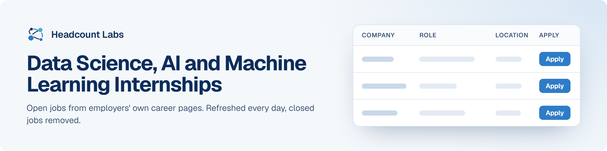

# Data Science, AI and Machine Learning Internships

Open internships in data science, analytics, AI and machine learning at US employers.

**49 open jobs** · 6 new since the last update · 105 removed because they closed or left the employer's board · updated November 23, 2026 at 4:32 AM EST

This list is built and refreshed every day by [Headcount Labs](https://headcountlabs.com/?utm_source=github&utm_medium=job-list&utm_campaign=data-science-ai-internships), which reads jobs straight from employers' own career pages and job boards. Every job here was still listed on its source board when we last read that board, within the past 3 days, and was posted in the past 30 days. Copies of the same job are merged into one row, and jobs that close are removed at the next update.

Want this data in your own app or agent? Use the [Headcount Labs jobs API](https://headcountlabs.com/docs/?utm_source=github&utm_medium=job-list&utm_campaign=data-science-ai-internships) (free tier), the [MCP server](https://headcountlabs.com/mcp/?utm_source=github&utm_medium=job-list&utm_campaign=data-science-ai-internships) for Claude, ChatGPT and other AI assistants, or the [public dataset subsets](https://huggingface.co/HeadcountLabs) on Hugging Face (the full dataset is coming soon).

**Full dataset.** A bigger, one-off snapshot dated 2026-10-19 (all matching jobs, not only the open jobs below) is on Hugging Face: [Tech and software jobs](https://huggingface.co/datasets/HeadcountLabs/tech-jobs) · [Internships](https://huggingface.co/datasets/HeadcountLabs/internships). It loads with `datasets.load_dataset` and is under the Open Database License (ODbL) 1.0.

**Jump to:** [Posted in the last 7 days (25)](#posted-in-the-last-7-days) · [Posted 8 to 30 days ago (24)](#posted-8-to-30-days-ago)

**Columns.** *Apply* opens the original posting on the employer's site. *Details* opens the job on Headcount Labs, with every posting we found for it. *Remote* shows what the employer states; a dash means the posting doesn't say. *Pay* is the range the employer published.

## Posted in the last 7 days

| Company | Role | Location | Remote | Pay | Posted | Apply | Details |
| --- | --- | --- | --- | --- | --- | :---: | :---: |
| **Teradata** | AI Studio Product Manager Intern | Des Moines, IA | — | — | Nov 20 |  | <a href="https://headcountlabs.com/catalog/jobs/dbc7ad87-e7f1-4ef1-a140-d9fa26ee5191?utm_source=github&utm_medium=job-list&utm_campaign=data-science-ai-internships">via Headcount Labs</a> |
| **Waymo** | 2027 Summer Intern, PhD, Agentic AI | Mountain View, CA | — | $85/hr | Nov 19 |  | <a href="https://headcountlabs.com/catalog/jobs/e5e27ffc-c80c-4fba-90fc-f9d2db574b61?utm_source=github&utm_medium=job-list&utm_campaign=data-science-ai-internships">via Headcount Labs</a> |
| **Vertiv** | AI Intern (Summer 2027) | 

3 locations
Huntsville, AL Westerville, OH Fort Lauderdale, FL
 | On-site | — | Nov 19 |  | <a href="https://headcountlabs.com/catalog/jobs/a0b59e51-67be-4dc6-bec2-8f8aeaafc402?utm_source=github&utm_medium=job-list&utm_campaign=data-science-ai-internships">via Headcount Labs</a> |
| **TI** | Synthetic Data for Edge AI System Engineer Intern | Dallas, TX | On-site | — | Nov 19 |  | <a href="https://headcountlabs.com/catalog/jobs/0e6f5a2c-14d9-4bbb-bbea-eb0da029c19c?utm_source=github&utm_medium=job-list&utm_campaign=data-science-ai-internships">via Headcount Labs</a> |
| **Snowflake** | Software Engineer Intern (AI / ML) - Summer 2027 | 

2 locations
US-CA-Menlo Park US-WA-Bellevue
 | — | $42–$60/hr | Nov 19 |  | <a href="https://headcountlabs.com/catalog/jobs/1faefef9-3a25-4594-af50-4b41ec858297?utm_source=github&utm_medium=job-list&utm_campaign=data-science-ai-internships">via Headcount Labs</a> |
| **Publicis Groupe Holdings B.V** | Identity Analytics Intern - Summer 2027 | Chicago, IL | — | $27/hr | Nov 19 |  | <a href="https://headcountlabs.com/catalog/jobs/4b82a98e-fc61-49b3-8c93-1934050be9d1?utm_source=github&utm_medium=job-list&utm_campaign=data-science-ai-internships">via Headcount Labs</a> |
| **MongoDB** | 2027 - AI and People Transformation Intern, NYC | New York City | — | — | Nov 19 |  | <a href="https://headcountlabs.com/catalog/jobs/99f22cc9-af9a-423b-8982-a311bd0f1c88?utm_source=github&utm_medium=job-list&utm_campaign=data-science-ai-internships">via Headcount Labs</a> |
| **Cisco** | AI Researcher II (Intern) - United States | 

3 locations
San Francisco, CA Milpitas, CA San Jose, CA
 | Hybrid | $44k–$185k/yr | Nov 19 |  | <a href="https://headcountlabs.com/catalog/jobs/4befd744-7763-41de-ab0d-947d0145dd3d?utm_source=github&utm_medium=job-list&utm_campaign=data-science-ai-internships">via Headcount Labs</a> |
| **Arrow Senior Living** | Analytics Internship Jan '27-May '27 (Internship) | St. Charles, MO | — | — | Nov 19 |  | <a href="https://headcountlabs.com/catalog/jobs/379bbcf3-368b-4461-9873-939868e58c34?utm_source=github&utm_medium=job-list&utm_campaign=data-science-ai-internships">via Headcount Labs</a> |
| **Sheetz, Inc** | Business Intelligence Analytics Intern | PITTSBURGH, PA | — | — | Nov 18 |  | <a href="https://headcountlabs.com/catalog/jobs/624f70a4-4a0f-4f78-8036-c9aa92d05d03?utm_source=github&utm_medium=job-list&utm_campaign=data-science-ai-internships">via Headcount Labs</a> |
| **S&amp;P Global** | Summer Intern, Client Services, Equity Analytics Products | New York, NY | — | $20–$25/hr | Nov 18 |  | <a href="https://headcountlabs.com/catalog/jobs/01188081-639b-4edb-9669-db2b6c1bc693?utm_source=github&utm_medium=job-list&utm_campaign=data-science-ai-internships">via Headcount Labs</a> |
| **Disney Entertainment** | Tech Data Analytics Intern | Santa Monica, CA | — | $32/hr | Nov 18 |  | <a href="https://headcountlabs.com/catalog/jobs/b7036dba-e56e-4df8-9c05-f4474cb57b32?utm_source=github&utm_medium=job-list&utm_campaign=data-science-ai-internships">via Headcount Labs</a> |
| **Disney Entertainment** | Data Engineering Intern | Santa Monica, CA | — | $43/hr | Nov 18 |  | <a href="https://headcountlabs.com/catalog/jobs/4e7be1c1-754a-430b-8f62-793b79e57004?utm_source=github&utm_medium=job-list&utm_campaign=data-science-ai-internships">via Headcount Labs</a> |
| **TE Connectivity** | Data Analyst Intern | United States | — | $20.91–$45.04/hr | Nov 17 |  | <a href="https://headcountlabs.com/catalog/jobs/deb0d7e7-b426-4d7d-a6fc-56177de1005c?utm_source=github&utm_medium=job-list&utm_campaign=data-science-ai-internships">via Headcount Labs</a> |
| **SPX Cooling Technologies** | Procurement Analytics Intern | Elk Grove Village, IL | — | $20–$25/hr | Nov 17 |  | <a href="https://headcountlabs.com/catalog/jobs/02d9a2f5-3cfd-44be-8def-42524858c217?utm_source=github&utm_medium=job-list&utm_campaign=data-science-ai-internships">via Headcount Labs</a> |
| **SAP (member)** | SAP iXp Intern - Full-Stack AI Developer | United States | Hybrid | — | Nov 17 |  | <a href="https://headcountlabs.com/catalog/jobs/64c6ce39-20ce-4268-af19-bc0057c4572c?utm_source=github&utm_medium=job-list&utm_campaign=data-science-ai-internships">via Headcount Labs</a> |
| **Publicis Groupe Holdings B.V** | PhD Data Visualization Intern - Summer 2027 | 

5 locations
Chicago, IL Westminster, CO Atlanta, GA Boston, MA Irving, TX
 | Hybrid | $55–$60/hr | Nov 17 |  | <a href="https://headcountlabs.com/catalog/jobs/74c2c32e-be99-44c8-ba28-a6b98197e7b2?utm_source=github&utm_medium=job-list&utm_campaign=data-science-ai-internships">via Headcount Labs</a> |
| **Publicis Groupe Holdings B.V** | PhD Data Science Intern - Summer 2027 | 

5 locations
Chicago, IL Westminster, CO Atlanta, GA Boston, MA Irving, TX
 | Hybrid | $55–$60/hr | Nov 17 |  | <a href="https://headcountlabs.com/catalog/jobs/1005ebb3-0d46-4ea4-8082-3e3544125ebd?utm_source=github&utm_medium=job-list&utm_campaign=data-science-ai-internships">via Headcount Labs</a> |
| **Garmin International, Inc.** | Software Engineer Intern - Real Time Aviation Data | Chanhassen, MN | — | — | Nov 17 |  | <a href="https://headcountlabs.com/catalog/jobs/b6fb5489-b116-4ccd-a24b-ae44682ffd9b?utm_source=github&utm_medium=job-list&utm_campaign=data-science-ai-internships">via Headcount Labs</a> |
| **Disney Entertainment** | Data Engineering Intern, Summer 2027 | New York, NY | — | $43/hr | Nov 17 |  | <a href="https://headcountlabs.com/catalog/jobs/f85cd47e-4bfb-435b-bac7-8d5298dbb20d?utm_source=github&utm_medium=job-list&utm_campaign=data-science-ai-internships">via Headcount Labs</a> |
| **Anduril Industries** | 2027 Machine Learning Engineer Intern | Santa Ana, CA | — | $42–$60/hr | Nov 17 |  | <a href="https://headcountlabs.com/catalog/jobs/9293b056-2719-4c5b-bf17-a274dda6cfa1?utm_source=github&utm_medium=job-list&utm_campaign=data-science-ai-internships">via Headcount Labs</a> |
| **HDR** | Wetland Scientist Intern | Woodcliff Lake, NJ | — | — | Nov 16 |  | <a href="https://headcountlabs.com/catalog/jobs/605a590c-7c12-4372-a057-76c00a2bfca7?utm_source=github&utm_medium=job-list&utm_campaign=data-science-ai-internships">via Headcount Labs</a> |
| **EchoStar** | Data Science &amp; Analytics Intern | Englewood, CO | — | $37/hr | Nov 16 |  | <a href="https://headcountlabs.com/catalog/jobs/241d62ff-aac7-47fb-946f-cb8682b89c93?utm_source=github&utm_medium=job-list&utm_campaign=data-science-ai-internships">via Headcount Labs</a> |
| **Carnival Corporation** | Intern, Energy Analytics &amp; Decarbonization (CCL) | Miami, FL | On-site | — | Nov 16 |  | <a href="https://headcountlabs.com/catalog/jobs/165ad0f7-3e0d-49ed-96dc-fdec926e8d1a?utm_source=github&utm_medium=job-list&utm_campaign=data-science-ai-internships">via Headcount Labs</a> |
| **Carnival Corporation** | Intern, Data Analytics (CCL) | Miami, FL | On-site | — | Nov 16 |  | <a href="https://headcountlabs.com/catalog/jobs/0b7f435f-2dff-4fc2-9abb-90c27b699c08?utm_source=github&utm_medium=job-list&utm_campaign=data-science-ai-internships">via Headcount Labs</a> |

## Posted 8 to 30 days ago

| Company | Role | Location | Remote | Pay | Posted | Apply | Details |
| --- | --- | --- | --- | --- | --- | :---: | :---: |
| **Fanatics Collectibles** | Summer 2027 Internship - Manufacturing Planning &amp; Analytics Intern | Sunnyvale, TX | On-site | — | Nov 15 |  | <a href="https://headcountlabs.com/catalog/jobs/600e5ddc-a958-408c-9c95-651aadf76542?utm_source=github&utm_medium=job-list&utm_campaign=data-science-ai-internships">via Headcount Labs</a> |
| **ServiceNow, Inc.** | AI Security Engineer Intern | San Diego, CA | — | $62.89/hr | Nov 14 |  | <a href="https://headcountlabs.com/catalog/jobs/e696b488-1ec4-44c0-ac18-7980d622d70d?utm_source=github&utm_medium=job-list&utm_campaign=data-science-ai-internships">via Headcount Labs</a> |
| **Saint-Gobain** | Data Transformation/Digital Systems Engineering Intern | BEAVERTON, MI | — | $24/hr | Nov 13 |  | <a href="https://headcountlabs.com/catalog/jobs/ed7e9a57-7a69-4ddb-ab8f-c261eb3097c8?utm_source=github&utm_medium=job-list&utm_campaign=data-science-ai-internships">via Headcount Labs</a> |
| **PACCAR** | Manufacturing Engineering Data Analytics Intern Summer 2027 | Columbus, MS | — | — | Nov 13 |  | <a href="https://headcountlabs.com/catalog/jobs/e5263e1b-19f3-4dbe-87fe-304b1e6f358c?utm_source=github&utm_medium=job-list&utm_campaign=data-science-ai-internships">via Headcount Labs</a> |
| **Encore Global** | IT Data Analyst Intern– Summer 2027 | Schiller Park, IL | — | $19.99–$20/hr | Nov 11 |  | <a href="https://headcountlabs.com/catalog/jobs/98b2a90a-cc15-4c74-a65d-8b2f33a94e60?utm_source=github&utm_medium=job-list&utm_campaign=data-science-ai-internships">via Headcount Labs</a> |
| **V2X** | AI Engineering Intern - Junior | Indianapolis, IN | — | — | Nov 10 |  | <a href="https://headcountlabs.com/catalog/jobs/79e35fe3-7e51-4a9d-b0b5-47c42016d5f5?utm_source=github&utm_medium=job-list&utm_campaign=data-science-ai-internships">via Headcount Labs</a> |
| **PACCAR** | Data Engineering Intern | Chillicothe, OH | — | — | Nov 10 |  | <a href="https://headcountlabs.com/catalog/jobs/72c5c265-ba02-4e67-ad4c-3a396d32f0e9?utm_source=github&utm_medium=job-list&utm_campaign=data-science-ai-internships">via Headcount Labs</a> |
| **PACCAR** | 2027 Summer Internship: AI-Driven Vehicle Definition | Denton, TX | — | — | Nov 10 |  | <a href="https://headcountlabs.com/catalog/jobs/d8b3c209-2a9f-49fb-a33b-5d3ef1cd3130?utm_source=github&utm_medium=job-list&utm_campaign=data-science-ai-internships">via Headcount Labs</a> |
| **Medpace, Inc.** | AI Engineering Intern - Summer 2027 | Cincinnati, OH | — | — | Nov 10 |  | <a href="https://headcountlabs.com/catalog/jobs/3b0ee172-6af4-48f7-9225-dcca00816e65?utm_source=github&utm_medium=job-list&utm_campaign=data-science-ai-internships">via Headcount Labs</a> |
| **Trilogy Health Services, LLC** | Information Systems Developer of AI Intern | Louisville, KY | — | — | Nov 9 |  | <a href="https://headcountlabs.com/catalog/jobs/6ab264e9-09d7-4ef0-95f0-94457d76d56f?utm_source=github&utm_medium=job-list&utm_campaign=data-science-ai-internships">via Headcount Labs</a> |
| **SPX Cooling Technologies** | Business Analytics Intern | Burr Ridge, IL | — | — | Nov 9 |  | <a href="https://headcountlabs.com/catalog/jobs/8c7280ba-7f4c-49ff-856e-a9b9e2e28ac1?utm_source=github&utm_medium=job-list&utm_campaign=data-science-ai-internships">via Headcount Labs</a> |
| **SPX Cooling Technologies** | Software Engineering Generative AI Intern | Elk Grove Village, IL | — | $20–$25/hr | Nov 6 |  | <a href="https://headcountlabs.com/catalog/jobs/e9ec4ab0-9d94-46e1-8f16-801333412515?utm_source=github&utm_medium=job-list&utm_campaign=data-science-ai-internships">via Headcount Labs</a> |
| **ENGIE** | Risk Analytics Intern | United States | — | $26.50–$35.50/hr | Nov 6 |  | <a href="https://headcountlabs.com/catalog/jobs/210c0d94-b7c7-4f9e-9a63-b95ab6a6ea30?utm_source=github&utm_medium=job-list&utm_campaign=data-science-ai-internships">via Headcount Labs</a> |
| **Duolingo University Recruitment** | AI Research Intern (PhD) | 

2 locations
New York, NY Pittsburgh, PA
 | — | $67–$69/hr | Nov 6 |  | <a href="https://headcountlabs.com/catalog/jobs/d3b68aa6-4e7c-4f1b-9c1c-f8c6dc141175?utm_source=github&utm_medium=job-list&utm_campaign=data-science-ai-internships">via Headcount Labs</a> |
| **V2X** | AI Engineering Intern - Senior | Indianapolis, IN | — | — | Nov 5 |  | <a href="https://headcountlabs.com/catalog/jobs/628e7e2d-f8bc-4449-8a3b-05932e2e99cd?utm_source=github&utm_medium=job-list&utm_campaign=data-science-ai-internships">via Headcount Labs</a> |
| **Direct Agents** | AI Business Strategy &amp; Operations Intern | New York, NY | On-site | $25–$30/hr | Nov 5 |  | <a href="https://headcountlabs.com/catalog/jobs/72f06d40-ae00-46a7-bb43-07ccd7704ef2?utm_source=github&utm_medium=job-list&utm_campaign=data-science-ai-internships">via Headcount Labs</a> |
| **Constellation Energy Generation, LLC.** | 2027 Summer Load Forecasting &amp; Analytics Intern (Baltimore, MD) | Baltimore, MD | — | — | Nov 4 |  | <a href="https://headcountlabs.com/catalog/jobs/95194420-0e2a-4f3f-889e-ff5f64810b92?utm_source=github&utm_medium=job-list&utm_campaign=data-science-ai-internships">via Headcount Labs</a> |
| **onepot** | Research Intern, Machine Learning | South San Francisco, CA | On-site | — | Nov 3 |  | <a href="https://headcountlabs.com/catalog/jobs/96fddd8f-5261-4b11-9a7a-5a04d937603b?utm_source=github&utm_medium=job-list&utm_campaign=data-science-ai-internships">via Headcount Labs</a> |
| **PACCAR** | 2027 Summer Internship: Resident Engineering Product Data Management | Denton, TX | — | — | Nov 2 |  | <a href="https://headcountlabs.com/catalog/jobs/9fb3af88-e7fa-4acc-9434-040e8ac4f7f4?utm_source=github&utm_medium=job-list&utm_campaign=data-science-ai-internships">via Headcount Labs</a> |
| **IPG Photonics** | Data Quality Analyst - Intern | Marlborough, MA | — | — | Oct 30 |  | <a href="https://headcountlabs.com/catalog/jobs/2a11c024-9370-4bf0-afff-c5fe57be3d47?utm_source=github&utm_medium=job-list&utm_campaign=data-science-ai-internships">via Headcount Labs</a> |
| **LIMRA AND LOMA** | Data Analyst Intern | Windsor, CT | — | — | Oct 29 |  | <a href="https://headcountlabs.com/catalog/jobs/fc877563-94a5-44ae-bcc8-9053d1695d20?utm_source=github&utm_medium=job-list&utm_campaign=data-science-ai-internships">via Headcount Labs</a> |
| **Gallagher** | U.S. Internship - Data Analytics - ALL LOCATIONS | Rolling Meadows, IL | — | — | Oct 28 |  | <a href="https://headcountlabs.com/catalog/jobs/c1383138-61fe-43c6-8743-b7bbf8ac4ff0?utm_source=github&utm_medium=job-list&utm_campaign=data-science-ai-internships">via Headcount Labs</a> |
| **Constellation Energy Generation, LLC.** | 2027 Geothermal Production Analytics Engineering Intern - Geysers | Middletown, CA | — | — | Oct 28 |  | <a href="https://headcountlabs.com/catalog/jobs/248e4a66-12ef-4abc-992f-0b1f1a3dd794?utm_source=github&utm_medium=job-list&utm_campaign=data-science-ai-internships">via Headcount Labs</a> |
| **PACCAR** | Summer Internship - Aftersales Process Analytics | Lewisville, TX | — | $25/hr | Oct 26 |  | <a href="https://headcountlabs.com/catalog/jobs/30c3fa23-bf98-4466-ab56-bd1c40c48c3f?utm_source=github&utm_medium=job-list&utm_campaign=data-science-ai-internships">via Headcount Labs</a> |

## Related data on Headcount Labs

- [Data scientist salary data from posted pay](https://headcountlabs.com/salary-data/data-scientist/)
- [Machine learning engineer job postings dataset](https://headcountlabs.com/data/machine-learning-engineer-job-postings/)
- [US job market report: open jobs by state, top employers, pay and remote share](https://headcountlabs.com/reports/us-job-market/)

## More lists from Headcount Labs

[Software Engineering Internships](https://github.com/HeadcountLabs/software-engineering-internships) · [Engineering Internships](https://github.com/HeadcountLabs/engineering-internships) · [Business, Finance and Marketing Internships](https://github.com/HeadcountLabs/business-finance-internships) · [Internships in the US](https://github.com/HeadcountLabs/internships) · [New Grad Software Engineer Jobs](https://github.com/HeadcountLabs/new-grad-software-engineer-jobs) · [Entry-Level and New Grad Jobs](https://github.com/HeadcountLabs/entry-level-jobs) · [Entry-Level Data Analyst Jobs](https://github.com/HeadcountLabs/entry-level-data-analyst-jobs) · [Remote Software Engineer Jobs](https://github.com/HeadcountLabs/remote-software-engineer-jobs) · [Remote Data, AI and Machine Learning Jobs](https://github.com/HeadcountLabs/remote-data-jobs) · [Remote Product Manager Jobs](https://github.com/HeadcountLabs/remote-product-manager-jobs) · [Remote Marketing Jobs](https://github.com/HeadcountLabs/remote-marketing-jobs) · [Remote Sales Jobs](https://github.com/HeadcountLabs/remote-sales-jobs) · [Remote Customer Support and Success Jobs](https://github.com/HeadcountLabs/remote-customer-support-jobs) · [Remote Healthcare Jobs](https://github.com/HeadcountLabs/remote-healthcare-jobs) · [Remote Finance and Accounting Jobs](https://github.com/HeadcountLabs/remote-finance-accounting-jobs) · [Remote Jobs in the US](https://github.com/HeadcountLabs/remote-jobs) · [AI and Machine Learning Engineer Jobs](https://github.com/HeadcountLabs/ai-ml-engineer-jobs) · [Data Engineer Jobs](https://github.com/HeadcountLabs/data-engineer-jobs) · [Cybersecurity Jobs](https://github.com/HeadcountLabs/cybersecurity-jobs) · [Product Manager Jobs](https://github.com/HeadcountLabs/product-manager-jobs) · [Registered Nurse Jobs](https://github.com/HeadcountLabs/registered-nurse-jobs) · [Software Jobs Paying $200k+](https://github.com/HeadcountLabs/high-paying-software-jobs) · [Tech and Software Jobs in the US](https://github.com/HeadcountLabs/tech-jobs) · [Jobs with Salary Listed in the US](https://github.com/HeadcountLabs/pay-transparency-jobs) · [San Francisco Bay Area Tech Jobs](https://github.com/HeadcountLabs/bay-area-tech-jobs) · [New York City Tech Jobs](https://github.com/HeadcountLabs/new-york-tech-jobs) · [Seattle Tech Jobs](https://github.com/HeadcountLabs/seattle-tech-jobs) · [Austin Tech Jobs](https://github.com/HeadcountLabs/austin-tech-jobs) · [Boston Tech Jobs](https://github.com/HeadcountLabs/boston-tech-jobs) · [Los Angeles Tech Jobs](https://github.com/HeadcountLabs/los-angeles-tech-jobs) · [Washington, DC Tech Jobs](https://github.com/HeadcountLabs/washington-dc-tech-jobs)

## Contributing

This README is generated, so edits to it are overwritten at the next update. If a job is closed, a link is broken or a detail is wrong, [open an issue](../../issues/new) with the link and we'll fix it in the data, which fixes it everywhere. Requests for new lists are welcome too.

## License

The list data is under the [Open Database License (ODbL) 1.0](LICENSE). Our own values in it are under the [Database Contents License (DbCL) 1.0](https://opendatacommons.org/licenses/dbcl/1-0/). Credit "Headcount Labs (https://headcountlabs.com)" when you reuse it. Job description text is the employer's own text and is not licensed by us. Takedown requests: [https://headcountlabs.com/remove/](https://headcountlabs.com/remove/). Location data includes data from OpenStreetMap contributors (ODbL) and Overture Maps. The same rows are in [`data/jobs.csv`](data/jobs.csv).

Generated by Headcount Labs from the jobs API on November 23, 2026 at 4:32 AM EST. At most 8 jobs per employer are shown in each list.
