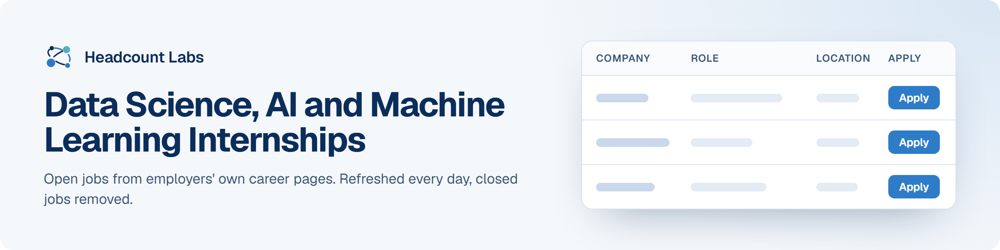

# Data Science, AI and Machine Learning Internships

Open internships in data science, analytics, AI and machine learning at US employers.

**393 open jobs** · 99 new since the last update · 70 removed because they closed or left the employer's board · updated October 22, 2026 at 5:32 AM EDT

This list is built and refreshed every day by [Headcount Labs](https://headcountlabs.com/?utm_source=github&utm_medium=job-list&utm_campaign=data-science-ai-internships), which reads jobs straight from employers' own career pages and job boards. Every job here was still listed on its source board when we last read that board, within the past 3 days, and was posted in the past 30 days. Copies of the same job are merged into one row, and jobs that close are removed at the next update.

Want this data in your own app or agent? Use the [Headcount Labs jobs API](https://headcountlabs.com/docs/?utm_source=github&utm_medium=job-list&utm_campaign=data-science-ai-internships) (free tier), the [MCP server](https://headcountlabs.com/mcp/?utm_source=github&utm_medium=job-list&utm_campaign=data-science-ai-internships) for Claude, ChatGPT and other AI assistants, or the [open dataset](https://huggingface.co/datasets/HeadcountLabs/job-postings) on Hugging Face ([example queries](https://github.com/HeadcountLabs/job-postings)).

**Full dataset.** A bigger, one-off snapshot dated 2026-10-19 (all matching jobs, not only the open jobs below) is on Hugging Face: [Tech and software jobs](https://huggingface.co/datasets/HeadcountLabs/tech-jobs) · [Internships](https://huggingface.co/datasets/HeadcountLabs/internships). It loads with `datasets.load_dataset` and is under the Open Database License (ODbL) 1.0.

**Jump to:** [Posted in the last 7 days (120)](#posted-in-the-last-7-days) · [Posted 8 to 30 days ago (273)](#posted-8-to-30-days-ago)

**Columns.** *Apply* opens the original posting on the employer's site. *Details* opens the job on Headcount Labs, with every posting we found for it. *Remote* shows what the employer states; a dash means the posting doesn't say. *Pay* is the range the employer published.

## Posted in the last 7 days

| Company | Role | Location | Remote | Pay | Posted | Apply | Details |
| --- | --- | --- | --- | --- | --- | :---: | :---: |
| **Wonder Group, INC** | Supply Chain Analytics Intern | New York, NY | Hybrid | — | Oct 21 |  | <a href="https://headcountlabs.com/catalog/jobs/156df771-8113-4967-81c5-4c6517a9b052?utm_source=github&utm_medium=job-list&utm_campaign=data-science-ai-internships">via Headcount Labs</a> |
| **Vontier** | Engineering Intern - Design Process and AI (Summer 2027) | Greensboro, NC | Hybrid | $23/hr | Oct 21 |  | <a href="https://headcountlabs.com/catalog/jobs/2a38b989-22c7-41cc-8e09-60c6cc488928?utm_source=github&utm_medium=job-list&utm_campaign=data-science-ai-internships">via Headcount Labs</a> |
| **The Elevance Health Companies, Inc.** | Marketing Workflow &amp; AI Enablement Intern - Summer 2027 | Indianapolis, IN | Hybrid | — | Oct 21 |  | <a href="https://headcountlabs.com/catalog/jobs/87c0b659-2d3d-4406-8c9b-fa02f9b57ac2?utm_source=github&utm_medium=job-list&utm_campaign=data-science-ai-internships">via Headcount Labs</a> |
| **Shield AI** | Summer 2027 - Data Science Intern (R6324) | San Diego, CA | On-site | — | Oct 21 |  | <a href="https://headcountlabs.com/catalog/jobs/b8bafcbd-cdfd-4d84-9825-4214d15213be?utm_source=github&utm_medium=job-list&utm_campaign=data-science-ai-internships">via Headcount Labs</a> |
| **Rakuten USA, Inc.** | Intern - Software Engineer, AI User Experience | Bellevue, WA | — | — | Oct 21 |  | <a href="https://headcountlabs.com/catalog/jobs/733e3b1a-0c2f-43c8-8e09-66530e07406e?utm_source=github&utm_medium=job-list&utm_campaign=data-science-ai-internships">via Headcount Labs</a> |
| **MIPS Holding Inc** | AI Software Intern (Summer 2027) | 

2 locations
Santa Clara, CA Richardson, TX
 | — | $20–$40/hr | Oct 21 |  | <a href="https://headcountlabs.com/catalog/jobs/00c8f79e-6c98-4680-b5c1-4ab793dd39a3?utm_source=github&utm_medium=job-list&utm_campaign=data-science-ai-internships">via Headcount Labs</a> |
| **Minerals Technologies** | Finance Intern - Data Analysis | Bethlehem, PA | — | — | Oct 21 |  | <a href="https://headcountlabs.com/catalog/jobs/79b64e23-6638-4af3-934a-98566ad26ef9?utm_source=github&utm_medium=job-list&utm_campaign=data-science-ai-internships">via Headcount Labs</a> |
| **Lindt &amp; Sprüngli (USA) Inc.** | Digital Commerce Retail Media Analytics Intern | Stratham, NH | — | $20/hr | Oct 21 |  | <a href="https://headcountlabs.com/catalog/jobs/fa4e4ee0-cdc5-4f82-aeb6-07f3af4b7d10?utm_source=github&utm_medium=job-list&utm_campaign=data-science-ai-internships">via Headcount Labs</a> |
| **KnowBe4** | AI Customer Success Intern | Clearwater, FL | Hybrid | — | Oct 21 |  | <a href="https://headcountlabs.com/catalog/jobs/931b4f37-7686-41b3-a248-b7982feed9ee?utm_source=github&utm_medium=job-list&utm_campaign=data-science-ai-internships">via Headcount Labs</a> |
| **Carnegie Mellon University** | AI Security Research Intern – Summer 2027 | Pittsburgh, PA | — | — | Oct 21 |  | <a href="https://headcountlabs.com/catalog/jobs/db5881fb-3fc0-4567-b3b8-162815a10812?utm_source=github&utm_medium=job-list&utm_campaign=data-science-ai-internships">via Headcount Labs</a> |
| **American Electric Power** | Data Scientist Intern - Columbus, OH | Columbus, OH | — | — | Oct 21 |  | <a href="https://headcountlabs.com/catalog/jobs/c76377b7-ccc1-4e7d-aa2c-b8956f6066a5?utm_source=github&utm_medium=job-list&utm_campaign=data-science-ai-internships">via Headcount Labs</a> |
| **AFMIC American Family Mutual Insurance Company, S.I.** | Summer 2027 Intern - Data Engineer | United States | Hybrid | — | Oct 21 |  | <a href="https://headcountlabs.com/catalog/jobs/10135d4d-a256-4e4a-8d63-3f3bdf60a4e3?utm_source=github&utm_medium=job-list&utm_campaign=data-science-ai-internships">via Headcount Labs</a> |
| **AFMIC American Family Mutual Insurance Company, S.I.** | Summer 2027 Intern - Data Engineering | United States | Hybrid | — | Oct 21 |  | <a href="https://headcountlabs.com/catalog/jobs/5d0af7d0-4762-4b89-a9e7-9c4f9a2b3a34?utm_source=github&utm_medium=job-list&utm_campaign=data-science-ai-internships">via Headcount Labs</a> |
| **ZINC Zillow, Inc.** | Applied Scientist (Economics) Intern | United States | Remote | $104k–$166k/yr | Oct 20 |  | <a href="https://headcountlabs.com/catalog/jobs/a6df0eb2-851d-4b1e-91bf-a78f526c24a6?utm_source=github&utm_medium=job-list&utm_campaign=data-science-ai-internships">via Headcount Labs</a> |
| **Zebra Technologies Corporation** | 2027 Summer Internship (US) - Supply Chain Analytics | 

2 locations
Lincolnshire, IL Holtsville, NY
 | Hybrid | $27–$34/hr | Oct 20 |  | <a href="https://headcountlabs.com/catalog/jobs/6e9e8ec4-549a-4048-8c2d-f48d09918bfc?utm_source=github&utm_medium=job-list&utm_campaign=data-science-ai-internships">via Headcount Labs</a> |
| **Xcel Energy Services Inc** | GIS, Grid Data Intern - MN | Minneapolis, MN | Hybrid | $22.10–$27.90/hr | Oct 20 |  | <a href="https://headcountlabs.com/catalog/jobs/4dd9e678-4257-461f-8ded-555028469ac9?utm_source=github&utm_medium=job-list&utm_campaign=data-science-ai-internships">via Headcount Labs</a> |
| **Xcel Energy Services Inc** | Energy Product Analytics Intern- CO | Denver, CO | Hybrid | $21–$27.90/hr | Oct 20 |  | <a href="https://headcountlabs.com/catalog/jobs/3e10d866-5202-4a6a-acbf-d11596159e25?utm_source=github&utm_medium=job-list&utm_campaign=data-science-ai-internships">via Headcount Labs</a> |
| **TMN Toyota Motor North America Company** | 2027 TFS Data Science Internship | Plano, TX | — | — | Oct 20 |  | <a href="https://headcountlabs.com/catalog/jobs/fc15ac41-0a81-4049-a2f5-a36f256dcef6?utm_source=github&utm_medium=job-list&utm_campaign=data-science-ai-internships">via Headcount Labs</a> |
| **The Energy Authority Inc** | Data Science Intern – Generative AI | Bellevue, WA | — | $20.98–$28.40/hr | Oct 20 |  | <a href="https://headcountlabs.com/catalog/jobs/69cf050d-3aa1-47d8-ab37-d5974ce6a2c2?utm_source=github&utm_medium=job-list&utm_campaign=data-science-ai-internships">via Headcount Labs</a> |
| **The Cigna Group** | Business Analytics Intern | Bloomfield, CT | Hybrid | — | Oct 20 |  | <a href="https://headcountlabs.com/catalog/jobs/54a791eb-6f9d-411d-ba48-9eeba01f552d?utm_source=github&utm_medium=job-list&utm_campaign=data-science-ai-internships">via Headcount Labs</a> |
| **Stand Together** | KIP Spring 2027 - Policy Data Analyst Intern - Empire Center for Public Policy | New York | Remote | $6k–$8k/yr | Oct 20 |  | <a href="https://headcountlabs.com/catalog/jobs/d9bdd3f5-77a5-43f3-a3b9-95eb5ea67385?utm_source=github&utm_medium=job-list&utm_campaign=data-science-ai-internships">via Headcount Labs</a> |
| **Space Dynamics Laboratory** | AI-Enabled Requirements Engineering Intern | North Logan, UT | On-site | — | Oct 20 |  | <a href="https://headcountlabs.com/catalog/jobs/c4574174-26fd-4f23-9a83-7cb971f05cdc?utm_source=github&utm_medium=job-list&utm_campaign=data-science-ai-internships">via Headcount Labs</a> |
| **Sony Corporate Technology Center America Inc.** | Research Engineer Intern (Ethical Creative and Protective AI Lab) | United States | Remote | $50/hr | Oct 20 |  | <a href="https://headcountlabs.com/catalog/jobs/aaf64de3-d798-4d49-a040-81b9144681ef?utm_source=github&utm_medium=job-list&utm_campaign=data-science-ai-internships">via Headcount Labs</a> |
| **Salesforce, Inc.** | Summer 2027 Intern - AI Research | Palo Alto, CA | — | $49–$68/hr | Oct 20 |  | <a href="https://headcountlabs.com/catalog/jobs/973fabed-cc88-4fa9-ab13-481fe0e46ab4?utm_source=github&utm_medium=job-list&utm_campaign=data-science-ai-internships">via Headcount Labs</a> |
| **Rogue Fitness** | AI Engineer Intern | Columbus, OH | On-site | $30/hr | Oct 20 |  | <a href="https://headcountlabs.com/catalog/jobs/76ccefb1-8932-4ed8-97b1-0e43d079f374?utm_source=github&utm_medium=job-list&utm_campaign=data-science-ai-internships">via Headcount Labs</a> |
| **Rakuten USA, Inc.** | Early Career AI Engineer, Intern | Bellevue, WA | — | $30–$50/hr | Oct 20 |  | <a href="https://headcountlabs.com/catalog/jobs/63faac36-584d-43a7-a019-7db77355c1fd?utm_source=github&utm_medium=job-list&utm_campaign=data-science-ai-internships">via Headcount Labs</a> |
| **Pioneer Hi-Bred International, Inc** | Digital Agriculture &amp; AI Integration Intern | Des Moines, IA | — | — | Oct 20 |  | <a href="https://headcountlabs.com/catalog/jobs/42092556-15c7-4996-ae77-8f51166503ab?utm_source=github&utm_medium=job-list&utm_campaign=data-science-ai-internships">via Headcount Labs</a> |
| **PACCAR** | Summer Internship - Technical Content Analytics | Renton, WA | — | $25/hr | Oct 20 |  | <a href="https://headcountlabs.com/catalog/jobs/150c900a-ed48-47da-ae2e-2d35d37d42e6?utm_source=github&utm_medium=job-list&utm_campaign=data-science-ai-internships">via Headcount Labs</a> |
| **PACCAR** | Summer 2027 - Field Service Data Analyst Intern | Kirkland, WA | — | $25/hr | Oct 20 |  | <a href="https://headcountlabs.com/catalog/jobs/52b708bd-3b94-4f9c-86d9-35d8caa6fc18?utm_source=github&utm_medium=job-list&utm_campaign=data-science-ai-internships">via Headcount Labs</a> |
| **MiTek USA Inc** | Data Scientist Intern | Earth City, MO | Hybrid | — | Oct 20 |  | <a href="https://headcountlabs.com/catalog/jobs/8e428b77-cf17-4613-97d4-9a3afffc610b?utm_source=github&utm_medium=job-list&utm_campaign=data-science-ai-internships">via Headcount Labs</a> |
| **MiTek USA Inc** | SAP ERP Implementation Intern — Data Migration | Chesterfield, MO | Hybrid | — | Oct 20 |  | <a href="https://headcountlabs.com/catalog/jobs/56b74d2e-dbd6-4a83-8557-3064389c4901?utm_source=github&utm_medium=job-list&utm_campaign=data-science-ai-internships">via Headcount Labs</a> |
| **MiTek USA Inc** | AI Intern | Greenwood Village, CO | Hybrid | — | Oct 20 |  | <a href="https://headcountlabs.com/catalog/jobs/37282138-abe1-4187-b159-65adc748e2d4?utm_source=github&utm_medium=job-list&utm_campaign=data-science-ai-internships">via Headcount Labs</a> |
| **MedPro Group** | Intern - Claims - Data Analytics | Fort Wayne, IN | — | — | Oct 20 |  | <a href="https://headcountlabs.com/catalog/jobs/757c11c9-2efb-4f06-b859-16817032a3ce?utm_source=github&utm_medium=job-list&utm_campaign=data-science-ai-internships">via Headcount Labs</a> |
| **K1** | AI Intern | Manhattan Beach, CA | On-site | $40/hr | Oct 20 |  | <a href="https://headcountlabs.com/catalog/jobs/cc078743-84ff-49b1-b30e-0f05caeb3a92?utm_source=github&utm_medium=job-list&utm_campaign=data-science-ai-internships">via Headcount Labs</a> |
| **Intel Corporation** | AI Data Science / Software Engineering PhD Intern New 2027 | 

2 locations
Santa Clara, CA Hillsboro, OR
 | On-site | $171k–$171k/yr | Oct 20 |  | <a href="https://headcountlabs.com/catalog/jobs/dd6c632e-7481-47d9-bafb-83bbee486010?utm_source=github&utm_medium=job-list&utm_campaign=data-science-ai-internships">via Headcount Labs</a> |
| **Inmar Intelligence** | Data Science Intern | 

2 locations
Winston Salem, NC Raleigh, NC
 | Remote | — | Oct 20 |  | <a href="https://headcountlabs.com/catalog/jobs/e0e88700-d7e8-4908-ac8e-0ddddf15a510?utm_source=github&utm_medium=job-list&utm_campaign=data-science-ai-internships">via Headcount Labs</a> |
| **IDeaS** | Marketing Analytics Intern | United States | Remote | — | Oct 20 |  | <a href="https://headcountlabs.com/catalog/jobs/8635d77d-3730-4e3d-8415-f85fc8e95b38?utm_source=github&utm_medium=job-list&utm_campaign=data-science-ai-internships">via Headcount Labs</a> |
| **Hartford Fire Ins. Co** | Data Science Intern - Summer 2027 | 

3 locations
Hartford, CT Charlotte, NC Chicago, IL
 | — | — | Oct 20 |  | <a href="https://headcountlabs.com/catalog/jobs/37ee0acb-667f-44ce-ae8d-11346e6c9193?utm_source=github&utm_medium=job-list&utm_campaign=data-science-ai-internships">via Headcount Labs</a> |
| **Constellation Brands** | Intern, AI Enablement | Rochester, NY | — | $19–$32/hr | Oct 20 |  | <a href="https://headcountlabs.com/catalog/jobs/b294f839-e9d5-4b6f-b128-2a8e66ca7e67?utm_source=github&utm_medium=job-list&utm_campaign=data-science-ai-internships">via Headcount Labs</a> |
| **City and County of Denver** | Audit Analytics Intern - AO | Downtown Denver | — | $21.42–$22.81/hr | Oct 20 |  | <a href="https://headcountlabs.com/catalog/jobs/da70e946-78d9-4b7c-9cb4-32da6253d5f8?utm_source=github&utm_medium=job-list&utm_campaign=data-science-ai-internships">via Headcount Labs</a> |
| **Anduril Industries** | 2027 Finance Data Analyst Intern | Costa Mesa, CA | — | — | Oct 20 |  | <a href="https://headcountlabs.com/catalog/jobs/f1465e22-757a-42fc-b98d-3e4fcb6c81a8?utm_source=github&utm_medium=job-list&utm_campaign=data-science-ai-internships">via Headcount Labs</a> |
| **AKIRA** | AI Creative Production Intern: Fashion &amp; E-Commerce | Chicago | On-site | $18–$20/hr | Oct 20 |  | <a href="https://headcountlabs.com/catalog/jobs/3d7fa94f-d061-4246-9435-d6c0cd5f2f0a?utm_source=github&utm_medium=job-list&utm_campaign=data-science-ai-internships">via Headcount Labs</a> |
| **AeroVironment, Inc.** | Machine Learning Engineering Intern | Centreville, VA | — | — | Oct 20 |  | <a href="https://headcountlabs.com/catalog/jobs/8dc8d607-f1a2-48c0-b7bf-de9330b45a01?utm_source=github&utm_medium=job-list&utm_campaign=data-science-ai-internships">via Headcount Labs</a> |
| **Zebra Technologies Corporation** | 2027 Summer Internship (US) - Business Analytics | Holtsville, NY | Hybrid | $25.50–$33/hr | Oct 19 |  | <a href="https://headcountlabs.com/catalog/jobs/f66ee58c-4a4e-4e66-a932-026c1df02347?utm_source=github&utm_medium=job-list&utm_campaign=data-science-ai-internships">via Headcount Labs</a> |
| **Waymo** | 2027 Summer Intern, PhD, Research Scientist, Visual Reasoning | Mountain View, CA | — | $85/hr | Oct 19 |  | <a href="https://headcountlabs.com/catalog/jobs/4bc2cf5f-f2f1-4554-b61e-8058c6bd445b?utm_source=github&utm_medium=job-list&utm_campaign=data-science-ai-internships">via Headcount Labs</a> |
| **Waymo** | 2027 Summer Intern, PhD, Machine Learning - Simulation &amp; Closed-Loop Training | Mountain View, CA | — | $85/hr | Oct 19 |  | <a href="https://headcountlabs.com/catalog/jobs/270fa579-339c-4c41-8d10-f8229893daf9?utm_source=github&utm_medium=job-list&utm_campaign=data-science-ai-internships">via Headcount Labs</a> |
| **US Internships Public Careers Site** | Software Development Engineer in Test Intern (AI/ML) - Undergraduate | United States, San Mateo, CA | — | $50/hr | Oct 19 |  | <a href="https://headcountlabs.com/catalog/jobs/140c0149-bead-4f37-864e-287ab175459c?utm_source=github&utm_medium=job-list&utm_campaign=data-science-ai-internships">via Headcount Labs</a> |
| **US Internships Public Careers Site** | Machine Learning Intern - Master's | United States, San Mateo, CA | — | $55.25/hr | Oct 19 |  | <a href="https://headcountlabs.com/catalog/jobs/b400f1f8-a723-4071-8657-b3bebc632226?utm_source=github&utm_medium=job-list&utm_campaign=data-science-ai-internships">via Headcount Labs</a> |
| **US Internships Public Careers Site** | Developer Experience (DevEx) AI Engineering Intern - Master's | United States, San Mateo, CA | — | $55.25/hr | Oct 19 |  | <a href="https://headcountlabs.com/catalog/jobs/682ab015-e23d-4406-a4ca-21489e17bac5?utm_source=github&utm_medium=job-list&utm_campaign=data-science-ai-internships">via Headcount Labs</a> |
| **US Internships Public Careers Site** | Machine Learning Intern - PhD | United States, San Mateo, CA | — | $63.50/hr | Oct 19 |  | <a href="https://headcountlabs.com/catalog/jobs/52729920-9fdb-485b-b422-b955374e7ebd?utm_source=github&utm_medium=job-list&utm_campaign=data-science-ai-internships">via Headcount Labs</a> |
| **The Allen Institute for Artificial Intelligence** | Research Internship, AI for Science | Seattle, WA | — | — | Oct 19 |  | <a href="https://headcountlabs.com/catalog/jobs/18a74db5-a835-4bf1-951d-d0d3fc96fb63?utm_source=github&utm_medium=job-list&utm_campaign=data-science-ai-internships">via Headcount Labs</a> |
| **Systems Planning and Analysis** | Integrated Analytics Intern (Summer 2027) | Alexandria, VA | — | $23/hr | Oct 19 |  | <a href="https://headcountlabs.com/catalog/jobs/82d989b1-5b09-44b9-a36c-ab639591f955?utm_source=github&utm_medium=job-list&utm_campaign=data-science-ai-internships">via Headcount Labs</a> |
| **Starwood Capital Group** | 2027 Data Summer Intern | New York, NY | — | — | Oct 19 |  | <a href="https://headcountlabs.com/catalog/jobs/4ac50460-3eab-4029-95b2-67bcd1dab7f7?utm_source=github&utm_medium=job-list&utm_campaign=data-science-ai-internships">via Headcount Labs</a> |
| **Scale AI** | Machine Learning Research Intern (Summer 2027) | 

2 locations
New York, NY San Francisco, CA
 | — | $120k–$150k/yr | Oct 19 |  | <a href="https://headcountlabs.com/catalog/jobs/e9b7d83e-a099-443f-9ce3-74c254dd47a9?utm_source=github&utm_medium=job-list&utm_campaign=data-science-ai-internships">via Headcount Labs</a> |
| **QTS Data Centers** | Summer 2027 Internship: People Services Data Analytics | Sterling, VA | — | $19.50–$29.82/hr | Oct 19 |  | <a href="https://headcountlabs.com/catalog/jobs/a308b4ae-56f7-4f3e-aee6-d723ab93b4b6?utm_source=github&utm_medium=job-list&utm_campaign=data-science-ai-internships">via Headcount Labs</a> |
| **PACCAR** | Summer 2027 - Warranty Data Analyst Intern | Renton, WA | — | $25/hr | Oct 19 |  | <a href="https://headcountlabs.com/catalog/jobs/be9bd77c-fe4b-4e02-9442-0598e352f665?utm_source=github&utm_medium=job-list&utm_campaign=data-science-ai-internships">via Headcount Labs</a> |
| **PACCAR** | Summer 2027 - Dealer Development Marketing Data Analytics Intern | Kirkland, WA | — | $25/hr | Oct 19 |  | <a href="https://headcountlabs.com/catalog/jobs/e88754e2-4da5-4926-879a-3f2eb1bd4aae?utm_source=github&utm_medium=job-list&utm_campaign=data-science-ai-internships">via Headcount Labs</a> |
| **Nubank** | Nu AI Core Summer PhD Research Internship | 

3 locations
Palo Alto, CA Virginia, VA Miami, FL
 | Remote | — | Oct 19 |  | <a href="https://headcountlabs.com/catalog/jobs/93e9ac10-679b-47b6-a355-0f4a68afebf3?utm_source=github&utm_medium=job-list&utm_campaign=data-science-ai-internships">via Headcount Labs</a> |
| **Noblis** | Summer 2027 - Data Innovations Intern | 

2 locations
Reston, VA Springfield, VA
 | — | $23–$38/hr | Oct 19 |  | <a href="https://headcountlabs.com/catalog/jobs/1365525d-7562-4592-ab6c-6db7d9bf6b2f?utm_source=github&utm_medium=job-list&utm_campaign=data-science-ai-internships">via Headcount Labs</a> |
| **NBP NBA Properties Inc** | Undergraduate - Data &amp; Analytics Intern | New York | — | $32/hr | Oct 19 |  | <a href="https://headcountlabs.com/catalog/jobs/dbbdfef2-2a30-4ea2-991b-c583f68700c6?utm_source=github&utm_medium=job-list&utm_campaign=data-science-ai-internships">via Headcount Labs</a> |
| **NBP NBA Properties Inc** | Graduate - Technology and Data Intern | New York | — | $40/hr | Oct 19 |  | <a href="https://headcountlabs.com/catalog/jobs/868fdb59-f49c-4d8c-a8a9-2527a08dae69?utm_source=github&utm_medium=job-list&utm_campaign=data-science-ai-internships">via Headcount Labs</a> |
| **Navy Federal Credit Union** | Intern - Year Round (AI Engineering) | Vienna, VA | On-site | $21.09–$36.48/hr | Oct 19 |  | <a href="https://headcountlabs.com/catalog/jobs/a04a1ea5-d9dc-4dd0-9830-ea259fdc287e?utm_source=github&utm_medium=job-list&utm_campaign=data-science-ai-internships">via Headcount Labs</a> |
| **MIPS Holding Inc** | AI/ML Systems Engineering Intern (Summer 2027) | Richardson, TX | — | $20–$40/hr | Oct 19 |  | <a href="https://headcountlabs.com/catalog/jobs/582081ff-fde4-4390-8e4d-796c016c69db?utm_source=github&utm_medium=job-list&utm_campaign=data-science-ai-internships">via Headcount Labs</a> |
| **Manitowoc** | Summer 2027 Intern - Data Analyst - Aftermarket | Shady Grove, PA | On-site | — | Oct 19 |  | <a href="https://headcountlabs.com/catalog/jobs/63be6742-25fc-4b5d-bf43-6bfdbf660ec8?utm_source=github&utm_medium=job-list&utm_campaign=data-science-ai-internships">via Headcount Labs</a> |
| **MACOM Technology Solutions Holdings, Inc.** | RF Design Intern, AI focus | Morrisville, NC | — | — | Oct 19 |  | <a href="https://headcountlabs.com/catalog/jobs/ff5d5dfe-8d85-4e21-87f4-059a10773998?utm_source=github&utm_medium=job-list&utm_campaign=data-science-ai-internships">via Headcount Labs</a> |
| **Legend Biotech US** | Data Intern | Bridgewater, NJ | Hybrid | — | Oct 19 |  | <a href="https://headcountlabs.com/catalog/jobs/fa5678af-d0b1-4488-8a36-a4bedfdc0abb?utm_source=github&utm_medium=job-list&utm_campaign=data-science-ai-internships">via Headcount Labs</a> |
| **KLA Corporation** | Tax &amp; Data Analytics Intern | Ann Arbor, MI | — | — | Oct 19 |  | <a href="https://headcountlabs.com/catalog/jobs/14318280-0a2e-4dc4-9b75-3a139c9e0d9d?utm_source=github&utm_medium=job-list&utm_campaign=data-science-ai-internships">via Headcount Labs</a> |
| **Inversion** | AI &amp; Internal Tools Software Engineer - Summer Internship 2027 | Playa Vista, CA | — | $38–$41/hr | Oct 19 |  | <a href="https://headcountlabs.com/catalog/jobs/6d217c1e-a594-4bc2-a9c9-fb5f0fa04eb1?utm_source=github&utm_medium=job-list&utm_campaign=data-science-ai-internships">via Headcount Labs</a> |
| **ICON Venue Group - USA** | CAA ICON Data Analytics Intern – Summer 2027 (Denver, CO) | Denver, CO | — | $19.84–$26/hr | Oct 19 |  | <a href="https://headcountlabs.com/catalog/jobs/375117cb-a71b-40f6-b706-7a52dd67f536?utm_source=github&utm_medium=job-list&utm_campaign=data-science-ai-internships">via Headcount Labs</a> |
| **Highmark Inc** | Summer 2027 Data Analyst Undergraduate Intern | United States | Hybrid | — | Oct 19 |  | <a href="https://headcountlabs.com/catalog/jobs/240ee54c-30a1-463e-a989-d6e7ba70863d?utm_source=github&utm_medium=job-list&utm_campaign=data-science-ai-internships">via Headcount Labs</a> |
| **Highmark Health** | Summer 2027 Data Science R&amp;D Graduate Intern | 

50 locations
Working at Home, PA Working at Home, AK Working at Home, AL Working at Home, AR Working at Home, AZ Working at Home, CA Working at Home, CO Working at Home, CT Working at Home, DC Working at Home, DE Working at Home, FL Working at Home, GA +38 more
 | Remote | — | Oct 19 |  | <a href="https://headcountlabs.com/catalog/jobs/4a0c4689-08c5-46f1-a3d6-09b330841c90?utm_source=github&utm_medium=job-list&utm_campaign=data-science-ai-internships">via Headcount Labs</a> |
| **Hear.com US** | AI &amp; Business Operations Intern | Miami, FL | On-site | $24/hr | Oct 19 |  | <a href="https://headcountlabs.com/catalog/jobs/d0ff9bcf-1811-49da-b8c6-39aed6a14ae0?utm_source=github&utm_medium=job-list&utm_campaign=data-science-ai-internships">via Headcount Labs</a> |
| **GM Financial** | Intern - Portfolio Analytics | Fort Worth, TX | Hybrid | — | Oct 19 |  | <a href="https://headcountlabs.com/catalog/jobs/3e95ab41-72ed-4bf2-9bbe-021780c07cd5?utm_source=github&utm_medium=job-list&utm_campaign=data-science-ai-internships">via Headcount Labs</a> |
| **FlightSafety International** | Business Intelligence &amp; Analytics Internship- Summer 2027 | Columbus, OH | On-site | — | Oct 19 |  | <a href="https://headcountlabs.com/catalog/jobs/c920ac8d-ecb5-4cd9-8dda-9bc78647563e?utm_source=github&utm_medium=job-list&utm_campaign=data-science-ai-internships">via Headcount Labs</a> |
| **FlightSafety International** | Data Engineer Internship - Summer 2027 | Columbus, OH | On-site | — | Oct 19 |  | <a href="https://headcountlabs.com/catalog/jobs/56afc5f4-4ceb-4a90-9ce0-b8847aa41afe?utm_source=github&utm_medium=job-list&utm_campaign=data-science-ai-internships">via Headcount Labs</a> |
| **EPC Eneric Petroleum Corp.** | Data Engineering Intern | 

2 locations
Phoenix, AZ Fairfield, IA
 | On-site | $17–$26/hr | Oct 19 |  | <a href="https://headcountlabs.com/catalog/jobs/5c7285a6-56f3-4c15-b755-4d6f4909d832?utm_source=github&utm_medium=job-list&utm_campaign=data-science-ai-internships">via Headcount Labs</a> |
| **en banque, finance, assurance - Société Générale recrutement** | Internship - AI Software Engineer | New York, NY | — | — | Oct 19 |  | <a href="https://headcountlabs.com/catalog/jobs/d7c1266d-71e7-4c26-a33e-b74b44e87748?utm_source=github&utm_medium=job-list&utm_campaign=data-science-ai-internships">via Headcount Labs</a> |
| **Carrier** | Data Analytics Intern - Summer | Indiana | On-site | — | Oct 19 |  | <a href="https://headcountlabs.com/catalog/jobs/775b5ca5-0fb7-4c8e-b27a-32ef9625193f?utm_source=github&utm_medium=job-list&utm_campaign=data-science-ai-internships">via Headcount Labs</a> |
| **Budget Rent a Car of Salt Lake City** | AI Project Intern – Revenue Management &amp; Data Analytics | SALT LAKE CITY, UT | — | $17/hr | Oct 19 |  | <a href="https://headcountlabs.com/catalog/jobs/6298e010-9117-479f-a620-53d343086114?utm_source=github&utm_medium=job-list&utm_campaign=data-science-ai-internships">via Headcount Labs</a> |
| **Bird Rock Systems** | AI Developer Intern | San Diego, CA | Hybrid | $25/hr | Oct 19 |  | <a href="https://headcountlabs.com/catalog/jobs/21e7ee00-9ca9-480c-8a57-1d7f97540d45?utm_source=github&utm_medium=job-list&utm_campaign=data-science-ai-internships">via Headcount Labs</a> |
| **Berkshire Hathaway Specialty Insurance** | Intern, AI &amp; Emerging Technology | Boston, MA | — | $25–$28/hr | Oct 19 |  | <a href="https://headcountlabs.com/catalog/jobs/a7296688-6f7b-4731-9894-81291e0b8a45?utm_source=github&utm_medium=job-list&utm_campaign=data-science-ai-internships">via Headcount Labs</a> |
| **Badger Meter Inc** | Sales Enablement &amp; Business Analytics Intern | United States | — | — | Oct 19 |  | <a href="https://headcountlabs.com/catalog/jobs/9649bfa2-3d1c-4537-84aa-d359968d9a5f?utm_source=github&utm_medium=job-list&utm_campaign=data-science-ai-internships">via Headcount Labs</a> |
| **Amplify** | Summer 2027: AI Scientist Intern | United States | Remote | $30–$35/hr | Oct 19 |  | <a href="https://headcountlabs.com/catalog/jobs/b0bcc68b-ee4d-42b0-af54-31ea05f2ae85?utm_source=github&utm_medium=job-list&utm_campaign=data-science-ai-internships">via Headcount Labs</a> |
| **Amplify** | Summer 2027: Data Analytics Intern | United States | Remote | $30–$35/hr | Oct 19 |  | <a href="https://headcountlabs.com/catalog/jobs/377e1bc2-1806-4108-8972-ecb9ac9b7d47?utm_source=github&utm_medium=job-list&utm_campaign=data-science-ai-internships">via Headcount Labs</a> |
| **31 MSI - (Marvell Semiconductor Inc.) US** | AI Data Science Intern, MS - Summer 2027 | Santa Clara, CA | Hybrid | — | Oct 19 |  | <a href="https://headcountlabs.com/catalog/jobs/8943ecf6-c615-41a3-9922-62112995d136?utm_source=github&utm_medium=job-list&utm_campaign=data-science-ai-internships">via Headcount Labs</a> |
| **Grainger Businesses** | GTG Intern - Data Science | CHICAGO, IL | — | $33/hr | Oct 18 |  | <a href="https://headcountlabs.com/catalog/jobs/07e42a92-1e86-4898-9a39-3b2790823022?utm_source=github&utm_medium=job-list&utm_campaign=data-science-ai-internships">via Headcount Labs</a> |
| **AWG** | Business Analytics Intern | Kansas City, KS | On-site | $21/hr | Oct 18 |  | <a href="https://headcountlabs.com/catalog/jobs/a8096588-ba59-4810-ba71-b7f47a0f67f7?utm_source=github&utm_medium=job-list&utm_campaign=data-science-ai-internships">via Headcount Labs</a> |
| **First Citizens Bank** | 2027 Summer Intern - Procurement Data &amp; Analytics Intern (Raleigh, NC) | Raleigh, NC | Hybrid | — | Oct 17 |  | <a href="https://headcountlabs.com/catalog/jobs/f14bf59d-777a-46a2-baa1-ceae8ed25857?utm_source=github&utm_medium=job-list&utm_campaign=data-science-ai-internships">via Headcount Labs</a> |
| **Eulerity** | AI Intern - Office of CEO &amp; Head of Product | New York, NY | On-site | $18–$20/hr | Oct 17 |  | <a href="https://headcountlabs.com/catalog/jobs/45253f01-e885-4692-8f28-2dbc7ab1de8d?utm_source=github&utm_medium=job-list&utm_campaign=data-science-ai-internships">via Headcount Labs</a> |
| **Celestica International LP** | Student Intern, AI / Data Science | San Jose, CA | Remote | — | Oct 17 |  | <a href="https://headcountlabs.com/catalog/jobs/40174526-cae8-40eb-948e-e50af9f699b0?utm_source=github&utm_medium=job-list&utm_campaign=data-science-ai-internships">via Headcount Labs</a> |
| **Veeam Software** | Data &amp; Analytics Engineering Intern - Summer 2027 | Alpharetta, GA | Hybrid | $20–$25/hr | Oct 16 |  | <a href="https://headcountlabs.com/catalog/jobs/5bede982-c473-4ad2-9f8f-018862c7119b?utm_source=github&utm_medium=job-list&utm_campaign=data-science-ai-internships">via Headcount Labs</a> |
| **Trulite Glass and Aluminum Solutions** | Data Analytics Intern | Alpharetta, GA | — | — | Oct 16 |  | <a href="https://headcountlabs.com/catalog/jobs/c2d85708-6fe8-4639-a884-0eb79b7e8370?utm_source=github&utm_medium=job-list&utm_campaign=data-science-ai-internships">via Headcount Labs</a> |
| **The Mitre Corporation** | Data Science and Engineering Intern | McLean, VA | Hybrid | $46k–$70k/yr | Oct 16 |  | <a href="https://headcountlabs.com/catalog/jobs/ab81b966-8b04-41f4-acab-4b9b37b0e817?utm_source=github&utm_medium=job-list&utm_campaign=data-science-ai-internships">via Headcount Labs</a> |
| **The Cigna Group** | Healthcare Analytics Summer Intern - Morris Plains, NJ - Start Date: May 24, 2027 | Morris Plains, NJ | On-site | $26–$28/hr | Oct 16 |  | <a href="https://headcountlabs.com/catalog/jobs/858b8ccc-7c07-4eb0-b2b9-6f6a981202ae?utm_source=github&utm_medium=job-list&utm_campaign=data-science-ai-internships">via Headcount Labs</a> |
| **Systems Planning and Analysis** | Data Engineering &amp; Analytics Tools Intern (Summer 2027) | Washington, DC | — | — | Oct 16 |  | <a href="https://headcountlabs.com/catalog/jobs/7b5eddf9-eccb-4ee8-a493-ba98703fe41a?utm_source=github&utm_medium=job-list&utm_campaign=data-science-ai-internships">via Headcount Labs</a> |
| **Snowflake** | Product Marketing, AI-Powered Data Engineering Intern (Spring 2027) | US-CA-Menlo Park | On-site | $40–$47/hr | Oct 16 |  | <a href="https://headcountlabs.com/catalog/jobs/1f272671-7e1a-42f6-9790-16a26c4eca41?utm_source=github&utm_medium=job-list&utm_campaign=data-science-ai-internships">via Headcount Labs</a> |
| **Schneider Electric** | Spring Semester AI Quality &amp; Continuous Improvement Intern | Foxboro, MA | — | — | Oct 16 |  | <a href="https://headcountlabs.com/catalog/jobs/e0c13c75-7d8b-47de-8f5f-f4f59a111097?utm_source=github&utm_medium=job-list&utm_campaign=data-science-ai-internships">via Headcount Labs</a> |
| **Prologis Management LLC** | Customer Experience Data Intern | Atlanta, GA | — | $25–$30/hr | Oct 16 |  | <a href="https://headcountlabs.com/catalog/jobs/93d1e0b9-113d-49c2-90bd-2de72a104026?utm_source=github&utm_medium=job-list&utm_campaign=data-science-ai-internships">via Headcount Labs</a> |
| **National Laboratory of the Rockies** | Graduate (10-12 weeks) Intern - AI/ML for Cybersecurity | 

2 locations
United States Golden, CO
 | — | $51k–$82k/yr | Oct 16 |  | <a href="https://headcountlabs.com/catalog/jobs/5489b225-3d06-4ec8-b2f9-d064db3e0d55?utm_source=github&utm_medium=job-list&utm_campaign=data-science-ai-internships">via Headcount Labs</a> |
| **Gilead Sciences, Inc.** | Intern - Research - Clinical Virology - AI | Foster City, CA | On-site | $20–$55/hr | Oct 16 |  | <a href="https://headcountlabs.com/catalog/jobs/7a52dd9d-0e4a-47ad-b110-e990ef9d74a3?utm_source=github&utm_medium=job-list&utm_campaign=data-science-ai-internships">via Headcount Labs</a> |
| **Eulerity** | Product Marketing Intern - AI &amp; Automation | New York, NY | — | $18–$20/hr | Oct 16 |  | <a href="https://headcountlabs.com/catalog/jobs/b120dac2-8abc-4575-9133-7afe62274cc6?utm_source=github&utm_medium=job-list&utm_campaign=data-science-ai-internships">via Headcount Labs</a> |
| **CRP Hilb Corporate** | Benefits Analytics Intern | Hunt Valley, MD | On-site | — | Oct 16 |  | <a href="https://headcountlabs.com/catalog/jobs/3e8416eb-2787-44d2-baab-9e6264ea7e9d?utm_source=github&utm_medium=job-list&utm_campaign=data-science-ai-internships">via Headcount Labs</a> |
| **Carnegie Mellon University** | AI Security Software Engineer Intern – Summer 2027 | Pittsburgh, PA | — | — | Oct 16 |  | <a href="https://headcountlabs.com/catalog/jobs/c528d1e0-948a-472b-9637-67118a53bb43?utm_source=github&utm_medium=job-list&utm_campaign=data-science-ai-internships">via Headcount Labs</a> |
| **ARISE VIRTUAL SOLUTIONS, INC** | Intern, Sales, Strategy &amp; AI Innovation | United States | — | — | Oct 16 |  | <a href="https://headcountlabs.com/catalog/jobs/4b2556de-5629-485d-9b33-8afdbfa872c1?utm_source=github&utm_medium=job-list&utm_campaign=data-science-ai-internships">via Headcount Labs</a> |
| **The Health Care Authority for Baptist Health, An Affiliate of UAB Health System** | Medical Laboratory Scientist Intern | United States | On-site | — | Oct 15 |  | <a href="https://headcountlabs.com/catalog/jobs/8c47036c-ea21-4a0b-862d-fa09eb488f28?utm_source=github&utm_medium=job-list&utm_campaign=data-science-ai-internships">via Headcount Labs</a> |
| **TForce Holding USA, Inc.** | Business Analytics Intern | Fargo, ND | On-site | — | Oct 15 |  | <a href="https://headcountlabs.com/catalog/jobs/ace727c8-da65-4bf4-8a23-b5b228aeadce?utm_source=github&utm_medium=job-list&utm_campaign=data-science-ai-internships">via Headcount Labs</a> |
| **Rivian** | Software Engineering Intern - Machine Learning Research, Perception (Spring 2027 Co-Op) | Palo Alto, CA | — | $33–$51/hr | Oct 15 |  | <a href="https://headcountlabs.com/catalog/jobs/333dd5b9-9801-4cf5-8c5f-ffc7d9f6aa82?utm_source=github&utm_medium=job-list&utm_campaign=data-science-ai-internships">via Headcount Labs</a> |
| **PACCAR** | Summer Internship - Product Definition Analytics | Renton, WA | — | $25/hr | Oct 15 |  | <a href="https://headcountlabs.com/catalog/jobs/de8e4453-5a46-4763-9d8b-746032f2df54?utm_source=github&utm_medium=job-list&utm_campaign=data-science-ai-internships">via Headcount Labs</a> |
| **PACCAR** | Summer Internship - Materials / Logistics / Supply Chain Analytics | Renton, WA | — | $25/hr | Oct 15 |  | <a href="https://headcountlabs.com/catalog/jobs/8ea77341-9b43-491f-91c4-ed3518964b53?utm_source=github&utm_medium=job-list&utm_campaign=data-science-ai-internships">via Headcount Labs</a> |
| **HPE** | AI &amp; HPC Performance Engineering Intern | Spring, TX | On-site | — | Oct 15 |  | <a href="https://headcountlabs.com/catalog/jobs/4b3970a6-a112-4b65-84b2-c7f7e9707245?utm_source=github&utm_medium=job-list&utm_campaign=data-science-ai-internships">via Headcount Labs</a> |
| **Fossil Group** | People Analytics Intern | Richardson, TX | On-site | — | Oct 15 |  | <a href="https://headcountlabs.com/catalog/jobs/8c9d530d-c047-40c3-91de-ebbbf3a38b1a?utm_source=github&utm_medium=job-list&utm_campaign=data-science-ai-internships">via Headcount Labs</a> |
| **ENGIE** | Intern, Data Analytics | United States | — | $21–$28/hr | Oct 15 |  | <a href="https://headcountlabs.com/catalog/jobs/78e74dfb-970a-45c4-8091-7c0a3f085948?utm_source=github&utm_medium=job-list&utm_campaign=data-science-ai-internships">via Headcount Labs</a> |
| **Duolingo University Recruitment** | Data Scientist, Intern | 

2 locations
Pittsburgh, PA New York, NY
 | — | $54–$56/hr | Oct 15 |  | <a href="https://headcountlabs.com/catalog/jobs/e3ee5e68-21e9-4e71-abaa-5096a96de4d7?utm_source=github&utm_medium=job-list&utm_campaign=data-science-ai-internships">via Headcount Labs</a> |
| **Duolingo University Recruitment** | Data Scientist, Intern (PhD) | 

2 locations
Pittsburgh, PA New York, NY
 | — | $63–$65/hr | Oct 15 |  | <a href="https://headcountlabs.com/catalog/jobs/36fb2215-85c9-4ed1-bb2d-54c0548ce12e?utm_source=github&utm_medium=job-list&utm_campaign=data-science-ai-internships">via Headcount Labs</a> |
| **Duolingo** | Data Scientist, Intern (PhD) | 

2 locations
New York, NY Pittsburgh, PA
 | — | $63–$65/hr | Oct 15 |  | <a href="https://headcountlabs.com/catalog/jobs/5f44e423-fb13-4b01-9e2b-70d9a85b8c52?utm_source=github&utm_medium=job-list&utm_campaign=data-science-ai-internships">via Headcount Labs</a> |
| **Duolingo** | Data Scientist, Intern | 

2 locations
New York, NY Pittsburgh, PA
 | — | $54–$56/hr | Oct 15 |  | <a href="https://headcountlabs.com/catalog/jobs/26f0dd7a-1f56-412c-a76a-f4e4e94b72da?utm_source=github&utm_medium=job-list&utm_campaign=data-science-ai-internships">via Headcount Labs</a> |
| **DO &amp; CO** | Data Analyst Intern | Jamaica, NY | On-site | — | Oct 15 |  | <a href="https://headcountlabs.com/catalog/jobs/afacb92a-bcb6-4bf5-9bcf-8c47aaa09be9?utm_source=github&utm_medium=job-list&utm_campaign=data-science-ai-internships">via Headcount Labs</a> |
| **Danaher** | CCM Data Governance - Intern Summer 2027 | Logan, UT | On-site | — | Oct 15 |  | <a href="https://headcountlabs.com/catalog/jobs/6db7a779-0357-4317-8d31-32218c6bead1?utm_source=github&utm_medium=job-list&utm_campaign=data-science-ai-internships">via Headcount Labs</a> |
| **Angel City** | Data Analytics Intern | Santa Monica, CA | — | $19/hr | Oct 15 |  | <a href="https://headcountlabs.com/catalog/jobs/3ddf8731-2107-4e57-9f4a-25f384206012?utm_source=github&utm_medium=job-list&utm_campaign=data-science-ai-internships">via Headcount Labs</a> |
| **Airbnb** | Strategic Finance &amp; Analytics Intern (MBA) | United States | — | $48/hr | Oct 15 |  | <a href="https://headcountlabs.com/catalog/jobs/d16a9b0d-d39c-42a0-93ac-17992f9f4df8?utm_source=github&utm_medium=job-list&utm_campaign=data-science-ai-internships">via Headcount Labs</a> |

## Posted 8 to 30 days ago

| Company | Role | Location | Remote | Pay | Posted | Apply | Details |
| --- | --- | --- | --- | --- | --- | :---: | :---: |
| **The Mitre Corporation** | AI Engineering Intern | 

2 locations
Bedford, MA McLean, VA
 | — | $46k–$70k/yr | Oct 14 |  | <a href="https://headcountlabs.com/catalog/jobs/37640bb7-0753-405d-b7f1-c907baa496ee?utm_source=github&utm_medium=job-list&utm_campaign=data-science-ai-internships">via Headcount Labs</a> |
| **Spectrum** | 2027 Summer Intern: Associate Data Analyst​ (Customer Operations) | Stamford, CT | — | $31–$32.50/hr | Oct 14 |  | <a href="https://headcountlabs.com/catalog/jobs/69ccc803-50fb-47a6-8c8b-f1812c7f690b?utm_source=github&utm_medium=job-list&utm_campaign=data-science-ai-internships">via Headcount Labs</a> |
| **Point72** | 2027 Summer Internship - MS/PhD Data Scientist, Proprietary Research | New York, NY | — | $130k–$175k/yr | Oct 14 |  | <a href="https://headcountlabs.com/catalog/jobs/ab54e641-8854-46c2-b3bb-c39dfdc8e1d6?utm_source=github&utm_medium=job-list&utm_campaign=data-science-ai-internships">via Headcount Labs</a> |
| **National Life Insurance Company** | Data Science Intern – Summer 2027 | 

2 locations
Addison, TX Montpelier, VT
 | — | $19–$28/hr | Oct 14 |  | <a href="https://headcountlabs.com/catalog/jobs/857d4479-321a-4a33-bb37-b3cdae3eb0fb?utm_source=github&utm_medium=job-list&utm_campaign=data-science-ai-internships">via Headcount Labs</a> |
| **Metropolitan Transportation Authority** | Data Analyst (Power Control Center), Emerging Talent Intern (Spring) | New York, NY | — | $21/hr | Oct 14 |  | <a href="https://headcountlabs.com/catalog/jobs/ad8f150f-e4ba-4882-bfaa-360fd2c06b8c?utm_source=github&utm_medium=job-list&utm_campaign=data-science-ai-internships">via Headcount Labs</a> |
| **Metropolitan Transportation Authority** | Data Analysis (Supplier Relations), Emerging Talent Intern (Spring) | New York, NY | — | $19/hr | Oct 14 |  | <a href="https://headcountlabs.com/catalog/jobs/09e14860-e80e-4aba-aaaf-1d2a96ff984e?utm_source=github&utm_medium=job-list&utm_campaign=data-science-ai-internships">via Headcount Labs</a> |
| **Dow Jones &amp; Company, Inc.** | Summer 2027 Internship Program – Data Analyst Intern | United States | Hybrid | $28/hr | Oct 14 |  | <a href="https://headcountlabs.com/catalog/jobs/bdb4593a-48b7-4b00-a16f-b243a1a7a00b?utm_source=github&utm_medium=job-list&utm_campaign=data-science-ai-internships">via Headcount Labs</a> |
| **CP00001 Washington University in St Louis** | Data Analyst - Emergency Management Intern (PRN) - Enterprise Physical Operations | University City, MO | — | $17.03–$24.61/hr | Oct 14 |  | <a href="https://headcountlabs.com/catalog/jobs/ab35537b-914e-4191-be19-696141074373?utm_source=github&utm_medium=job-list&utm_campaign=data-science-ai-internships">via Headcount Labs</a> |
| **Businessolver** | Business Intelligence Analyst Internship (Innovation &amp; Data Science) | United States | Remote | $23/hr | Oct 14 |  | <a href="https://headcountlabs.com/catalog/jobs/1f3d30d7-5c08-4477-84da-19ba1f37007a?utm_source=github&utm_medium=job-list&utm_campaign=data-science-ai-internships">via Headcount Labs</a> |
| **WTW** | Early Careers: Corporate Risk and Broking (CRB)- Internship - Risk &amp; Analytics Core - New York - 2027 | New York, NY | Hybrid | $31–$34/hr | Oct 13 |  | <a href="https://headcountlabs.com/catalog/jobs/fec4173f-d8d2-4435-9b9d-54c3b922e74c?utm_source=github&utm_medium=job-list&utm_campaign=data-science-ai-internships">via Headcount Labs</a> |
| **WTW** | Early Careers: Corporate Risk and Broking (CRB)- Internship - Risk &amp; Analytics Enterprise Risk Consulting - New York - 2027 | New York, NY | Hybrid | $31–$34/hr | Oct 13 |  | <a href="https://headcountlabs.com/catalog/jobs/34a99909-585d-4e28-bc79-ae6d77a8d4c1?utm_source=github&utm_medium=job-list&utm_campaign=data-science-ai-internships">via Headcount Labs</a> |
| **Wing** | Data Infra Software Engineering Intern, Summer 2027 | Palo Alto, CA | — | $128k–$135k/yr | Oct 13 |  | <a href="https://headcountlabs.com/catalog/jobs/231981ec-cd0e-48d9-b147-454dabc96f52?utm_source=github&utm_medium=job-list&utm_campaign=data-science-ai-internships">via Headcount Labs</a> |
| **Wing** | Machine Learning Engineering Intern, Summer 2027 | Palo Alto, CA | — | $128k–$135k/yr | Oct 13 |  | <a href="https://headcountlabs.com/catalog/jobs/094f43d5-31b8-431d-941f-e58741ba6521?utm_source=github&utm_medium=job-list&utm_campaign=data-science-ai-internships">via Headcount Labs</a> |
| **WGBH** | Audio Visual Metadata and Training Data Internship -Spring 2027 | Boston, MA | Hybrid | $17/hr | Oct 13 |  | <a href="https://headcountlabs.com/catalog/jobs/c9d3005b-5ee4-4fe4-9da0-781be678918d?utm_source=github&utm_medium=job-list&utm_campaign=data-science-ai-internships">via Headcount Labs</a> |
| **Waymo** | 2027 Summer Intern, MS/PhD, Machine Learning, Planning/Prediction | Mountain View, CA | — | $70/hr | Oct 13 |  | <a href="https://headcountlabs.com/catalog/jobs/ccbdaa0e-8c8d-4056-8a62-406bd7f42375?utm_source=github&utm_medium=job-list&utm_campaign=data-science-ai-internships">via Headcount Labs</a> |
| **Trinity Partners, LLC** | AI Summer Intern – Data Science &amp; AI | New York, NY | — | — | Oct 13 |  | <a href="https://headcountlabs.com/catalog/jobs/02f8f25e-d33c-4cbd-9692-2db730ab2c04?utm_source=github&utm_medium=job-list&utm_campaign=data-science-ai-internships">via Headcount Labs</a> |
| **Trinity Partners, LLC** | Product Engineering Summer Intern – Generative AI | New York, NY | — | — | Oct 13 |  | <a href="https://headcountlabs.com/catalog/jobs/aad8714f-231a-4b31-bdff-f9236312e88e?utm_source=github&utm_medium=job-list&utm_campaign=data-science-ai-internships">via Headcount Labs</a> |
| **TRC Companies, Inc.** | Data Science Intern | Exton, PA | — | $20–$28/hr | Oct 13 |  | <a href="https://headcountlabs.com/catalog/jobs/a149ea5f-2645-4141-b4e9-1983195f0485?utm_source=github&utm_medium=job-list&utm_campaign=data-science-ai-internships">via Headcount Labs</a> |
| **The Toro Company** | IBP ISC Data Management Intern - The Toro Company | Bloomington, MN | — | $20–$24/hr | Oct 13 |  | <a href="https://headcountlabs.com/catalog/jobs/ed58b44e-3097-41bc-9e50-ab37c41d852a?utm_source=github&utm_medium=job-list&utm_campaign=data-science-ai-internships">via Headcount Labs</a> |
| **The Church of Jesus Christ of Latter-day Saints** | Business and Data Analyst (Full time, Paid Intern) - Special Projects Department | Salt Lake City, UT | On-site | — | Oct 13 |  | <a href="https://headcountlabs.com/catalog/jobs/678f203c-7ed6-49e3-8c56-b88f27882e97?utm_source=github&utm_medium=job-list&utm_campaign=data-science-ai-internships">via Headcount Labs</a> |
| **Select Sires, Inc.** | 2027 Select Sires, Inc. Internship - Data Analytics | Plain City, OH | — | — | Oct 13 |  | <a href="https://headcountlabs.com/catalog/jobs/5d4f8ac4-fb1a-492d-8a2c-3f998939f166?utm_source=github&utm_medium=job-list&utm_campaign=data-science-ai-internships">via Headcount Labs</a> |
| **Promega** | Research Scientist Intern | Madison, WI | — | — | Oct 13 |  | <a href="https://headcountlabs.com/catalog/jobs/e5429b1c-0df7-48f6-9fcb-4390351be0e6?utm_source=github&utm_medium=job-list&utm_campaign=data-science-ai-internships">via Headcount Labs</a> |
| **Prologis Management LLC** | AI Product Management Intern | Denver, CO | — | $25–$30/hr | Oct 13 |  | <a href="https://headcountlabs.com/catalog/jobs/baec5c51-6ee4-4894-9c89-02c1041280a8?utm_source=github&utm_medium=job-list&utm_campaign=data-science-ai-internships">via Headcount Labs</a> |
| **General Dynamics Mission Systems, Inc** | Business Development Analytics &amp; Operations Intern | Chantilly, VA | — | $22/yr | Oct 13 |  | <a href="https://headcountlabs.com/catalog/jobs/5f001c3a-ca25-40a6-b5de-728363b11541?utm_source=github&utm_medium=job-list&utm_campaign=data-science-ai-internships">via Headcount Labs</a> |
| **Garmin International, Inc.** | Data Scientist Intern | Louisville, CO | — | — | Oct 13 |  | <a href="https://headcountlabs.com/catalog/jobs/439b1818-7f62-4c6a-a341-39d18aca5365?utm_source=github&utm_medium=job-list&utm_campaign=data-science-ai-internships">via Headcount Labs</a> |
| **FieldAI** | Robotics Research, Embodied AI Intern (Spring &amp; Summer 2027) | Irvine, CA | On-site | — | Oct 13 |  | <a href="https://headcountlabs.com/catalog/jobs/c12e9d6e-6daa-4298-b881-b65fd477adc7?utm_source=github&utm_medium=job-list&utm_campaign=data-science-ai-internships">via Headcount Labs</a> |
| **Constellation Brands** | Intern, Finance Analytics | Rochester, NY | — | $19–$29.50/hr | Oct 13 |  | <a href="https://headcountlabs.com/catalog/jobs/f6da356f-7401-4594-81cb-86dd743ed2c0?utm_source=github&utm_medium=job-list&utm_campaign=data-science-ai-internships">via Headcount Labs</a> |
| **Carlisle** | Project Data &amp; Specification Sales Intern | Portland, ME | Hybrid | — | Oct 13 |  | <a href="https://headcountlabs.com/catalog/jobs/b05ac1b5-1ac5-47de-89b2-398b28d19b45?utm_source=github&utm_medium=job-list&utm_campaign=data-science-ai-internships">via Headcount Labs</a> |
| **Turning Stone Enterprises** | Data Science Intern | 

2 locations
Verona, NY 5218 Patrick Rd
 | — | $20/hr | Oct 12 |  | <a href="https://headcountlabs.com/catalog/jobs/078acebc-bdc4-436e-8317-ba6e31454669?utm_source=github&utm_medium=job-list&utm_campaign=data-science-ai-internships">via Headcount Labs</a> |
| **TIAA** | 2027 Early Talent Internship: TIAA Enterprise Analytics | 

2 locations
Charlotte, NC Dallas, TX
 | — | $22–$30/hr | Oct 12 |  | <a href="https://headcountlabs.com/catalog/jobs/96b0efa0-f823-405d-8dfc-5fcc817f8e96?utm_source=github&utm_medium=job-list&utm_campaign=data-science-ai-internships">via Headcount Labs</a> |
| **TIAA** | 2027 Early Talent Internship: Business Management and Project Analytics | 

2 locations
Charlotte, NC Dallas, TX
 | — | $22–$30/hr | Oct 12 |  | <a href="https://headcountlabs.com/catalog/jobs/707838bf-965b-4ade-b0b9-09b28569294f?utm_source=github&utm_medium=job-list&utm_campaign=data-science-ai-internships">via Headcount Labs</a> |
| **The Alexander Group, Inc** | Associate Commercial Data Science Intern | New York, NY | — | $30/hr | Oct 12 |  | <a href="https://headcountlabs.com/catalog/jobs/00cd6ceb-3467-4399-8940-79941ee52f10?utm_source=github&utm_medium=job-list&utm_campaign=data-science-ai-internships">via Headcount Labs</a> |
| **Spectrum** | 2027 Summer Intern: Data Science | Greenwood Village, CO | — | — | Oct 12 |  | <a href="https://headcountlabs.com/catalog/jobs/39370188-014c-4b29-b8f1-6f7d9e07c391?utm_source=github&utm_medium=job-list&utm_campaign=data-science-ai-internships">via Headcount Labs</a> |
| **MEMX** | Data Engineering Intern, Summer 2027 (Hybrid, NYC) | United States | Hybrid | $30/hr | Oct 12 |  | <a href="https://headcountlabs.com/catalog/jobs/ef1c0d29-82c9-4636-b05d-aa2dd380b63e?utm_source=github&utm_medium=job-list&utm_campaign=data-science-ai-internships">via Headcount Labs</a> |
| **Hex** | AI Engineer Intern | San Francisco, CA | Hybrid | $11k/mo | Oct 12 |  | <a href="https://headcountlabs.com/catalog/jobs/d327846b-63c4-40fe-a588-f97829473f46?utm_source=github&utm_medium=job-list&utm_campaign=data-science-ai-internships">via Headcount Labs</a> |
| **CapTech Consulting** | Consulting Internship: Data Analysis/Data Engineering (Summer 2027) | Richmond, VA | — | $30/hr | Oct 12 |  | <a href="https://headcountlabs.com/catalog/jobs/c071660e-2327-4527-b612-354c084aaa41?utm_source=github&utm_medium=job-list&utm_campaign=data-science-ai-internships">via Headcount Labs</a> |
| **Capital Insurance Group** | Analytics Summer Intern | Reno, NV | On-site | $25/hr | Oct 12 |  | <a href="https://headcountlabs.com/catalog/jobs/77916ef0-63b0-4182-b0c3-4a4950194550?utm_source=github&utm_medium=job-list&utm_campaign=data-science-ai-internships">via Headcount Labs</a> |
| **Azul** | IT Intern, AI and Operations | 

2 locations
Sunnyvale, CA United States
 | Remote | $25/hr | Oct 12 |  | <a href="https://headcountlabs.com/catalog/jobs/c20aea79-537b-440d-9b67-d708f79149f1?utm_source=github&utm_medium=job-list&utm_campaign=data-science-ai-internships">via Headcount Labs</a> |
| **Aon Corporation** | Early Careers: Health Analytics Intern | 

2 locations
Atlanta, GA Chicago, IL
 | — | $22.50–$28.75/hr | Oct 12 |  | <a href="https://headcountlabs.com/catalog/jobs/8c0350c3-b473-4699-b794-2a4378a20821?utm_source=github&utm_medium=job-list&utm_campaign=data-science-ai-internships">via Headcount Labs</a> |
| **Tencent** | Data Science Intern | Palo Alto, CA | On-site | $28.27–$60/hr | Oct 11 |  | <a href="https://headcountlabs.com/catalog/jobs/09709854-1a67-4e3f-9910-5bd47b433945?utm_source=github&utm_medium=job-list&utm_campaign=data-science-ai-internships">via Headcount Labs</a> |
| **Proxima Beta U.S. LLC** | Data Science Intern | Palo Alto, CA | On-site | $28.27–$60/hr | Oct 11 |  | <a href="https://headcountlabs.com/catalog/jobs/7b823f5e-b723-4366-99bf-802afca602ce?utm_source=github&utm_medium=job-list&utm_campaign=data-science-ai-internships">via Headcount Labs</a> |
| **C&amp;S Wholesale Grocers, LLC** | IS Internship - Data Analytics &amp; Data Science | Edison, NJ | — | — | Oct 11 |  | <a href="https://headcountlabs.com/catalog/jobs/d8258935-8b92-4ef9-811f-78b82fecb7d1?utm_source=github&utm_medium=job-list&utm_campaign=data-science-ai-internships">via Headcount Labs</a> |
| **Applied Materials, Inc** | 2027 Summer Intern - Physicist/Scientist - PhD, (Santa Clara) | Santa Clara, CA | — | — | Oct 10 |  | <a href="https://headcountlabs.com/catalog/jobs/72384ed1-454a-4b94-bf48-e1b5466a97ad?utm_source=github&utm_medium=job-list&utm_campaign=data-science-ai-internships">via Headcount Labs</a> |
| **Workday** | Machine Learning Engineer Intern | Pleasanton, CA | — | — | Oct 9 |  | <a href="https://headcountlabs.com/catalog/jobs/bc0cd11f-ed1b-4287-bf06-64cc6d2c4e41?utm_source=github&utm_medium=job-list&utm_campaign=data-science-ai-internships">via Headcount Labs</a> |
| **SageSure** | Data Science Intern | Jersey City, NJ | — | — | Oct 9 |  | <a href="https://headcountlabs.com/catalog/jobs/ce856fca-fc8a-401e-aad7-dff71d04fc0e?utm_source=github&utm_medium=job-list&utm_campaign=data-science-ai-internships">via Headcount Labs</a> |
| **SageSure** | Data Scientist Intern | 

2 locations
Cheshire, CT Jersey City, NJ
 | — | — | Oct 9 |  | <a href="https://headcountlabs.com/catalog/jobs/4ac13372-aa19-4b0a-bef7-5c716366d061?utm_source=github&utm_medium=job-list&utm_campaign=data-science-ai-internships">via Headcount Labs</a> |
| **SageSure** | Data Ops Engineer Intern | 

2 locations
Cheshire, CT Jersey City, NJ
 | — | — | Oct 9 |  | <a href="https://headcountlabs.com/catalog/jobs/0f2e08e0-83aa-40df-be12-55d7256849ad?utm_source=github&utm_medium=job-list&utm_campaign=data-science-ai-internships">via Headcount Labs</a> |
| **Munich Re** | Data and Analytics Intern | Amelia, OH | — | — | Oct 9 |  | <a href="https://headcountlabs.com/catalog/jobs/486a8737-bcb5-4059-9632-1d7307d13a2a?utm_source=github&utm_medium=job-list&utm_campaign=data-science-ai-internships">via Headcount Labs</a> |
| **MEMX** | Data Center Operations Intern, Summer 2027 (Hybrid, NYC) | United States | Hybrid | $30/hr | Oct 9 |  | <a href="https://headcountlabs.com/catalog/jobs/33b7751a-74c7-4af9-bf79-ed35c859c63f?utm_source=github&utm_medium=job-list&utm_campaign=data-science-ai-internships">via Headcount Labs</a> |
| **Itron, Inc.** | Intern - People Analytics (Summer 2027) | Liberty Lake, WA | Hybrid | $44.23/hr | Oct 9 |  | <a href="https://headcountlabs.com/catalog/jobs/42e8a054-01b3-4177-b2ba-c7ce87ab9167?utm_source=github&utm_medium=job-list&utm_campaign=data-science-ai-internships">via Headcount Labs</a> |
| **Intel Corporation** | AI-Driven Physical Design Engineering (PhD Intern) | California Santa Clara, CA | On-site | $142k–$142k/yr | Oct 9 |  | <a href="https://headcountlabs.com/catalog/jobs/71f9a7e5-514b-4d0b-8a88-9065353652fc?utm_source=github&utm_medium=job-list&utm_campaign=data-science-ai-internships">via Headcount Labs</a> |
| **Complex** | Social Media Analytics Intern (Fall 2026/Spring 2027) | New York | Remote | — | Oct 9 |  | <a href="https://headcountlabs.com/catalog/jobs/f865d549-f05c-4bab-b982-5891e0b86a80?utm_source=github&utm_medium=job-list&utm_campaign=data-science-ai-internships">via Headcount Labs</a> |
| **BEREC Bellwether Enterprise Real Estate Capital, LLC** | Summer 2027 Internship - Agency Analytics - Birmingham | Birmingham, AL | On-site | — | Oct 9 |  | <a href="https://headcountlabs.com/catalog/jobs/31f4a768-2d31-4762-8ca0-d106bda271a9?utm_source=github&utm_medium=job-list&utm_campaign=data-science-ai-internships">via Headcount Labs</a> |
| **Applied Materials, Inc** | 2027 Data Analytics &amp; Business Operations Spring Co-Op or Summer Intern- Bachelor's/Master's (Austin, TX) | Austin, TX | — | — | Oct 9 |  | <a href="https://headcountlabs.com/catalog/jobs/1dcea4d3-211e-45c9-9e9e-be602e05aeea?utm_source=github&utm_medium=job-list&utm_campaign=data-science-ai-internships">via Headcount Labs</a> |
| **AFMIC American Family Mutual Insurance Company, S.I.** | Summer 2027 Intern - Data Analyst | Madison, WI | Hybrid | — | Oct 9 |  | <a href="https://headcountlabs.com/catalog/jobs/c88eed87-ce6e-45fd-a6f4-48ee0f326b1a?utm_source=github&utm_medium=job-list&utm_campaign=data-science-ai-internships">via Headcount Labs</a> |
| **6J6 - Zoetis LLC** | Summer Intern – Pharmacogenomics Data Science &amp; Genomic Prediction (VMRD) | Columbia, IL | — | — | Oct 9 |  | <a href="https://headcountlabs.com/catalog/jobs/f48eee1a-cd5f-4aa3-ae52-aea2836e2ecc?utm_source=github&utm_medium=job-list&utm_campaign=data-science-ai-internships">via Headcount Labs</a> |
| **Wing** | Data Scientist Intern, Summer 2027 | Palo Alto, CA | — | $120k–$126k/yr | Oct 8 |  | <a href="https://headcountlabs.com/catalog/jobs/64442cc1-fde8-4b84-8d50-66cd52a69a8f?utm_source=github&utm_medium=job-list&utm_campaign=data-science-ai-internships">via Headcount Labs</a> |
| **Waymo** | 2027 Summer Intern, PhD, Machine Learning, Planning/Prediction | Mountain View, CA | — | $85/hr | Oct 8 |  | <a href="https://headcountlabs.com/catalog/jobs/de8262e8-8eb1-49a5-a4be-8d11dd27b4e1?utm_source=github&utm_medium=job-list&utm_campaign=data-science-ai-internships">via Headcount Labs</a> |
| **Roblox** | [2027] Applied Scientist - PhD Intern | San Mateo, CA | Hybrid | $72/hr | Oct 8 |  | <a href="https://headcountlabs.com/catalog/jobs/d60a3635-2749-43a8-83cc-242c205cd64e?utm_source=github&utm_medium=job-list&utm_campaign=data-science-ai-internships">via Headcount Labs</a> |
| **Roblox** | [2027] Data Scientist - PhD Intern | San Mateo, CA | Hybrid | $66/hr | Oct 8 |  | <a href="https://headcountlabs.com/catalog/jobs/03b45055-c357-4736-b80f-c777fdd11164?utm_source=github&utm_medium=job-list&utm_campaign=data-science-ai-internships">via Headcount Labs</a> |
| **Perpay - Career's Page** | Super Day - Data Engineering Internship | Philadelphia, PA | On-site | — | Oct 8 |  | <a href="https://headcountlabs.com/catalog/jobs/f9327077-1111-4348-a40e-4e472920565f?utm_source=github&utm_medium=job-list&utm_campaign=data-science-ai-internships">via Headcount Labs</a> |
| **Perpay - Career's Page** | Super Day - Data Science Internship | Philadelphia, PA | On-site | — | Oct 8 |  | <a href="https://headcountlabs.com/catalog/jobs/44b50c00-fe69-44b0-ba40-711d7628e281?utm_source=github&utm_medium=job-list&utm_campaign=data-science-ai-internships">via Headcount Labs</a> |
| **Lydall Performance Materials (US), Inc** | Quality Data Entry (Part-Time / Internship) | Lancaster, PA | — | $19/hr | Oct 8 |  | <a href="https://headcountlabs.com/catalog/jobs/daa81ac2-0b45-488d-96e8-a851703b51a8?utm_source=github&utm_medium=job-list&utm_campaign=data-science-ai-internships">via Headcount Labs</a> |
| **IMC** | Machine Learning Engineer Intern - Summer 2027 | New York | — | $200k/yr | Oct 8 |  | <a href="https://headcountlabs.com/catalog/jobs/bcd2cd52-60fa-4ef3-8c65-0aee4a898f07?utm_source=github&utm_medium=job-list&utm_campaign=data-science-ai-internships">via Headcount Labs</a> |
| **Health Care Service Corp.** | Early Careers - Security Data Classification Intern | Richardson, TX | Hybrid | $19.13–$34.17/hr | Oct 8 |  | <a href="https://headcountlabs.com/catalog/jobs/a81255d0-a3d7-4f06-b980-e2e3f7d6a2cc?utm_source=github&utm_medium=job-list&utm_campaign=data-science-ai-internships">via Headcount Labs</a> |
| **Fulcrum** | Data Center Quality Inspector-Intern | 

2 locations
Shreveport, LA Haskell, TX
 | — | — | Oct 8 |  | <a href="https://headcountlabs.com/catalog/jobs/253ef82f-8bf1-430b-97c4-12e76514665c?utm_source=github&utm_medium=job-list&utm_campaign=data-science-ai-internships">via Headcount Labs</a> |
| **Direct Supply, Inc.** | AI Engineer Intern | Milwaukee, WI | — | — | Oct 8 |  | <a href="https://headcountlabs.com/catalog/jobs/3d66833c-3dc0-4726-bd2b-0dc29bef206b?utm_source=github&utm_medium=job-list&utm_campaign=data-science-ai-internships">via Headcount Labs</a> |
| **Dell Technologies** | Data Science Undergraduate Intern | TX | On-site | $46k–$60k/yr | Oct 8 |  | <a href="https://headcountlabs.com/catalog/jobs/f33ae43a-e432-4848-b3ff-da3752e8f13f?utm_source=github&utm_medium=job-list&utm_campaign=data-science-ai-internships">via Headcount Labs</a> |
| **Dell Inc.** | Data Science Undergraduate Intern | TX | On-site | $18/hr | Oct 8 |  | <a href="https://headcountlabs.com/catalog/jobs/73c3a2b3-837f-49fa-8bf2-6d93d58f141d?utm_source=github&utm_medium=job-list&utm_campaign=data-science-ai-internships">via Headcount Labs</a> |
| **Booz Allen Hamilton_United States** | University, Applied AI Software Development Intern | McLean, VA | — | $55k–$126k/yr | Oct 8 |  | <a href="https://headcountlabs.com/catalog/jobs/30167930-b1ba-486b-8eea-2338d8565fac?utm_source=github&utm_medium=job-list&utm_campaign=data-science-ai-internships">via Headcount Labs</a> |
| **BCBSM Career Section** | 2027 Summer Intern - Service Analytics &amp; Insights | Detroit, MI | Hybrid | — | Oct 8 |  | <a href="https://headcountlabs.com/catalog/jobs/ff4e5ddb-3612-4288-a9b5-7be1fec4d184?utm_source=github&utm_medium=job-list&utm_campaign=data-science-ai-internships">via Headcount Labs</a> |
| **US: Mastercard International Incor** | Data Engineering Intern, Summer 2027 – San Franscisco, CA, US | 

2 locations
San Francisco, CA San Francisco
 | — | $35–$46/hr | Oct 7 |  | <a href="https://headcountlabs.com/catalog/jobs/7883398e-c5db-4eb8-81ae-52f434721084?utm_source=github&utm_medium=job-list&utm_campaign=data-science-ai-internships">via Headcount Labs</a> |
| **The Mitre Corporation** | AI Solutions Architect Intern | 

3 locations
McLean, VA Bedford, MA San Diego, CA
 | — | $46k–$58k/yr | Oct 7 |  | <a href="https://headcountlabs.com/catalog/jobs/ecf236e3-2f93-4571-8a59-431b3f9a9399?utm_source=github&utm_medium=job-list&utm_campaign=data-science-ai-internships">via Headcount Labs</a> |
| **Tenstorrent University Jobs** | AI Software Intern (USA) | 

2 locations
Austin, TX Santa Clara, CA
 | — | $50–$70/hr | Oct 7 |  | <a href="https://headcountlabs.com/catalog/jobs/a76629f1-ca5c-4263-aa5b-7e704158211e?utm_source=github&utm_medium=job-list&utm_campaign=data-science-ai-internships">via Headcount Labs</a> |
| **Tenstorrent University Jobs** | AI Software Intern - Cloud, Infrastructure &amp; Data Centre Deployment (USA) | 

2 locations
Austin, TX Santa Clara, CA
 | — | $50–$70/hr | Oct 7 |  | <a href="https://headcountlabs.com/catalog/jobs/77d05a39-4e51-4062-ab85-39544018f9b3?utm_source=github&utm_medium=job-list&utm_campaign=data-science-ai-internships">via Headcount Labs</a> |
| **Tenstorrent University Jobs** | Hardware Intern - Architecture, AI HW &amp; SoC (USA) | 

4 locations
Austin, TX Boston, MA Fort Collins, CO Santa Clara, CA
 | On-site | $50–$70/hr | Oct 7 |  | <a href="https://headcountlabs.com/catalog/jobs/3d6b4738-738d-48ea-8427-4d33dfc33242?utm_source=github&utm_medium=job-list&utm_campaign=data-science-ai-internships">via Headcount Labs</a> |
| **Staples, Inc.** | Financial Analytics Intern | Framingham, MA | — | — | Oct 7 |  | <a href="https://headcountlabs.com/catalog/jobs/ba21d747-5104-4b9f-a915-0cdc51a141ec?utm_source=github&utm_medium=job-list&utm_campaign=data-science-ai-internships">via Headcount Labs</a> |
| **Sigma Computing** | AI/ML PhD Intern (Summer 2027) | 

2 locations
New York, NY San Francisco, CA
 | — | $80–$90/hr | Oct 7 |  | <a href="https://headcountlabs.com/catalog/jobs/a832f84f-16cc-45ef-ac76-79ee52522ad3?utm_source=github&utm_medium=job-list&utm_campaign=data-science-ai-internships">via Headcount Labs</a> |
| **Procter &amp; Gamble** | R&amp;D PhD Summer Intern: Data Science &amp; AI, Grooming | BOSTON, MA | — | $61/hr | Oct 7 |  | <a href="https://headcountlabs.com/catalog/jobs/99b2757a-ed75-4bc6-8051-d87da199cee7?utm_source=github&utm_medium=job-list&utm_campaign=data-science-ai-internships">via Headcount Labs</a> |
| **PACCAR** | Summer Internship - Customer Experience Analytics (Vehicle Support Center) | Renton, WA | — | $25/hr | Oct 7 |  | <a href="https://headcountlabs.com/catalog/jobs/22ed2949-bf67-4838-af99-f86de1775001?utm_source=github&utm_medium=job-list&utm_campaign=data-science-ai-internships">via Headcount Labs</a> |
| **Nissan North America, Inc. (NNA)** | Pricing and Cross Car Line Analytics Intern - Franklin, TN - Summer 2027 | Franklin, TN | — | — | Oct 7 |  | <a href="https://headcountlabs.com/catalog/jobs/3c60df70-ac08-40de-a442-75924f70e457?utm_source=github&utm_medium=job-list&utm_campaign=data-science-ai-internships">via Headcount Labs</a> |
| **Munich Re** | Data Science Intern | Hartford, CT | — | — | Oct 7 |  | <a href="https://headcountlabs.com/catalog/jobs/23214f4f-452b-4829-b6e6-b67bb6be7289?utm_source=github&utm_medium=job-list&utm_campaign=data-science-ai-internships">via Headcount Labs</a> |
| **Minnesota Historical Society** | Intern - Field Trips Data Intern | St Paul, MN | — | $17.02/hr | Oct 7 |  | <a href="https://headcountlabs.com/catalog/jobs/960da981-2bed-4cf5-ba2f-37d8c0dadcbe?utm_source=github&utm_medium=job-list&utm_campaign=data-science-ai-internships">via Headcount Labs</a> |
| **Intel Corporation** | Data Science and Analytics - PhD Intern | Hillsboro, OR | On-site | $137k–$137k/yr | Oct 7 |  | <a href="https://headcountlabs.com/catalog/jobs/314290ca-7ffe-4a55-a5af-4e11c222b2cd?utm_source=github&utm_medium=job-list&utm_campaign=data-science-ai-internships">via Headcount Labs</a> |
| **Highmark Health** | Summer 2027 Market Analytics Graduate Intern | United States | Hybrid | — | Oct 7 |  | <a href="https://headcountlabs.com/catalog/jobs/ab064110-ff39-49cc-940c-21ff8209c493?utm_source=github&utm_medium=job-list&utm_campaign=data-science-ai-internships">via Headcount Labs</a> |
| **First National Bank of Omaha** | Compliance Data Enablement Intern | 

2 locations
United States Boulder, CO
 | — | — | Oct 7 |  | <a href="https://headcountlabs.com/catalog/jobs/f3d0dc1b-213a-43b3-90c0-b1e74a73a1b6?utm_source=github&utm_medium=job-list&utm_campaign=data-science-ai-internships">via Headcount Labs</a> |
| **Dow Jones** | Summer 2027 Internship Program - Marketing Data Science Intern | NEW YORK, NY | Hybrid | $28/hr | Oct 7 |  | <a href="https://headcountlabs.com/catalog/jobs/bd4d0bed-5704-4064-bf62-dfbcd7c6d05b?utm_source=github&utm_medium=job-list&utm_campaign=data-science-ai-internships">via Headcount Labs</a> |
| **Dow Jones** | Summer 2027 Internship Program – Data Analyst Intern | NEW YORK, NY | Hybrid | $28/hr | Oct 7 |  | <a href="https://headcountlabs.com/catalog/jobs/2d7c21f6-dd75-4081-abda-b457c1f8f02d?utm_source=github&utm_medium=job-list&utm_campaign=data-science-ai-internships">via Headcount Labs</a> |
| **Coke Florida** | 2027 Summer Intern - Finance (Procurement Digital Transformation and AI Enablement) | Tampa, FL | On-site | — | Oct 7 |  | <a href="https://headcountlabs.com/catalog/jobs/dd7857f7-ef1e-476f-976b-a3ccb536831f?utm_source=github&utm_medium=job-list&utm_campaign=data-science-ai-internships">via Headcount Labs</a> |
| **Bose Corporation, U.S.A** | Audio Machine Learning Intern/Co-op | 

3 locations
Framingham, MA Georgia Michigan
 | — | $40–$51.25/hr | Oct 7 |  | <a href="https://headcountlabs.com/catalog/jobs/20fd4fda-29a0-4ff3-a898-cdd7447eb3a3?utm_source=github&utm_medium=job-list&utm_campaign=data-science-ai-internships">via Headcount Labs</a> |
| **Axos Bank** | AI Engineer Intern | San Diego, CA | On-site | $20–$25/hr | Oct 7 |  | <a href="https://headcountlabs.com/catalog/jobs/e595d58b-8485-41ed-bb67-379e3fc7f882?utm_source=github&utm_medium=job-list&utm_campaign=data-science-ai-internships">via Headcount Labs</a> |
| **WAUKESHA-PEARCE INDUSTRIES LLC** | Safety Data Sheet Intern (CORP-105) (4515) | Houston, TX | Remote | — | Oct 6 |  | <a href="https://headcountlabs.com/catalog/jobs/cbf60774-6bb7-4c70-b1da-96d3f09ec36c?utm_source=github&utm_medium=job-list&utm_campaign=data-science-ai-internships">via Headcount Labs</a> |
| **Vulcan Materials Company** | 2027 Summer Internship- Data &amp; Analytics (Bham) | Birmingham, AL | On-site | — | Oct 6 |  | <a href="https://headcountlabs.com/catalog/jobs/6818f181-ed79-4bbd-8524-b0f1c38c74a3?utm_source=github&utm_medium=job-list&utm_campaign=data-science-ai-internships">via Headcount Labs</a> |
| **Vantor Inc.** | AI Engineer Intern | United States | Remote | — | Oct 6 |  | <a href="https://headcountlabs.com/catalog/jobs/1669d1e1-767c-49d0-bee8-d81857ad5ae0?utm_source=github&utm_medium=job-list&utm_campaign=data-science-ai-internships">via Headcount Labs</a> |
| **TensorWave** | Data Center Build &amp; Deployment Intern | Las Vegas, NV | On-site | — | Oct 6 |  | <a href="https://headcountlabs.com/catalog/jobs/efee09b4-bead-46e3-981b-90803c5c2663?utm_source=github&utm_medium=job-list&utm_campaign=data-science-ai-internships">via Headcount Labs</a> |
| **Procter &amp; Gamble** | Research &amp; Development Scientist/Engineer Intern Summer 2027 - Freshmen, Sophomores, and Juniors | 

4 locations
Mason, OH Cincinnati, OH Saint Bernard, OH Westchester, OH
 | — | $31–$43/hr | Oct 6 |  | <a href="https://headcountlabs.com/catalog/jobs/4b082d18-65d4-4ec8-aab2-3fb960ac126d?utm_source=github&utm_medium=job-list&utm_campaign=data-science-ai-internships">via Headcount Labs</a> |
| **PACCAR** | Summer Internship - Customer Experience Analytics | Renton, WA | — | $25/hr | Oct 6 |  | <a href="https://headcountlabs.com/catalog/jobs/ae660f7d-d1d5-42f3-b16f-5aaba73db140?utm_source=github&utm_medium=job-list&utm_campaign=data-science-ai-internships">via Headcount Labs</a> |
| **MACOM Technology Solutions Holdings, Inc.** | Big Data Factory Automation Intern | Durham, NC | — | — | Oct 6 |  | <a href="https://headcountlabs.com/catalog/jobs/e9a7a186-a23d-4075-a525-b553965c0dd3?utm_source=github&utm_medium=job-list&utm_campaign=data-science-ai-internships">via Headcount Labs</a> |
| **Lyft** | PhD Machine Learning Software Engineer Intern (Summer 2027) | San Francisco, CA | Hybrid | $65–$68/hr | Oct 6 |  | <a href="https://headcountlabs.com/catalog/jobs/aa38a0aa-2fa1-468e-ae94-a254c7f1f27a?utm_source=github&utm_medium=job-list&utm_campaign=data-science-ai-internships">via Headcount Labs</a> |
| **HM Life Insurance Company** | Summer 2027 HMIG Undergraduate Financial Analytics Intern | United States | Hybrid | — | Oct 6 |  | <a href="https://headcountlabs.com/catalog/jobs/01d7f966-87c1-4d02-882d-13e9143ba698?utm_source=github&utm_medium=job-list&utm_campaign=data-science-ai-internships">via Headcount Labs</a> |
| **Faire** | Applied AI/ML Scientist, Intern | San Francisco, CA | On-site | $75/hr | Oct 6 |  | <a href="https://headcountlabs.com/catalog/jobs/d1ce577c-2e4a-4495-960a-2bf8aee67509?utm_source=github&utm_medium=job-list&utm_campaign=data-science-ai-internships">via Headcount Labs</a> |
| **Clēnera, LLC** | Data Engineering Intern (January 2027) | Boise, ID | — | — | Oct 6 |  | <a href="https://headcountlabs.com/catalog/jobs/d7583789-6ef1-4ab6-84a6-9f9bd67a9313?utm_source=github&utm_medium=job-list&utm_campaign=data-science-ai-internships">via Headcount Labs</a> |
| **Axos Clearing LLC** | Data Intern | Omaha, NE | On-site | $20–$25/hr | Oct 6 |  | <a href="https://headcountlabs.com/catalog/jobs/f7c18ee0-660c-4f95-b11a-ed4e66c70d2a?utm_source=github&utm_medium=job-list&utm_campaign=data-science-ai-internships">via Headcount Labs</a> |
| **Archer Daniels Midland** | Data Analyst Intern, Nutrition - Erlanger, KY | Erlanger, KY | — | — | Oct 6 |  | <a href="https://headcountlabs.com/catalog/jobs/3b5e0a26-259a-4f3c-b8a3-d599bb5b88a0?utm_source=github&utm_medium=job-list&utm_campaign=data-science-ai-internships">via Headcount Labs</a> |
| **Waymo** | 2027 Summer Intern, MS/PhD, Software Engineer, Eval Data Infra | Mountain View, CA | — | $70/hr | Oct 5 |  | <a href="https://headcountlabs.com/catalog/jobs/003faa76-60df-4390-81a1-49e7b4179d98?utm_source=github&utm_medium=job-list&utm_campaign=data-science-ai-internships">via Headcount Labs</a> |
| **TD Bank, N.A.** | 2027 Summer Internship Graduate Leadership Program- Retail Banking Strategy &amp; AI | 

4 locations
New York, NY Tampa, FL Charlotte, NC Mount Laurel, NJ
 | — | $65–$67/hr | Oct 5 |  | <a href="https://headcountlabs.com/catalog/jobs/8a2b8d5e-95df-4cc4-8652-c8a01cb833e2?utm_source=github&utm_medium=job-list&utm_campaign=data-science-ai-internships">via Headcount Labs</a> |
| **Rivian** | Engineering Intern - AI/ML ASIC CAD (Spring 2027 Co-Op) | Palo Alto, CA | — | $45–$51/hr | Oct 5 |  | <a href="https://headcountlabs.com/catalog/jobs/28841489-3371-4e4b-921b-1a08462ae001?utm_source=github&utm_medium=job-list&utm_campaign=data-science-ai-internships">via Headcount Labs</a> |
| **Midland States Bank** | Intern - Associate Solutions Engineer - Data Warehouse | 

2 locations
Effingham, IL Saint Louis, MO
 | — | $18/hr | Oct 5 |  | <a href="https://headcountlabs.com/catalog/jobs/6486d7e0-0e03-4f94-902a-422db2bbd523?utm_source=github&utm_medium=job-list&utm_campaign=data-science-ai-internships">via Headcount Labs</a> |
| **Midland States Bank** | Intern - AI Solutions Engineer | 

3 locations
Effingham, IL Rockford, IL Saint Louis, MO
 | — | $18/hr | Oct 5 |  | <a href="https://headcountlabs.com/catalog/jobs/c1214570-9e43-41df-a535-5efd2d7384d8?utm_source=github&utm_medium=job-list&utm_campaign=data-science-ai-internships">via Headcount Labs</a> |
| **MARTINS FAMOUS PASTRY SHOPPE** | Vehicle Maintenance Data Analyst Intern | Pennsylvania | — | — | Oct 5 |  | <a href="https://headcountlabs.com/catalog/jobs/0fe47497-c706-484c-959c-8a4ac2f91fe0?utm_source=github&utm_medium=job-list&utm_campaign=data-science-ai-internships">via Headcount Labs</a> |
| **LexisNexis Risk Solutions Inc. Company** | Data Science Intern | Alpharetta, GA | On-site | $20/hr | Oct 5 |  | <a href="https://headcountlabs.com/catalog/jobs/c8172230-3717-4d39-959c-400054f40d67?utm_source=github&utm_medium=job-list&utm_campaign=data-science-ai-internships">via Headcount Labs</a> |
| **LexisNexis Risk Solutions FL Inc. Company** | Data Analyst Intern | 

2 locations
Alpharetta, GA Georgia
 | On-site | $20/hr | Oct 5 |  | <a href="https://headcountlabs.com/catalog/jobs/d7228d6c-6287-4b06-9772-8905f2d5be35?utm_source=github&utm_medium=job-list&utm_campaign=data-science-ai-internships">via Headcount Labs</a> |
| **Intel Corporation** | AI Solution Architect - Graduate Intern | Santa Clara, CA | On-site | $133k–$134k/yr | Oct 5 |  | <a href="https://headcountlabs.com/catalog/jobs/eaac298a-5562-4694-a41d-658b9e380b3e?utm_source=github&utm_medium=job-list&utm_campaign=data-science-ai-internships">via Headcount Labs</a> |
| **First Solar** | Data Science Intern – Device Characterization (Spring 2027) | Perrysburg, OH | On-site | $22–$25/hr | Oct 5 |  | <a href="https://headcountlabs.com/catalog/jobs/f1a4148c-74d9-4070-bc79-1a9a9af56164?utm_source=github&utm_medium=job-list&utm_campaign=data-science-ai-internships">via Headcount Labs</a> |
| **Figma** | PhD Intern, AI Applied Scientist (2027) | San Francisco, CA • New York, NY | — | $74/hr | Oct 5 |  | <a href="https://headcountlabs.com/catalog/jobs/a1dabc06-b4f2-4082-8212-e6b395a70185?utm_source=github&utm_medium=job-list&utm_campaign=data-science-ai-internships">via Headcount Labs</a> |
| **Cook Group** | Intern, Statistics &amp; Data Science | Bloomington, IN | — | — | Oct 5 |  | <a href="https://headcountlabs.com/catalog/jobs/907cc5f0-d254-40ef-89d5-3eb6e0d1d707?utm_source=github&utm_medium=job-list&utm_campaign=data-science-ai-internships">via Headcount Labs</a> |
| **Coke Florida** | 2027 Summer Intern - IT (Enterprise Data, AI &amp; Automation) | Tampa, FL | On-site | — | Oct 5 |  | <a href="https://headcountlabs.com/catalog/jobs/c4794f82-9a89-46fb-a545-11df1779bd2c?utm_source=github&utm_medium=job-list&utm_campaign=data-science-ai-internships">via Headcount Labs</a> |
| **Builders Mutual** | Analytics Internship &#124; Summer 2027 | Raleigh, NC | — | — | Oct 5 |  | <a href="https://headcountlabs.com/catalog/jobs/21ba343e-b61c-4707-94fe-e86c7c8d027c?utm_source=github&utm_medium=job-list&utm_campaign=data-science-ai-internships">via Headcount Labs</a> |
| **Builders FirstSource** | IT App Services &amp; AI Internship - Remote (Summer 2027) | Irving, TX | Remote | — | Oct 5 |  | <a href="https://headcountlabs.com/catalog/jobs/83843f61-4ce4-45e0-9415-01e92a9a7e23?utm_source=github&utm_medium=job-list&utm_campaign=data-science-ai-internships">via Headcount Labs</a> |
| **Advanced Micro Devices, Inc** | 2027 PhD AI Training Systems and Performance Engineer Intern/Co-Op | San Jose, CA | On-site | — | Oct 5 |  | <a href="https://headcountlabs.com/catalog/jobs/e2852a8d-b6b6-4346-8918-6e846b3ec3f5?utm_source=github&utm_medium=job-list&utm_campaign=data-science-ai-internships">via Headcount Labs</a> |
| **WoodmenLife** | 2027 Summer Data Analytics Intern | Omaha, NE | Hybrid | — | Oct 4 |  | <a href="https://headcountlabs.com/catalog/jobs/d9abbf2c-cc58-40f7-80ca-3c7762757959?utm_source=github&utm_medium=job-list&utm_campaign=data-science-ai-internships">via Headcount Labs</a> |
| **WoodmenLife** | 2027 Summer AI Engineer Intern | Omaha, NE | Hybrid | — | Oct 4 |  | <a href="https://headcountlabs.com/catalog/jobs/3933be3a-0e11-42f9-8eaf-e731965f4b30?utm_source=github&utm_medium=job-list&utm_campaign=data-science-ai-internships">via Headcount Labs</a> |
| **HPE** | People Care HR AI Agent - Process Improvement Project Management Intern | Spring, TX | Hybrid | — | Oct 4 |  | <a href="https://headcountlabs.com/catalog/jobs/14f88d58-fa12-4aa3-bef9-5089b10925f2?utm_source=github&utm_medium=job-list&utm_campaign=data-science-ai-internships">via Headcount Labs</a> |
| **The Cigna Group** | Product Analytics Summer Intern - Start Date: May 24, 2027 | 

2 locations
St. Louis, MO Morris Plains, NJ
 | On-site | $26–$28/hr | Oct 2 |  | <a href="https://headcountlabs.com/catalog/jobs/593cb591-4841-4069-b4d3-a0e1b56cb05a?utm_source=github&utm_medium=job-list&utm_campaign=data-science-ai-internships">via Headcount Labs</a> |
| **Solidigm** | Talent Acquisition Data Engineering &amp; Analytics Graduate Intern | Rancho Cordova, CA | Remote | $50/hr | Oct 2 |  | <a href="https://headcountlabs.com/catalog/jobs/f6ce4993-c031-4dd0-9495-c0223256b714?utm_source=github&utm_medium=job-list&utm_campaign=data-science-ai-internships">via Headcount Labs</a> |
| **Keysight Technologies, Inc.** | Data Scientist, Intern | Santa Rosa, CA | — | — | Oct 2 |  | <a href="https://headcountlabs.com/catalog/jobs/b0064953-200c-4fc7-9a37-a2012320ba76?utm_source=github&utm_medium=job-list&utm_campaign=data-science-ai-internships">via Headcount Labs</a> |
| **Intuit** | Summer 2027: Marketing Intern, AI Tooling for Marketing Efficiency | 

2 locations
Mountain View, CA San Francisco, CA
 | — | $29.50–$56.50/hr | Oct 2 |  | <a href="https://headcountlabs.com/catalog/jobs/f2e53c51-c09d-4d4b-b2e0-3241ec031c06?utm_source=github&utm_medium=job-list&utm_campaign=data-science-ai-internships">via Headcount Labs</a> |
| **Intuit** | Summer 2027: Finance Transformation &amp; Analytics Intern | Mountain View, CA | — | $37–$57/hr | Oct 2 |  | <a href="https://headcountlabs.com/catalog/jobs/90d2116e-b299-4998-a116-159e9272cb7c?utm_source=github&utm_medium=job-list&utm_campaign=data-science-ai-internships">via Headcount Labs</a> |
| **Hartford Fire Ins. Co** | Tech &amp; Data Program Summer 2027 - Software Engineer Intern (Hartford) | Hartford, CT | Hybrid | — | Oct 2 |  | <a href="https://headcountlabs.com/catalog/jobs/4e315fce-d9f1-4c6e-a97b-9e87cb8f1ac7?utm_source=github&utm_medium=job-list&utm_campaign=data-science-ai-internships">via Headcount Labs</a> |
| **Hartford Fire Ins. Co** | Tech &amp; Data Program Summer 2027 – Data Engineer Intern (Hartford) | Hartford, CT | Hybrid | — | Oct 2 |  | <a href="https://headcountlabs.com/catalog/jobs/30ddca3c-b578-47e1-bf77-7709043413c3?utm_source=github&utm_medium=job-list&utm_campaign=data-science-ai-internships">via Headcount Labs</a> |
| **Figure** | Supply Chain Analytics Intern [Winter 2027] | San Jose, CA | — | $40–$45/hr | Oct 2 |  | <a href="https://headcountlabs.com/catalog/jobs/a8e2490a-14ed-4785-bdfd-db23b104e445?utm_source=github&utm_medium=job-list&utm_campaign=data-science-ai-internships">via Headcount Labs</a> |
| **Farmers Mutual Hail Insurance Company** | Data Architect Intern | West Des Moines, IA | — | — | Oct 2 |  | <a href="https://headcountlabs.com/catalog/jobs/4cd1f3b3-f001-4539-a619-1d0a32433ad3?utm_source=github&utm_medium=job-list&utm_campaign=data-science-ai-internships">via Headcount Labs</a> |
| **Cboe Global Markets** | Quant &amp; Data Analytics Intern | Chicago, IL | — | $22–$42/hr | Oct 2 |  | <a href="https://headcountlabs.com/catalog/jobs/36ccb00c-7737-4df9-a1fb-e417ba5931fa?utm_source=github&utm_medium=job-list&utm_campaign=data-science-ai-internships">via Headcount Labs</a> |
| **C3 AI Ascend Internship Program: Summer 2027** | AI Product Manager - MBA Intern (Summer 2027) | Redwood City, CA | — | $8k–$10k/mo | Oct 2 |  | <a href="https://headcountlabs.com/catalog/jobs/7b6f3c9d-d690-4997-aec0-e5b7a2c2ee2c?utm_source=github&utm_medium=job-list&utm_campaign=data-science-ai-internships">via Headcount Labs</a> |
| **C3 AI** | AI Product Manager - MBA Intern (Summer 2027) | Redwood City, CA | — | $8k–$10k/mo | Oct 2 |  | <a href="https://headcountlabs.com/catalog/jobs/13fd9597-86e9-4f7f-bf92-0d6cd4ea1439?utm_source=github&utm_medium=job-list&utm_campaign=data-science-ai-internships">via Headcount Labs</a> |
| **Black &amp; Veatch Family of Companies** | Electrical Engineer Intern - Data Centers | Overland Park, KS | — | — | Oct 2 |  | <a href="https://headcountlabs.com/catalog/jobs/a804f194-4638-4075-aa50-87750bcec864?utm_source=github&utm_medium=job-list&utm_campaign=data-science-ai-internships">via Headcount Labs</a> |
| **BEECH-NUT NUTRITION COMPANY** | Category &amp; Business Analytics (Sales) Intern | Amsterdam, NY | — | $16.50/hr | Oct 2 |  | <a href="https://headcountlabs.com/catalog/jobs/0134af83-bf17-4e4b-8b60-fcfd6a4c9b1d?utm_source=github&utm_medium=job-list&utm_campaign=data-science-ai-internships">via Headcount Labs</a> |
| **Affirm** | Software Engineer (Machine Learning) Intern (Summer 2027) | San Francisco, CA | — | $10k/mo | Oct 2 |  | <a href="https://headcountlabs.com/catalog/jobs/7a382ada-3bf6-48f8-b677-d8a789dc7c53?utm_source=github&utm_medium=job-list&utm_campaign=data-science-ai-internships">via Headcount Labs</a> |
| **Waymo** | 2027 Summer Intern, MS/PhD, Machine Learning, Driver Refinement Foundations | Mountain View, CA | — | $70/hr | Oct 1 |  | <a href="https://headcountlabs.com/catalog/jobs/bbfdfe88-60c9-4dd5-bfcf-a34a7b666508?utm_source=github&utm_medium=job-list&utm_campaign=data-science-ai-internships">via Headcount Labs</a> |
| **Waymo** | 2027 Summer Intern, MS/PhD, AI-driven ML Performance Engineering Intern | Mountain View, CA | — | $70/hr | Oct 1 |  | <a href="https://headcountlabs.com/catalog/jobs/add312e3-b78d-4978-b20f-3a8716f62818?utm_source=github&utm_medium=job-list&utm_campaign=data-science-ai-internships">via Headcount Labs</a> |
| **Veeam Software** | Competitive Intelligence AI Engineering Intern - Summer 2027 | Georgia | Remote | $20–$25/hr | Oct 1 |  | <a href="https://headcountlabs.com/catalog/jobs/aebedcd8-c260-4b35-a64a-c7e3ffb4ab80?utm_source=github&utm_medium=job-list&utm_campaign=data-science-ai-internships">via Headcount Labs</a> |
| **Veeam** | Competitive Intelligence AI Engineering Intern - Summer 2027 | Georgia | Remote | $20–$25/hr | Oct 1 |  | <a href="https://headcountlabs.com/catalog/jobs/50cfd188-fa75-4fcb-8e72-b897fa5d434c?utm_source=github&utm_medium=job-list&utm_campaign=data-science-ai-internships">via Headcount Labs</a> |
| **TD SYNNEX Corporation** | Summer 2027 Internship Program &#124; Commercial, High Growth Track: • Sales • Marketing • Vendor Management • Business Development • Product Management • Data Analytics | 

2 locations
Greenville, SC Clearwater, FL
 | On-site | — | Oct 1 |  | <a href="https://headcountlabs.com/catalog/jobs/92e7e17d-04d6-43a6-aeb3-53786517134e?utm_source=github&utm_medium=job-list&utm_campaign=data-science-ai-internships">via Headcount Labs</a> |
| **Stand Together** | KIP Spring 2027 - Analytics Intern - Illinois Policy Institute | Chicago, IL | Hybrid | $6k–$8k/yr | Oct 1 |  | <a href="https://headcountlabs.com/catalog/jobs/46e5f4e5-4415-4efa-bdbc-f56eea83238d?utm_source=github&utm_medium=job-list&utm_campaign=data-science-ai-internships">via Headcount Labs</a> |
| **SeatGeek** | Data Analyst - Internship | New York, NY | — | $45/hr | Oct 1 |  | <a href="https://headcountlabs.com/catalog/jobs/486bf293-a197-403b-84ac-0df45981ff49?utm_source=github&utm_medium=job-list&utm_campaign=data-science-ai-internships">via Headcount Labs</a> |
| **Red Ventures** | 2027 Launch Program: Data Science Intern &#124; RVPR | San Juan | — | — | Oct 1 |  | <a href="https://headcountlabs.com/catalog/jobs/c7262062-c40d-4295-865e-72cb6bca0a5f?utm_source=github&utm_medium=job-list&utm_campaign=data-science-ai-internships">via Headcount Labs</a> |
| **Pinterest** | Master's Data Science Internship 2027 (USA) | 

4 locations
San Francisco, CA Palo Alto, CA Seattle, WA New York, NY
 | Hybrid | $11k/mo | Oct 1 |  | <a href="https://headcountlabs.com/catalog/jobs/cf0466e6-b454-4237-a75b-4ef04a71035c?utm_source=github&utm_medium=job-list&utm_campaign=data-science-ai-internships">via Headcount Labs</a> |
| **Pinterest** | Master's Machine Learning Internship 2027 (USA) | 

4 locations
San Francisco, CA Palo Alto, CA Seattle, WA New York, NY
 | Hybrid | $11k/mo | Oct 1 |  | <a href="https://headcountlabs.com/catalog/jobs/c5e1cb07-4819-4379-beec-4f30f310b517?utm_source=github&utm_medium=job-list&utm_campaign=data-science-ai-internships">via Headcount Labs</a> |
| **Pinterest** | PhD Machine Learning Internship 2027 (USA) | 

4 locations
San Francisco, CA Palo Alto, CA Seattle, WA New York, NY
 | Hybrid | $12k/mo | Oct 1 |  | <a href="https://headcountlabs.com/catalog/jobs/c4b3579b-753c-48d8-9dc7-20093dabb4d6?utm_source=github&utm_medium=job-list&utm_campaign=data-science-ai-internships">via Headcount Labs</a> |
| **Pinterest** | PhD Data Science Internship 2027 (USA) | 

4 locations
San Francisco, CA Palo Alto, CA Seattle, WA New York, NY
 | — | $12k/mo | Oct 1 |  | <a href="https://headcountlabs.com/catalog/jobs/7caca30f-a2fb-4ff4-bcb8-c57254f6e7a4?utm_source=github&utm_medium=job-list&utm_campaign=data-science-ai-internships">via Headcount Labs</a> |
| **National Futures Association** | Summer 2027 Centralized Data Science and Analytics Intern | Chicago, IL | On-site | $30/hr | Oct 1 |  | <a href="https://headcountlabs.com/catalog/jobs/ac0e7162-e839-486d-8365-3d5663b88b62?utm_source=github&utm_medium=job-list&utm_campaign=data-science-ai-internships">via Headcount Labs</a> |
| **Intuit** | Summer 2027: Business Data Analyst Intern, Strategy &amp; Planning | Mountain View, CA | — | $31–$62/hr | Oct 1 |  | <a href="https://headcountlabs.com/catalog/jobs/02800711-9f36-44a5-9857-9927721c012b?utm_source=github&utm_medium=job-list&utm_campaign=data-science-ai-internships">via Headcount Labs</a> |
| **Intel Corporation** | AI SOC Power Delivery Pathfinding PhD Intern | Hillsboro, OR | On-site | $142k–$142k/yr | Oct 1 |  | <a href="https://headcountlabs.com/catalog/jobs/73418c59-09c5-4ca1-acf3-7650e09049c0?utm_source=github&utm_medium=job-list&utm_campaign=data-science-ai-internships">via Headcount Labs</a> |
| **Intel Corporation** | Research Scientist Intern - Graphics, ML | Arizona | — | $171k–$171k/yr | Oct 1 |  | <a href="https://headcountlabs.com/catalog/jobs/302c2fad-2c5f-4c88-aa12-87cb10f5c3f1?utm_source=github&utm_medium=job-list&utm_campaign=data-science-ai-internships">via Headcount Labs</a> |
| **Gilead Sciences, Inc.** | Intern - Research - Pathobiology - AI | Foster City, CA | On-site | $20–$55/hr | Oct 1 |  | <a href="https://headcountlabs.com/catalog/jobs/943d68d9-3dd7-4a53-8538-9256955834ba?utm_source=github&utm_medium=job-list&utm_campaign=data-science-ai-internships">via Headcount Labs</a> |
| **Gilead Sciences, Inc.** | Intern - Research - Medicinal Chemistry/ Structural Biology &amp; Chemistry - AI | Foster City, CA | On-site | $20–$55/hr | Oct 1 |  | <a href="https://headcountlabs.com/catalog/jobs/bce4961a-fd3d-4f48-8fa8-0803e7ad4a67?utm_source=github&utm_medium=job-list&utm_campaign=data-science-ai-internships">via Headcount Labs</a> |
| **First Solar** | AI/ML Process Engineering Intern (Spring 2027) | Perrysburg, OH | On-site | $22–$25/hr | Oct 1 |  | <a href="https://headcountlabs.com/catalog/jobs/890a5e86-585d-45c1-8395-7ed6f0496d6d?utm_source=github&utm_medium=job-list&utm_campaign=data-science-ai-internships">via Headcount Labs</a> |
| **Ericsson** | People Analytics and AI Intern | Texas | — | — | Oct 1 |  | <a href="https://headcountlabs.com/catalog/jobs/3d64e7bb-0680-4d57-b3c9-e971170a639c?utm_source=github&utm_medium=job-list&utm_campaign=data-science-ai-internships">via Headcount Labs</a> |
| **Datacor** | Summer 2027 AI Engineer Intern | United States | Remote | — | Oct 1 |  | <a href="https://headcountlabs.com/catalog/jobs/4b156e08-8c0b-4627-bb5b-01649aa63e6f?utm_source=github&utm_medium=job-list&utm_campaign=data-science-ai-internships">via Headcount Labs</a> |
| **07G Federal Reserve Bank of Chicago** | Summer 2027 Intern-Data Science and Business Analytics | Chicago, IL | — | $20–$33/hr | Oct 1 |  | <a href="https://headcountlabs.com/catalog/jobs/847858a6-6087-46c4-b06a-0a0ce2e5628b?utm_source=github&utm_medium=job-list&utm_campaign=data-science-ai-internships">via Headcount Labs</a> |
| **07G Federal Reserve Bank of Chicago** | Summer 2027 Intern- PhD Data Science or Computer Science | Chicago, IL | — | $20–$33/hr | Oct 1 |  | <a href="https://headcountlabs.com/catalog/jobs/1e5caf7d-94ea-4dc5-bee5-fc52f93ef078?utm_source=github&utm_medium=job-list&utm_campaign=data-science-ai-internships">via Headcount Labs</a> |
| **04D Federal Reserve Bank of Cleveland** | SCS - Advanced Analytics Intern - 2027 | Cleveland, OH | — | $20.50–$26/hr | Oct 1 |  | <a href="https://headcountlabs.com/catalog/jobs/842d5954-3d3e-42bc-9f0e-8a85d5f87d4c?utm_source=github&utm_medium=job-list&utm_campaign=data-science-ai-internships">via Headcount Labs</a> |
| **Rivian** | Engineering Intern - Machine Learning Hardware (Spring 2027 Co-op) | Palo Alto, CA | — | $45–$51/hr | Sep 30 |  | <a href="https://headcountlabs.com/catalog/jobs/965fa877-a2f2-4a9d-8666-98a774e72fa5?utm_source=github&utm_medium=job-list&utm_campaign=data-science-ai-internships">via Headcount Labs</a> |
| **Rivian** | Software Engineering Intern - Applied AI (Spring 2027 Co-Op) | Palo Alto, CA | — | $33–$51/hr | Sep 30 |  | <a href="https://headcountlabs.com/catalog/jobs/d2596188-d5a0-4d97-8023-94be22459d85?utm_source=github&utm_medium=job-list&utm_campaign=data-science-ai-internships">via Headcount Labs</a> |
| **Procter &amp; Gamble** | Data Scientist (Master's Degree) Internship | CINCINNATI, OH | — | $29–$50/hr | Sep 30 |  | <a href="https://headcountlabs.com/catalog/jobs/5af6abdc-1a34-4f27-9fa2-9c96d6e6a668?utm_source=github&utm_medium=job-list&utm_campaign=data-science-ai-internships">via Headcount Labs</a> |
| **Procter &amp; Gamble** | Data &amp; AI Engineering Internship | CINCINNATI, OH | — | $29–$50/hr | Sep 30 |  | <a href="https://headcountlabs.com/catalog/jobs/466cf003-5c9e-4360-bcf4-ca9ec7ec169a?utm_source=github&utm_medium=job-list&utm_campaign=data-science-ai-internships">via Headcount Labs</a> |
| **Procter &amp; Gamble** | Analytics &amp; Insights Internship (Advanced Analytics) | CINCINNATI, OH | — | $29–$50/hr | Sep 30 |  | <a href="https://headcountlabs.com/catalog/jobs/4508e124-3110-4d97-b583-011cbbf3d58c?utm_source=github&utm_medium=job-list&utm_campaign=data-science-ai-internships">via Headcount Labs</a> |
| **Procter &amp; Gamble** | Analytics &amp; Insights Internship | CINCINNATI, OH | — | $29–$50/hr | Sep 30 |  | <a href="https://headcountlabs.com/catalog/jobs/2563a3f5-04e3-4651-887f-d5b21ed648da?utm_source=github&utm_medium=job-list&utm_campaign=data-science-ai-internships">via Headcount Labs</a> |
| **POET** | Data Engineering Intern - Summer 2027 | Sioux Falls, SD | On-site | — | Sep 30 |  | <a href="https://headcountlabs.com/catalog/jobs/8fbf01a8-bed3-41fa-9129-5b418bb99014?utm_source=github&utm_medium=job-list&utm_campaign=data-science-ai-internships">via Headcount Labs</a> |
| **MARTINS FAMOUS PASTRY SHOPPE** | AI Developer Intern - Summer 2027 | Pennsylvania | On-site | — | Sep 30 |  | <a href="https://headcountlabs.com/catalog/jobs/343a6c92-e9a5-4f2d-95ec-c6fb03abceac?utm_source=github&utm_medium=job-list&utm_campaign=data-science-ai-internships">via Headcount Labs</a> |
| **Lyntris** | AI/ML Engineering Internship | 

4 locations
Saint Paul, MN Ann Arbor, MI Orlando, FL Minneapolis, MN
 | — | — | Sep 30 |  | <a href="https://headcountlabs.com/catalog/jobs/8d2e5659-6722-43ab-83c7-7f5dc0ac45da?utm_source=github&utm_medium=job-list&utm_campaign=data-science-ai-internships">via Headcount Labs</a> |
| **Intuit** | Summer 2027: Digital Procurement &amp; AI Solutions Intern | San Diego, CA | — | $37–$56.50/hr | Sep 30 |  | <a href="https://headcountlabs.com/catalog/jobs/19594d58-d441-4a6e-af77-8bbe7eb6e0ed?utm_source=github&utm_medium=job-list&utm_campaign=data-science-ai-internships">via Headcount Labs</a> |
| **IDeaS** | Data Science Research Internship | Bloomington, MN | — | — | Sep 30 |  | <a href="https://headcountlabs.com/catalog/jobs/9f2087ea-a926-4ebc-b91d-f1f41c7204e4?utm_source=github&utm_medium=job-list&utm_campaign=data-science-ai-internships">via Headcount Labs</a> |
| **Hampton Proton** | Data Analyst Internship | Hampton, VA | On-site | — | Sep 30 |  | <a href="https://headcountlabs.com/catalog/jobs/68e3d71c-ef84-4f56-bc98-f6023e2ba5df?utm_source=github&utm_medium=job-list&utm_campaign=data-science-ai-internships">via Headcount Labs</a> |
| **GenScript** | AI Intern, Enterprise Agent Development | Piscataway, NJ | On-site | $30–$40/hr | Sep 30 |  | <a href="https://headcountlabs.com/catalog/jobs/e7a8c586-c4ea-4e74-ac23-25925b3effd5?utm_source=github&utm_medium=job-list&utm_campaign=data-science-ai-internships">via Headcount Labs</a> |
| **Dallas Fort Worth International Airport Board** | 2027 Undergraduate Summer Internship – Enterprise Data &amp; Analytics | United States | — | — | Sep 30 |  | <a href="https://headcountlabs.com/catalog/jobs/a6a68686-d775-4bd7-a196-4194dadb1ea7?utm_source=github&utm_medium=job-list&utm_campaign=data-science-ai-internships">via Headcount Labs</a> |
| **Crowe Advisory LLC** | Machine Learning Intern | 

75 locations
Chicago, IL Austin, TX Boca Raton, FL Boston, MA Burlington, VT Charlotte, NC Cleveland, OH Columbus, OH Costa Mesa, CA Dallas, TX Denver, CO Fort Wayne, IN +63 more
 | On-site | $27–$42/hr | Sep 30 |  | <a href="https://headcountlabs.com/catalog/jobs/6709c5ca-8341-489d-b524-b041b9540fea?utm_source=github&utm_medium=job-list&utm_campaign=data-science-ai-internships">via Headcount Labs</a> |
| **Bi-State Development Agency of the Missouri-Illinois Metropolitan District** | Intern - AI Agent and Analytics | St. Louis, MO | — | — | Sep 30 |  | <a href="https://headcountlabs.com/catalog/jobs/33f40749-e65e-4715-80bc-41ee23221b7a?utm_source=github&utm_medium=job-list&utm_campaign=data-science-ai-internships">via Headcount Labs</a> |
| **Acuity Inc.** | Finance AI Product Management Intern - Onsite | Atlanta, GA | On-site | — | Sep 30 |  | <a href="https://headcountlabs.com/catalog/jobs/1a47c0d0-389f-4767-a894-db72a4006035?utm_source=github&utm_medium=job-list&utm_campaign=data-science-ai-internships">via Headcount Labs</a> |
| **Waymo** | 2027 Summer Intern, PhD, Planner Machine Learning | San Francisco, CA | — | $85/hr | Sep 29 |  | <a href="https://headcountlabs.com/catalog/jobs/8dbc1829-d288-4542-90c5-781268c17a34?utm_source=github&utm_medium=job-list&utm_campaign=data-science-ai-internships">via Headcount Labs</a> |
| **Watts Regulator Company** | E-Commerce Analytics &amp; Web Intern, Summer 2027 | North Andover, MA | Remote | $21–$24/hr | Sep 29 |  | <a href="https://headcountlabs.com/catalog/jobs/b14559b1-aa01-42a6-8aa1-7104f29b00f0?utm_source=github&utm_medium=job-list&utm_campaign=data-science-ai-internships">via Headcount Labs</a> |
| **UnitedHealth Group** | 2027 AI/ML Research Intern - PHD Level - Remote | Eden Prairie, MN | Remote | $85k–$125k/yr | Sep 29 |  | <a href="https://headcountlabs.com/catalog/jobs/9a570ef9-d13a-4133-9316-16777733abe6?utm_source=github&utm_medium=job-list&utm_campaign=data-science-ai-internships">via Headcount Labs</a> |
| **Under Armour, Inc.** | 2027 Summer Internship, AI Automation | Baltimore, MD | On-site | — | Sep 29 |  | <a href="https://headcountlabs.com/catalog/jobs/bc8215eb-3fe5-40bf-ba1f-5577bde796ce?utm_source=github&utm_medium=job-list&utm_campaign=data-science-ai-internships">via Headcount Labs</a> |
| **Under Armour, Inc.** | 2027 Summer Internship, Business Analytics | Baltimore, MD | On-site | — | Sep 29 |  | <a href="https://headcountlabs.com/catalog/jobs/60e1d815-f219-4649-a94e-3b040dc5cbb9?utm_source=github&utm_medium=job-list&utm_campaign=data-science-ai-internships">via Headcount Labs</a> |
| **The Toro Company** | eCommerce Data Analytics Intern - The Toro Company | Bloomington, MN | — | $20–$24/hr | Sep 29 |  | <a href="https://headcountlabs.com/catalog/jobs/7df0bf59-2648-4dab-b03d-05a25ca09b63?utm_source=github&utm_medium=job-list&utm_campaign=data-science-ai-internships">via Headcount Labs</a> |
| **Q2 Software, Inc.** | 2027 Summer Internship - Machine Learning Engineer | Cary, NC | — | — | Sep 29 |  | <a href="https://headcountlabs.com/catalog/jobs/f8c3830a-d734-4dd4-8c31-7bc181153133?utm_source=github&utm_medium=job-list&utm_campaign=data-science-ai-internships">via Headcount Labs</a> |
| **Q2 Software, Inc.** | 2027 Summer Internship - Data Science | Cary, NC | — | — | Sep 29 |  | <a href="https://headcountlabs.com/catalog/jobs/1325ee5b-b220-4e06-95e5-3706044ebf25?utm_source=github&utm_medium=job-list&utm_campaign=data-science-ai-internships">via Headcount Labs</a> |
| **Promega** | Research Scientist Intern (Summer 2027) | Madison, WI | — | — | Sep 29 |  | <a href="https://headcountlabs.com/catalog/jobs/c4ebc537-ea18-4a1d-b47a-9560ba210080?utm_source=github&utm_medium=job-list&utm_campaign=data-science-ai-internships">via Headcount Labs</a> |
| **Procter &amp; Gamble** | R&amp;D PhD Summer Intern - AI Research Engineer | MASON, OH | — | $60.57/hr | Sep 29 |  | <a href="https://headcountlabs.com/catalog/jobs/c2a2592f-6978-4480-9517-66651a1993d4?utm_source=github&utm_medium=job-list&utm_campaign=data-science-ai-internships">via Headcount Labs</a> |
| **Procter &amp; Gamble** | R&amp;D PhD Summer Intern: AI Agents for Automated Machine Learning Research | MASON, OH | — | $60.57/hr | Sep 29 |  | <a href="https://headcountlabs.com/catalog/jobs/612b1427-c915-49fe-8f1e-41ef6fabdb4b?utm_source=github&utm_medium=job-list&utm_campaign=data-science-ai-internships">via Headcount Labs</a> |
| **National Life Insurance Company** | Digital &amp; AI Experience Intern – Summer 2027 | 

2 locations
Addison, TX Montpelier, VT
 | Hybrid | $19–$28/hr | Sep 29 |  | <a href="https://headcountlabs.com/catalog/jobs/2c712786-630b-40a1-9849-fb23ff6e47e5?utm_source=github&utm_medium=job-list&utm_campaign=data-science-ai-internships">via Headcount Labs</a> |
| **Keysight Technologies, Inc.** | EDA AI/ML Layout Engineering Intern | Calabasas, CA | — | $40.32–$43.42/hr | Sep 29 |  | <a href="https://headcountlabs.com/catalog/jobs/d54fc4dc-79d6-4949-b60c-7e8b8a4cd4d4?utm_source=github&utm_medium=job-list&utm_campaign=data-science-ai-internships">via Headcount Labs</a> |
| **Keysight Technologies, Inc.** | EDA AI/ML Software Intern | Calabasas, CA | — | $40.32–$43.42/hr | Sep 29 |  | <a href="https://headcountlabs.com/catalog/jobs/7cea51cd-8d9c-482e-b895-2bbf43d7d1c2?utm_source=github&utm_medium=job-list&utm_campaign=data-science-ai-internships">via Headcount Labs</a> |
| **Gilead Sciences, Inc.** | Intern - Research - Inflammation - AI | Foster City, CA | On-site | $20–$55/hr | Sep 29 |  | <a href="https://headcountlabs.com/catalog/jobs/b9d1f754-7c1e-4b26-a5c2-f1a5da4178e6?utm_source=github&utm_medium=job-list&utm_campaign=data-science-ai-internships">via Headcount Labs</a> |
| **Gilead Sciences, Inc.** | Intern - Research - Oncology Biomarker - AI | Foster City, CA | On-site | $20–$55/hr | Sep 29 |  | <a href="https://headcountlabs.com/catalog/jobs/1b5650f9-fb9c-4ef9-b922-40f4c81ca764?utm_source=github&utm_medium=job-list&utm_campaign=data-science-ai-internships">via Headcount Labs</a> |
| **Gilead Sciences, Inc.** | Intern - Research - Inflammation Biology - AI | Foster City, CA | On-site | $20–$55/hr | Sep 29 |  | <a href="https://headcountlabs.com/catalog/jobs/e69be8d1-f09e-4e7b-be3e-642d22557bba?utm_source=github&utm_medium=job-list&utm_campaign=data-science-ai-internships">via Headcount Labs</a> |
| **Gilead Sciences, Inc.** | Intern - Research - Protein Therapeutics, Computational Biologics Engineering - AI | Foster City, CA | — | $20–$55/hr | Sep 29 |  | <a href="https://headcountlabs.com/catalog/jobs/765e00eb-2f9d-43fd-9db0-17290dafe790?utm_source=github&utm_medium=job-list&utm_campaign=data-science-ai-internships">via Headcount Labs</a> |
| **Elire** | Summer 2027 AI Infrastructure &amp; Networking Consulting Internship | 

2 locations
Minneapolis, MN United States
 | Hybrid | — | Sep 29 |  | <a href="https://headcountlabs.com/catalog/jobs/c25bfdfd-60df-4664-aaf6-cc8900130363?utm_source=github&utm_medium=job-list&utm_campaign=data-science-ai-internships">via Headcount Labs</a> |
| **Duravant** | AI &amp; Business Operations Intern | Montgomery, AL | — | — | Sep 29 |  | <a href="https://headcountlabs.com/catalog/jobs/42865d68-c850-4653-acf2-1f16e3f156e9?utm_source=github&utm_medium=job-list&utm_campaign=data-science-ai-internships">via Headcount Labs</a> |
| **Booz Allen Hamilton_United States** | AI RAN Telecommunications Engineer Intern | McLean, VA | — | $53k–$108k/yr | Sep 29 |  | <a href="https://headcountlabs.com/catalog/jobs/27462450-77d4-4cab-b73b-a38d649cc806?utm_source=github&utm_medium=job-list&utm_campaign=data-science-ai-internships">via Headcount Labs</a> |
| **Birdseye Solutions** | Intern AI Systems (Dallas) | Dallas, TX | Hybrid | — | Sep 29 |  | <a href="https://headcountlabs.com/catalog/jobs/00b5c79f-b66d-445b-8062-7b941e73cd60?utm_source=github&utm_medium=job-list&utm_campaign=data-science-ai-internships">via Headcount Labs</a> |
| **Acuity Inc.** | Data and AI Intern - Flexible | Atlanta, GA | — | — | Sep 29 |  | <a href="https://headcountlabs.com/catalog/jobs/95dd8feb-5f49-4346-84de-445f465952ee?utm_source=github&utm_medium=job-list&utm_campaign=data-science-ai-internships">via Headcount Labs</a> |
| **31 MSI - (Marvell Semiconductor Inc.) US** | AI-Native Development Platform Engineer Intern, MS - Summer 2027 | Santa Clara, CA | — | — | Sep 29 |  | <a href="https://headcountlabs.com/catalog/jobs/f98d80a7-84f5-42e7-ad8e-e369f7e895bf?utm_source=github&utm_medium=job-list&utm_campaign=data-science-ai-internships">via Headcount Labs</a> |
| **WTL Wheatland Tube, LLC** | Intern, Finance and Analytics | Cambridge, OH | — | — | Sep 28 |  | <a href="https://headcountlabs.com/catalog/jobs/0b987621-668e-4617-9bc6-9937f3764734?utm_source=github&utm_medium=job-list&utm_campaign=data-science-ai-internships">via Headcount Labs</a> |
| **UPSIDE Group** | Lab Automation AI Intern - Part-time, Immediate Hire or Spring Semester, Local | Emeryville, CA | On-site | $25/hr | Sep 28 |  | <a href="https://headcountlabs.com/catalog/jobs/4e223350-a70a-4a89-8877-cf2c3e37d224?utm_source=github&utm_medium=job-list&utm_campaign=data-science-ai-internships">via Headcount Labs</a> |
| **South Jersey Industries, Inc.** | Data Analytics Intern | Folsom, NJ | Hybrid | $18–$28/hr | Sep 28 |  | <a href="https://headcountlabs.com/catalog/jobs/f3b3f91c-f392-4c35-bff3-1e107c93f54e?utm_source=github&utm_medium=job-list&utm_campaign=data-science-ai-internships">via Headcount Labs</a> |
| **Lyft** | Applied Scientist Intern, PhD (Summer 2027) | San Francisco, CA | Hybrid | $64–$68/hr | Sep 28 |  | <a href="https://headcountlabs.com/catalog/jobs/67848c3e-022a-4076-8d21-500d587f612c?utm_source=github&utm_medium=job-list&utm_campaign=data-science-ai-internships">via Headcount Labs</a> |
| **LE0019 IAT Insurance Group, Inc** | Data Engineering &amp; Visualization Internship | Raleigh, NC | — | — | Sep 28 |  | <a href="https://headcountlabs.com/catalog/jobs/4d27f358-c990-4b53-8cb6-826faf7a5e7f?utm_source=github&utm_medium=job-list&utm_campaign=data-science-ai-internships">via Headcount Labs</a> |
| **Keysight Technologies, Inc.** | Process AI Automation, Intern | Austin, TX | — | — | Sep 28 |  | <a href="https://headcountlabs.com/catalog/jobs/9031ad2e-3144-4ad6-8670-695691f9dd87?utm_source=github&utm_medium=job-list&utm_campaign=data-science-ai-internships">via Headcount Labs</a> |
| **H&amp;R Block** | Embark Financial Services Data Analytics Intern - S | KANSAS CITY, MO | — | — | Sep 28 |  | <a href="https://headcountlabs.com/catalog/jobs/83f5fb51-4dee-457e-bcf0-10866329453b?utm_source=github&utm_medium=job-list&utm_campaign=data-science-ai-internships">via Headcount Labs</a> |
| **H&amp;R Block** | Embark Machine Learning Intern - S | KANSAS CITY, MO | — | — | Sep 28 |  | <a href="https://headcountlabs.com/catalog/jobs/a4dbe3de-f5b0-4cbc-9c0a-4ed85330d690?utm_source=github&utm_medium=job-list&utm_campaign=data-science-ai-internships">via Headcount Labs</a> |
| **Gilead Sciences, Inc.** | Intern - Research - Strategy, Innovation &amp; Portfolio - AI | Foster City, CA | — | $20–$55/hr | Sep 28 |  | <a href="https://headcountlabs.com/catalog/jobs/e8adeb92-930b-4364-8f60-682e58fb7348?utm_source=github&utm_medium=job-list&utm_campaign=data-science-ai-internships">via Headcount Labs</a> |
| **Framatome North America** | AI and Software Innovation Intern | Lynchburg, VA | — | $24.70–$32.30/hr | Sep 28 |  | <a href="https://headcountlabs.com/catalog/jobs/e2582194-fcb9-475a-a04b-4ee815c138ab?utm_source=github&utm_medium=job-list&utm_campaign=data-science-ai-internships">via Headcount Labs</a> |
| **Financial Times** | Data Journalism Summer Intern | New York, NY | Hybrid | $22/hr | Sep 28 |  | <a href="https://headcountlabs.com/catalog/jobs/7fe4e175-025a-426c-8124-74b479c8af77?utm_source=github&utm_medium=job-list&utm_campaign=data-science-ai-internships">via Headcount Labs</a> |
| **FCORPS FOX Corporate Services** | Summer 2027 FOX News Media Internship Program - Data Analytics - New York | New York, NY | On-site | — | Sep 28 |  | <a href="https://headcountlabs.com/catalog/jobs/fd30e6b1-4759-4b3a-a7db-0d729ebb6948?utm_source=github&utm_medium=job-list&utm_campaign=data-science-ai-internships">via Headcount Labs</a> |
| **Constellation Energy Generation, LLC.** | 2027 Summer Quantitative Analytics &amp; Data Science Intern (Baltimore, MD) | Baltimore, MD | — | — | Sep 28 |  | <a href="https://headcountlabs.com/catalog/jobs/16191803-a5e2-4ae6-b643-389e1167eeb8?utm_source=github&utm_medium=job-list&utm_campaign=data-science-ai-internships">via Headcount Labs</a> |
| **Boston Scientific** | R&amp;D Research Data Science Intern | 

2 locations
United States St. Paul, MN
 | On-site | — | Sep 28 |  | <a href="https://headcountlabs.com/catalog/jobs/b6de0704-5055-47dc-80e8-3b237f1e643a?utm_source=github&utm_medium=job-list&utm_campaign=data-science-ai-internships">via Headcount Labs</a> |
| **Bombardier** | Intern/Co-op (Data Analyst) | Red Oak, TX | — | — | Sep 28 |  | <a href="https://headcountlabs.com/catalog/jobs/2479eb30-ec07-4741-9f5a-283af05a9dab?utm_source=github&utm_medium=job-list&utm_campaign=data-science-ai-internships">via Headcount Labs</a> |
| **Bisnow** | Events Data Intern | Miami | Remote | $14–$15/hr | Sep 28 |  | <a href="https://headcountlabs.com/catalog/jobs/7d5d28f3-0e6f-4f94-85e2-3765f83973ba?utm_source=github&utm_medium=job-list&utm_campaign=data-science-ai-internships">via Headcount Labs</a> |
| **BCBSM Career Section** | 2027 Summer Intern - Data Analytics, HEDIS | Detroit, MI | Hybrid | — | Sep 28 |  | <a href="https://headcountlabs.com/catalog/jobs/5d54bbc1-51c4-4652-9fdc-65ae34177130?utm_source=github&utm_medium=job-list&utm_campaign=data-science-ai-internships">via Headcount Labs</a> |
| **ISO New England Inc.** | Student Internship - AI Assisted Modeling of Energy Storage | Holyoke, MA | On-site | — | Sep 27 |  | <a href="https://headcountlabs.com/catalog/jobs/9c3530fd-5a73-418c-9d2e-bfd94e2507a5?utm_source=github&utm_medium=job-list&utm_campaign=data-science-ai-internships">via Headcount Labs</a> |
| **Bechtel** | 27 Intern &#124; US &#124; AI &amp; Innovation | 

2 locations
United States Sugar Land, TX
 | — | $22–$32/hr | Sep 27 |  | <a href="https://headcountlabs.com/catalog/jobs/fcefa378-4f68-4a2b-a8a5-432c87da6760?utm_source=github&utm_medium=job-list&utm_campaign=data-science-ai-internships">via Headcount Labs</a> |
| **Western National &amp; family of companies** | IT Data Engineering Intern | Edina, MN | — | $20/hr | Sep 25 |  | <a href="https://headcountlabs.com/catalog/jobs/80fa1684-f671-4c0d-904b-c1324bae86fc?utm_source=github&utm_medium=job-list&utm_campaign=data-science-ai-internships">via Headcount Labs</a> |
| **USF University of South Florida** | IAE Machine Learning Engineer Internship - Fall 2026 | Tampa, FL | On-site | $18.50/hr | Sep 25 |  | <a href="https://headcountlabs.com/catalog/jobs/d7ec36e9-7952-4965-8cc8-6acfe7bddb29?utm_source=github&utm_medium=job-list&utm_campaign=data-science-ai-internships">via Headcount Labs</a> |
| **USA 3M Company** | Business Analytics (CBG) - (Undergraduate &amp; Graduate Intern Transition - Interest in Future Employment Opportunities) | Maplewood, MN | On-site | — | Sep 25 |  | <a href="https://headcountlabs.com/catalog/jobs/ba997f0d-6535-4bbb-98cc-01d1cea84ede?utm_source=github&utm_medium=job-list&utm_campaign=data-science-ai-internships">via Headcount Labs</a> |
| **Rockwell Automation (USA)** | Intern, AI Software Engineering (June-August 2027) | 

2 locations
Mayfield Heights, OH Milwaukee, WI
 | Hybrid | $20–$32/hr | Sep 25 |  | <a href="https://headcountlabs.com/catalog/jobs/24073677-4053-48bd-84cf-f543d3ee932a?utm_source=github&utm_medium=job-list&utm_campaign=data-science-ai-internships">via Headcount Labs</a> |
| **Red Ventures** | 2027 Launch Program: Data Science Intern | Charlotte, NC | — | — | Sep 25 |  | <a href="https://headcountlabs.com/catalog/jobs/4cff1509-50f4-4d14-ae88-fa0363e37e29?utm_source=github&utm_medium=job-list&utm_campaign=data-science-ai-internships">via Headcount Labs</a> |
| **Pacific Life Insurance Company** | Summer 2027 Data Engineering Internship | United States | — | $25/hr | Sep 25 |  | <a href="https://headcountlabs.com/catalog/jobs/dceec6ca-b369-4e98-83e2-360f8f4de81b?utm_source=github&utm_medium=job-list&utm_campaign=data-science-ai-internships">via Headcount Labs</a> |
| **ISO New England Inc.** | Student Internship - Power System Modeling &amp; Data Verification Intern | Windsor, CT | On-site | — | Sep 25 |  | <a href="https://headcountlabs.com/catalog/jobs/e7064151-143e-4639-8560-eb516418fce5?utm_source=github&utm_medium=job-list&utm_campaign=data-science-ai-internships">via Headcount Labs</a> |
| **ISO New England Inc.** | Student Internship - Market Data Analyst | Holyoke, MA | On-site | — | Sep 25 |  | <a href="https://headcountlabs.com/catalog/jobs/7a9674a6-e98f-4de7-b1d4-22c3ec23f2d6?utm_source=github&utm_medium=job-list&utm_campaign=data-science-ai-internships">via Headcount Labs</a> |
| **Ginkgo Bioworks Inc.** | Automation Scientist Graduate Intern, RAC Operations | Boston, MA | — | $38k–$54k/yr | Sep 25 |  | <a href="https://headcountlabs.com/catalog/jobs/1dbd52ac-684e-480c-a8d9-c71914d383b8?utm_source=github&utm_medium=job-list&utm_campaign=data-science-ai-internships">via Headcount Labs</a> |
| **GCM Grosvenor** | 2027 Fund Data Reporting and Analytics Summer Intern | Chicago, IL | — | $65k–$70k/yr | Sep 25 |  | <a href="https://headcountlabs.com/catalog/jobs/22123c73-c182-4228-a09c-fbbf3107086c?utm_source=github&utm_medium=job-list&utm_campaign=data-science-ai-internships">via Headcount Labs</a> |
| **FCORPS FOX Corporate Services** | Spring 2027 FOX News Media Internship Program - Data Analytics - New York | New York, NY | — | — | Sep 25 |  | <a href="https://headcountlabs.com/catalog/jobs/95539905-4930-4564-9032-38bb1a9ff338?utm_source=github&utm_medium=job-list&utm_campaign=data-science-ai-internships">via Headcount Labs</a> |
| **DoorDash USA** | Machine Learning Intern (PhD) - Summer 2027 | 

4 locations
San Francisco, CA Sunnyvale, CA New York City, NY Seattle, WA
 | — | $131k–$192k/yr | Sep 25 |  | <a href="https://headcountlabs.com/catalog/jobs/495edec0-adf5-42c1-9f04-a29646d33441?utm_source=github&utm_medium=job-list&utm_campaign=data-science-ai-internships">via Headcount Labs</a> |
| **Astera Labs Early Career - North America 2027** | Data Analytics Intern | San Jose, CA | — | $35–$55/hr | Sep 25 |  | <a href="https://headcountlabs.com/catalog/jobs/8eeffba5-8d3d-4a85-886c-07ef64e0c913?utm_source=github&utm_medium=job-list&utm_campaign=data-science-ai-internships">via Headcount Labs</a> |
| **Astera Labs Early Career - North America 2027** | Packaging Automation &amp; Data Engineering Intern (Spring 2027 - January Start) | San Jose, CA | — | $35–$55/hr | Sep 25 |  | <a href="https://headcountlabs.com/catalog/jobs/785623da-c8d8-44a0-b8a1-35e15d6a2d3d?utm_source=github&utm_medium=job-list&utm_campaign=data-science-ai-internships">via Headcount Labs</a> |
| **AbbVie** | 2027 Business Technology Solutions Intern - Data &amp; Software Engineering (Undergraduate) | 

3 locations
South San Francisco, CA North Chicago, IL Irvine, CA
 | Hybrid | $21–$37.80/hr | Sep 25 |  | <a href="https://headcountlabs.com/catalog/jobs/017e9037-279b-4285-a8b6-a67b79282a4c?utm_source=github&utm_medium=job-list&utm_campaign=data-science-ai-internships">via Headcount Labs</a> |
| **Wurl** | Data Science Intern | United States | Remote | — | Sep 24 |  | <a href="https://headcountlabs.com/catalog/jobs/f35baeac-e7d7-4f72-95da-ebe0728d2bd5?utm_source=github&utm_medium=job-list&utm_campaign=data-science-ai-internships">via Headcount Labs</a> |
| **The Clorox Company** | Sales &amp; Customer Analytics Intern Summer 2027 | United States | — | $20–$28/hr | Sep 24 |  | <a href="https://headcountlabs.com/catalog/jobs/da6ca179-4f03-48b2-82c4-b454411e59a0?utm_source=github&utm_medium=job-list&utm_campaign=data-science-ai-internships">via Headcount Labs</a> |
| **Susquehanna International Group, LLP** | Machine Learning Engineering Internship: Summer 2027 | Bala Cynwyd (Philadelphia Area), PA | — | — | Sep 24 |  | <a href="https://headcountlabs.com/catalog/jobs/9637e55d-7fa5-4394-a648-ad61ac1ff079?utm_source=github&utm_medium=job-list&utm_campaign=data-science-ai-internships">via Headcount Labs</a> |
| **Radiance Technologies, Inc.** | 2027 Modeling, Analytics, &amp; Simulation Sciences (MASS) Engineer Intern | Beavercreek, OH | — | — | Sep 24 |  | <a href="https://headcountlabs.com/catalog/jobs/def7ceb9-50ce-46fd-b837-1802422c1812?utm_source=github&utm_medium=job-list&utm_campaign=data-science-ai-internships">via Headcount Labs</a> |
| **Merck** | 2027 Future Talent Program - Data Science - Intern | West Point, PA | — | $40k–$111k/yr | Sep 24 |  | <a href="https://headcountlabs.com/catalog/jobs/58d47c9a-699a-41f5-96a0-72ee7f3d27e6?utm_source=github&utm_medium=job-list&utm_campaign=data-science-ai-internships">via Headcount Labs</a> |
| **Lazard Student** | AI &amp; Data Transformation Intern | New York | On-site | $100k/yr | Sep 24 |  | <a href="https://headcountlabs.com/catalog/jobs/a9dae50d-e4f3-4a02-a172-b6f6035a0e76?utm_source=github&utm_medium=job-list&utm_campaign=data-science-ai-internships">via Headcount Labs</a> |
| **Ivy Tech Community College of Indiana** | Data Analysis Intern | Indianapolis, IN | Hybrid | $15/hr | Sep 24 |  | <a href="https://headcountlabs.com/catalog/jobs/8bd6f4de-aeca-444b-8b1e-f2e66fb8b4c0?utm_source=github&utm_medium=job-list&utm_campaign=data-science-ai-internships">via Headcount Labs</a> |
| **Enterprise Holdings** | Intern - Data Engineer (EFM IT), Summer 2027 | St. Louis, MO | Hybrid | — | Sep 24 |  | <a href="https://headcountlabs.com/catalog/jobs/30fece6f-a392-4d04-9d68-463bfdeee592?utm_source=github&utm_medium=job-list&utm_campaign=data-science-ai-internships">via Headcount Labs</a> |
| **DoorDash USA** | Machine Learning Intern (Masters) - Summer 2027 | 

4 locations
San Francisco, CA Sunnyvale, CA New York City, NY Seattle, WA
 | — | $131k–$192k/yr | Sep 24 |  | <a href="https://headcountlabs.com/catalog/jobs/d083381b-aa3b-40de-9f3a-4d1283ec6b05?utm_source=github&utm_medium=job-list&utm_campaign=data-science-ai-internships">via Headcount Labs</a> |
| **Brunswick** | Mercury Marine: Data Analytics Internship | Fond du Lac, WI | On-site | $18–$27.50/hr | Sep 24 |  | <a href="https://headcountlabs.com/catalog/jobs/02348c07-b1be-4b4a-a5fa-6ce74dd946f8?utm_source=github&utm_medium=job-list&utm_campaign=data-science-ai-internships">via Headcount Labs</a> |
| **Brightstar.AI** | Applied AI Engineer Intern - Advancing Agent Quality | Miami, FL | On-site | — | Sep 24 |  | <a href="https://headcountlabs.com/catalog/jobs/a15bf97b-e592-4ffa-9239-a2fc76599291?utm_source=github&utm_medium=job-list&utm_campaign=data-science-ai-internships">via Headcount Labs</a> |
| **West Bend Insurance Company** | Summer 2027 Internship - Data Scientist | West Bend, WI | On-site | — | Sep 23 |  | <a href="https://headcountlabs.com/catalog/jobs/e55ae218-b5e1-4a95-aa2a-6155e3c0a829?utm_source=github&utm_medium=job-list&utm_campaign=data-science-ai-internships">via Headcount Labs</a> |
| **West Bend Insurance Company** | Summer 2027 Internship – Data Solution Engineer | West Bend, WI | On-site | — | Sep 23 |  | <a href="https://headcountlabs.com/catalog/jobs/48357a30-571d-475a-bb65-294c57c49fa8?utm_source=github&utm_medium=job-list&utm_campaign=data-science-ai-internships">via Headcount Labs</a> |
| **US50 The Clorox Sales Company** | Sales &amp; Customer Analytics Intern Summer 2027 | Pleasanton, CA | — | — | Sep 23 |  | <a href="https://headcountlabs.com/catalog/jobs/b81e0b56-b401-4b0e-99f8-828c4b1bd009?utm_source=github&utm_medium=job-list&utm_campaign=data-science-ai-internships">via Headcount Labs</a> |
| **The Toro Company** | Marketing Performance Analytics Intern - The Toro Company | Bloomington, MN | — | $20–$24/hr | Sep 23 |  | <a href="https://headcountlabs.com/catalog/jobs/fbf78933-e313-480d-912a-3126c2491755?utm_source=github&utm_medium=job-list&utm_campaign=data-science-ai-internships">via Headcount Labs</a> |
| **Klaviyo Campus** | AI Engineer Intern (Summer 2027) | Boston, MA | On-site | $60/hr | Sep 23 |  | <a href="https://headcountlabs.com/catalog/jobs/ce50275c-b333-41fc-8f40-54c1b06119ba?utm_source=github&utm_medium=job-list&utm_campaign=data-science-ai-internships">via Headcount Labs</a> |
| **Klaviyo Campus** | Machine Learning Engineer Internship-Summer 2027 | Palo Alto, CA | On-site | $65/hr | Sep 23 |  | <a href="https://headcountlabs.com/catalog/jobs/c0b7edd5-afe8-4eab-bef4-1d403ed3aba1?utm_source=github&utm_medium=job-list&utm_campaign=data-science-ai-internships">via Headcount Labs</a> |
| **IMC** | Hardware Machine Learning PhD Research Internship | New York | — | $225k/yr | Sep 23 |  | <a href="https://headcountlabs.com/catalog/jobs/96c21ac8-482e-4f2b-99b8-902c287d1265?utm_source=github&utm_medium=job-list&utm_campaign=data-science-ai-internships">via Headcount Labs</a> |
| **Figma** | Data Engineer Intern (2027) | San Francisco, CA • New York, NY | — | $46/hr | Sep 23 |  | <a href="https://headcountlabs.com/catalog/jobs/db32af85-8906-4b28-bbc4-5d05a431276d?utm_source=github&utm_medium=job-list&utm_campaign=data-science-ai-internships">via Headcount Labs</a> |
| **Archer Daniels Midland** | Audit Intern- Data Analytics | Decatur, IL | — | $21–$24/hr | Sep 23 |  | <a href="https://headcountlabs.com/catalog/jobs/5813c229-4611-4cfe-bb26-5a86b0c18dfc?utm_source=github&utm_medium=job-list&utm_campaign=data-science-ai-internships">via Headcount Labs</a> |
| **Applied Materials, Inc** | 2026 Summer Intern - Physics &amp; AI modeling Engineering | Santa Clara, CA | — | — | Sep 23 |  | <a href="https://headcountlabs.com/catalog/jobs/b9d8a037-eb0d-4f12-b5ab-5afd2cf8765d?utm_source=github&utm_medium=job-list&utm_campaign=data-science-ai-internships">via Headcount Labs</a> |
| **AlloBaas** | Data Team Intern | Lakewood, OH | Remote | — | Sep 23 |  | <a href="https://headcountlabs.com/catalog/jobs/a190fc92-fad1-46b9-bbc3-d2abc3cfe89e?utm_source=github&utm_medium=job-list&utm_campaign=data-science-ai-internships">via Headcount Labs</a> |
| **US51 Clorox Services Company** | Enterprise Data &amp; Technology (EDT) Intern ( Summer 2027) | 

2 locations
Durham, NC Pleasanton, CA
 | — | $24–$39/hr | Sep 22 |  | <a href="https://headcountlabs.com/catalog/jobs/cfb0c019-bee5-4edd-afae-af2c4664b99d?utm_source=github&utm_medium=job-list&utm_campaign=data-science-ai-internships">via Headcount Labs</a> |
| **The Mitre Corporation** | Computer and Data Science Intern | 

2 locations
Bellevue, NE Colorado Springs, CO
 | — | $46k–$70k/yr | Sep 22 |  | <a href="https://headcountlabs.com/catalog/jobs/ad188c15-1243-4d4f-b307-4b987a60fc29?utm_source=github&utm_medium=job-list&utm_campaign=data-science-ai-internships">via Headcount Labs</a> |
| **The Marzetti Company** | Lab Analytics Intern - Summer 2027 | Lewis Center, OH | — | — | Sep 22 |  | <a href="https://headcountlabs.com/catalog/jobs/a3d9f0f9-7aed-470d-beb6-b1ae5c446042?utm_source=github&utm_medium=job-list&utm_campaign=data-science-ai-internships">via Headcount Labs</a> |
| **Tencent America LLC** | Site Reliability Engineer (SRE) Intern — AI Infrastructure | Palo Alto, CA | On-site | $27.12–$51.93/hr | Sep 22 |  | <a href="https://headcountlabs.com/catalog/jobs/b309e2a4-4ea1-44bc-a5f1-7addf5a85f2d?utm_source=github&utm_medium=job-list&utm_campaign=data-science-ai-internships">via Headcount Labs</a> |
| **Tencent** | Site Reliability Engineer (SRE) Intern — AI Infrastructure | Palo Alto, CA | On-site | $27.12–$51.93/hr | Sep 22 |  | <a href="https://headcountlabs.com/catalog/jobs/2f9d99c5-42db-48b5-92e3-a06c7c6596f7?utm_source=github&utm_medium=job-list&utm_campaign=data-science-ai-internships">via Headcount Labs</a> |
| **Stryker** | Summer 2027 Internship - Data Analytics - Michigan | Portage, MI | — | $35/hr | Sep 22 |  | <a href="https://headcountlabs.com/catalog/jobs/6108702c-1e93-4343-bafb-4c14817c954c?utm_source=github&utm_medium=job-list&utm_campaign=data-science-ai-internships">via Headcount Labs</a> |
| **Propio** | Data Analytics Intern | Overland Park, KS | — | — | Sep 22 |  | <a href="https://headcountlabs.com/catalog/jobs/abc79f8c-aea7-4139-999e-b7887737cae0?utm_source=github&utm_medium=job-list&utm_campaign=data-science-ai-internships">via Headcount Labs</a> |
| **Navy Federal Credit Union** | Intern - Year Round (IT Reporting &amp; Analytics) | Vienna, VA | Hybrid | $21.09–$36.48/hr | Sep 22 |  | <a href="https://headcountlabs.com/catalog/jobs/ee497c86-fb0d-48d4-b06a-96ae4c346405?utm_source=github&utm_medium=job-list&utm_campaign=data-science-ai-internships">via Headcount Labs</a> |
| **KLA Corporation** | Algorithm Engineering Intern (AI, Computer Vision &amp; Software Engineering) | Milpitas, CA | — | $58/hr | Sep 22 |  | <a href="https://headcountlabs.com/catalog/jobs/6f3bbaf9-1963-4584-9d34-2b185e86c956?utm_source=github&utm_medium=job-list&utm_campaign=data-science-ai-internships">via Headcount Labs</a> |
| **HAI Group** | Data Analytics Intern | Cheshire, CT | — | $22–$25/hr | Sep 22 |  | <a href="https://headcountlabs.com/catalog/jobs/431cbfa8-8ae9-47b9-a8e1-9d24257c9dcb?utm_source=github&utm_medium=job-list&utm_campaign=data-science-ai-internships">via Headcount Labs</a> |
| **G2** | Marketing AI Intern | United States | Remote | $24/hr | Sep 22 |  | <a href="https://headcountlabs.com/catalog/jobs/41d99d35-7e95-45ef-8169-021182989624?utm_source=github&utm_medium=job-list&utm_campaign=data-science-ai-internships">via Headcount Labs</a> |
| **Fuyao Glass America Inc** | Onsite Intern - Data Control | Fountain Inn, SC | On-site | — | Sep 22 |  | <a href="https://headcountlabs.com/catalog/jobs/475eccca-9fcf-4a3c-b4d5-fddbf27586fa?utm_source=github&utm_medium=job-list&utm_campaign=data-science-ai-internships">via Headcount Labs</a> |
| **Danaher** | IT Data Analyst Intern | Brea, CA | On-site | — | Sep 22 |  | <a href="https://headcountlabs.com/catalog/jobs/1138f5f9-c3c1-459d-86da-6cf86cc16734?utm_source=github&utm_medium=job-list&utm_campaign=data-science-ai-internships">via Headcount Labs</a> |
| **Coinbase** | Internal Audit Analytics Intern | New York, NY | Hybrid | $50/hr | Sep 22 |  | <a href="https://headcountlabs.com/catalog/jobs/bfe1fcf3-4bf2-4dae-b032-7ccb4a274c2e?utm_source=github&utm_medium=job-list&utm_campaign=data-science-ai-internships">via Headcount Labs</a> |

## Related data on Headcount Labs

- [Data scientist salary data from posted pay](https://headcountlabs.com/salary-data/data-scientist/)
- [Machine learning engineer job postings dataset](https://headcountlabs.com/data/machine-learning-engineer-job-postings/)
- [US job market report: open jobs by state, top employers, pay and remote share](https://headcountlabs.com/reports/us-job-market/)

## More lists from Headcount Labs

[Software Engineering Internships](https://github.com/HeadcountLabs/software-engineering-internships) · [Engineering Internships](https://github.com/HeadcountLabs/engineering-internships) · [Business, Finance and Marketing Internships](https://github.com/HeadcountLabs/business-finance-internships) · [Internships in the US](https://github.com/HeadcountLabs/internships) · [New Grad Software Engineer Jobs](https://github.com/HeadcountLabs/new-grad-software-engineer-jobs) · [Entry-Level and New Grad Jobs](https://github.com/HeadcountLabs/entry-level-jobs) · [Entry-Level Data Analyst Jobs](https://github.com/HeadcountLabs/entry-level-data-analyst-jobs) · [Remote Software Engineer Jobs](https://github.com/HeadcountLabs/remote-software-engineer-jobs) · [Remote Data, AI and Machine Learning Jobs](https://github.com/HeadcountLabs/remote-data-jobs) · [Remote Product Manager Jobs](https://github.com/HeadcountLabs/remote-product-manager-jobs) · [Remote Marketing Jobs](https://github.com/HeadcountLabs/remote-marketing-jobs) · [Remote Sales Jobs](https://github.com/HeadcountLabs/remote-sales-jobs) · [Remote Customer Support and Success Jobs](https://github.com/HeadcountLabs/remote-customer-support-jobs) · [Remote Healthcare Jobs](https://github.com/HeadcountLabs/remote-healthcare-jobs) · [Remote Finance and Accounting Jobs](https://github.com/HeadcountLabs/remote-finance-accounting-jobs) · [Remote Jobs in the US](https://github.com/HeadcountLabs/remote-jobs) · [AI and Machine Learning Engineer Jobs](https://github.com/HeadcountLabs/ai-ml-engineer-jobs) · [Data Engineer Jobs](https://github.com/HeadcountLabs/data-engineer-jobs) · [Cybersecurity Jobs](https://github.com/HeadcountLabs/cybersecurity-jobs) · [Product Manager Jobs](https://github.com/HeadcountLabs/product-manager-jobs) · [Registered Nurse Jobs](https://github.com/HeadcountLabs/registered-nurse-jobs) · [Software Jobs Paying $200k+](https://github.com/HeadcountLabs/high-paying-software-jobs) · [Tech and Software Jobs in the US](https://github.com/HeadcountLabs/tech-jobs) · [Jobs with Salary Listed in the US](https://github.com/HeadcountLabs/pay-transparency-jobs) · [San Francisco Bay Area Tech Jobs](https://github.com/HeadcountLabs/bay-area-tech-jobs) · [New York City Tech Jobs](https://github.com/HeadcountLabs/new-york-tech-jobs) · [Seattle Tech Jobs](https://github.com/HeadcountLabs/seattle-tech-jobs) · [Austin Tech Jobs](https://github.com/HeadcountLabs/austin-tech-jobs) · [Boston Tech Jobs](https://github.com/HeadcountLabs/boston-tech-jobs) · [Los Angeles Tech Jobs](https://github.com/HeadcountLabs/los-angeles-tech-jobs) · [Washington, DC Tech Jobs](https://github.com/HeadcountLabs/washington-dc-tech-jobs)

## Contributing

This README is generated, so edits to it are overwritten at the next update. If a job is closed, a link is broken or a detail is wrong, [open an issue](../../issues/new) with the link and we'll fix it in the data, which fixes it everywhere. Requests for new lists are welcome too.

## License

The list data is under the [Open Database License (ODbL) 1.0](LICENSE). Our own values in it are under the [Database Contents License (DbCL) 1.0](https://opendatacommons.org/licenses/dbcl/1-0/). Credit "Headcount Labs (https://headcountlabs.com)" when you reuse it. Job description text is the employer's own text and is not licensed by us. Takedown requests: [https://headcountlabs.com/remove/](https://headcountlabs.com/remove/). Location data includes data from OpenStreetMap contributors (ODbL) and Overture Maps. The same rows are in [`data/jobs.csv`](data/jobs.csv).

Generated by Headcount Labs from the jobs API on October 22, 2026 at 5:32 AM EDT. At most 8 jobs per employer are shown in each list.
